<p align="center">
  
</p>
<h1 align="center">TandemLLM</h1>
<p align="center">
  <a href="https://tandemllm.0xbakeer.com"></a>
  <a href="https://github.com/0xBakeer/TandemLLM/releases/latest"></a>
  <a href="LICENSE"></a>
  
  
  <a href="https://huggingface.co/collections/0xBakeer/tandemllm-qwen38-27b-exl3-6acdd787008264fa4f35eab4"></a>
  <a href="manual/tandemllm-manual.pdf"></a>
  <a href="https://doi.org/10.5281/zenodo.23045275"></a>
  <a href="docs/community-weights.md"></a>
  
</p>

<p align="center">
  Website: <a href="https://tandemllm.0xbakeer.com"><b>tandemllm.0xbakeer.com</b></a>
</p>

<table>
  <tr>
    <td width="33%" valign="top">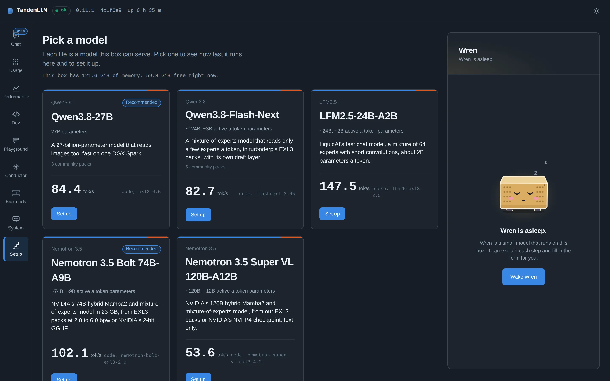<br><sub>Setup Guide: one tile per model, each with its measured speed.</sub></td>
    <td width="33%" valign="top">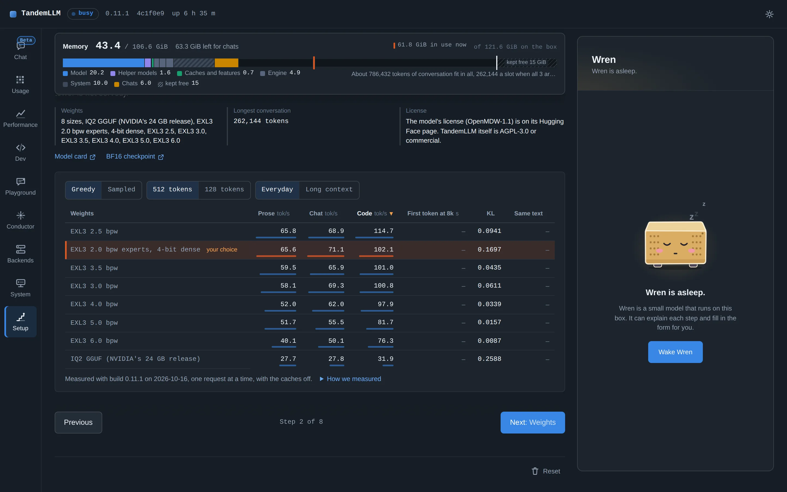<br><sub>Each size's tok/s and KL, here Nemotron 3.5 Bolt.</sub></td>
    <td width="33%" valign="top">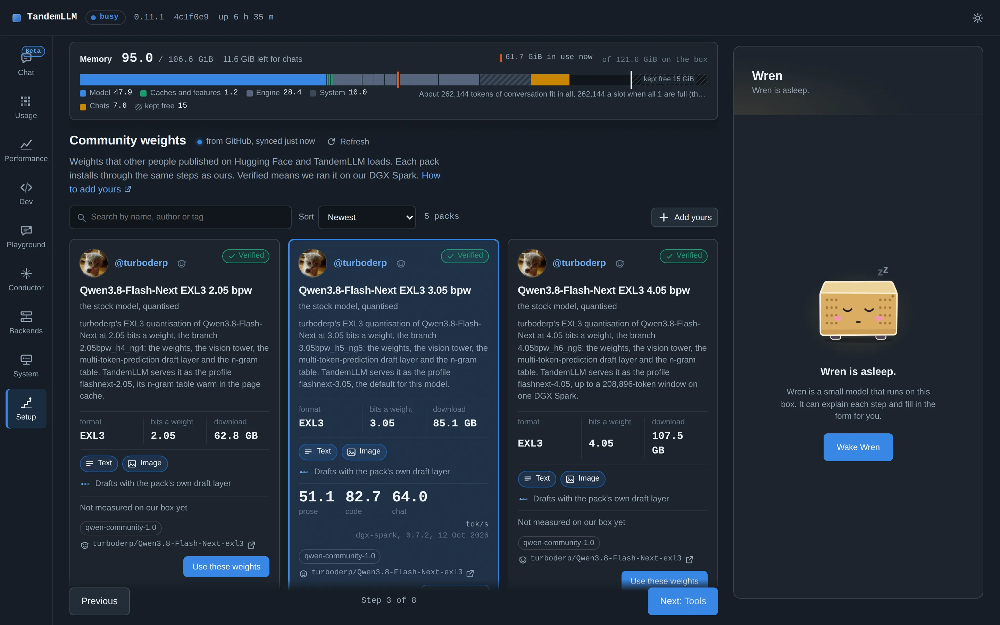<br><sub>Community weights with their maker: turboderp's Flash-Next packs.</sub></td>
  </tr>
  <tr>
    <td width="33%" valign="top">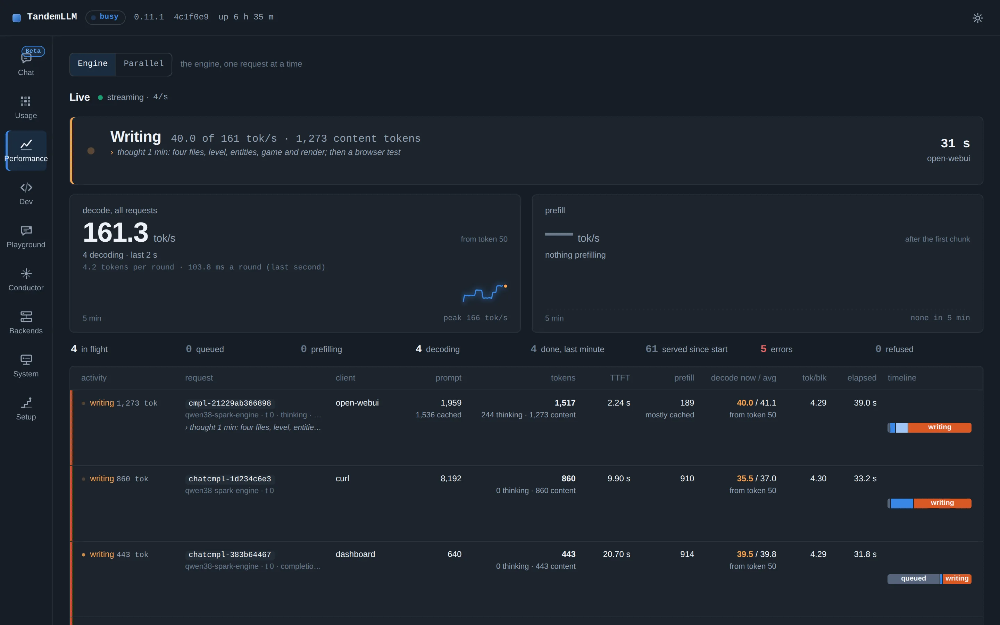<br><sub>Performance: live decode speed and every running request.</sub></td>
    <td width="33%" valign="top">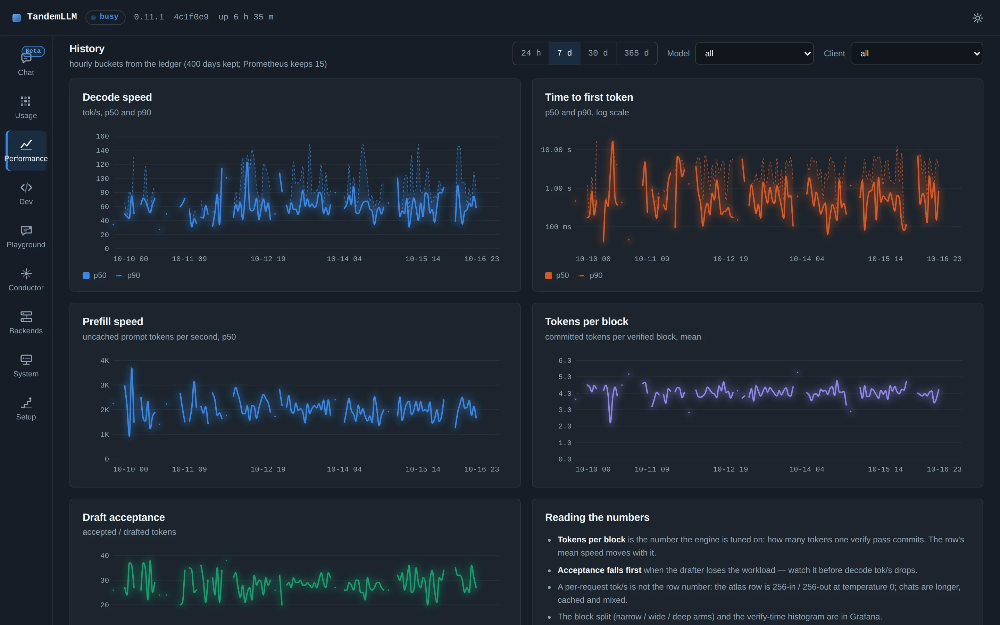<br><sub>History: decode speed, first-token time, tokens per block, draft acceptance.</sub></td>
    <td width="33%" valign="top">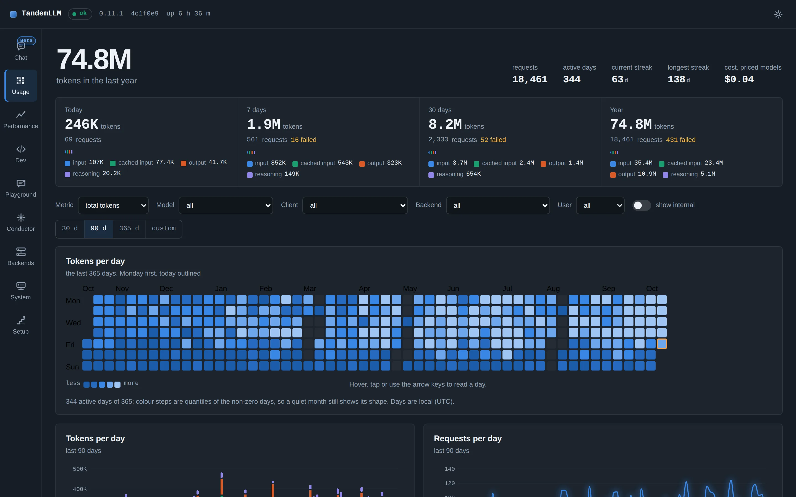<br><sub>Usage: tokens per day for a year.</sub></td>
  </tr>
</table>

<p align="center">
  More pictures, the Chat tab among them: <a href="docs/gallery/README.md">docs/gallery</a>
</p>

TandemLLM is an inference engine for one NVIDIA DGX Spark, and it runs several models: Qwen3.8-27B, Qwen3.8-Flash-Next, LiquidAI's LFM2.5-24B-A2B (from 0.9.0), NVIDIA's Nemotron 3.5 Bolt 74B-A9B (from 0.10.0) and NVIDIA's Nemotron 3.5 Super VL 120B-A12B (from 0.11.0). The box serves one at a time, and they share one server and one setup guide. LFM2.5 is the fast one. Its default pack decodes 153.5 tok/s for one request.

On Qwen3.8-27B with the published NVFP4 weights and StairCut on, it writes about 50 tokens a second for one request. Plain greedy decoding on the same box runs at 13.69 tok/s. The text is the model's own greedy text, with one documented exception: where the two best tokens are within one unit in the last place (ulp), the batched verify can round the other way ([docs/exactness.md](docs/exactness.md)).

TandemLLM is a working name, and it says how the engine works. Small drafters guess the next tokens, and the big model checks all the guesses in one pass. A guess the model agrees with is a free token. At the first wrong guess the model puts in its own token, so nothing a drafter does reaches the output.

## Start here

Start with [docs/setup.md](docs/setup.md), section "A new box from the command line". On a new DGX Spark it takes three commands: `install.sh --setup`, then `use-profile.sh <profile> --dry-run` to see the downloads, then `use-profile.sh <profile>`. You need no Hugging Face token.

The manual is in [manual/tandemllm-manual.pdf](manual/tandemllm-manual.pdf), a PDF you can read without LaTeX. Its install chapter covers both paths.

## Models

Every file below is public on Hugging Face. The Setup Guide, or `ops/use-profile.sh <profile>` from a shell, downloads what a profile needs, checks each weight file against the hub's sha256, and starts the engine on port 8000.

Qwen3.8-27B comes as NVFP4 or as one of six EXL3 sizes. The six EXL3 sizes and their drafters are one collection: [TandemLLM Qwen3.8-27B EXL3](https://huggingface.co/collections/0xBakeer/tandemllm-qwen38-27b-exl3-6acdd787008264fa4f35eab4). Each EXL3 card has its KL against BF16 and a speed table; the KL column below comes from those cards.

| profile | weights | download | KL vs BF16 |
|-|-|-|-|
| `nvfp4` | [0xBakeer/TandemLLM-Qwen3.8-27B-NVFP4](https://huggingface.co/0xBakeer/TandemLLM-Qwen3.8-27B-NVFP4) | 15.0 GB | see [docs/quantisation.md](docs/quantisation.md) |
| `exl3-2.5` | [0xBakeer/TandemLLM-Qwen3.8-27B-EXL3-2.5](https://huggingface.co/0xBakeer/TandemLLM-Qwen3.8-27B-EXL3-2.5) | 12.0 GB | 0.1112 |
| `exl3-3.0` | [0xBakeer/TandemLLM-Qwen3.8-27B-EXL3-3.0](https://huggingface.co/0xBakeer/TandemLLM-Qwen3.8-27B-EXL3-3.0) | 13.5 GB | 0.0621 |
| `exl3-3.5` | [0xBakeer/TandemLLM-Qwen3.8-27B-EXL3-3.5](https://huggingface.co/0xBakeer/TandemLLM-Qwen3.8-27B-EXL3-3.5) | 15.2 GB | 0.0298 |
| `exl3-4.0` | [0xBakeer/TandemLLM-Qwen3.8-27B-EXL3-4.0](https://huggingface.co/0xBakeer/TandemLLM-Qwen3.8-27B-EXL3-4.0) | 16.9 GB | 0.0171 |
| `exl3-4.5` (default for the 27B) | [0xBakeer/TandemLLM-Qwen3.8-27B-EXL3-4.5](https://huggingface.co/0xBakeer/TandemLLM-Qwen3.8-27B-EXL3-4.5) | 18.4 GB | 0.0096 |
| `exl3-6.0` | [0xBakeer/TandemLLM-Qwen3.8-27B-EXL3-6.0](https://huggingface.co/0xBakeer/TandemLLM-Qwen3.8-27B-EXL3-6.0) | 23.3 GB | 0.0018 |

The 27B profiles share the rest: the base checkpoint `Qwen/Qwen3.8-27B-FP8` (30.4 GB, without `mtp.safetensors`) and the BF16 drafters [0xBakeer/TandemLLM-Qwen3.8-27B-DFlash2-b8](https://huggingface.co/0xBakeer/TandemLLM-Qwen3.8-27B-DFlash2-b8) and [-b16](https://huggingface.co/0xBakeer/TandemLLM-Qwen3.8-27B-DFlash2-b16) (7.7 GB together). An EXL3 profile also needs the K3 drafters and the K4 draft head, [0xBakeer/TandemLLM-Qwen3.8-27B-EXL3-drafters](https://huggingface.co/0xBakeer/TandemLLM-Qwen3.8-27B-EXL3-drafters) (1.9 GB). The script fetches all of them; you never copy a drafter by hand.

Qwen3.8-Flash-Next runs from turboderp's EXL3 packs, one branch each of [`turboderp/Qwen3.8-Flash-Next-exl3`](https://huggingface.co/turboderp/Qwen3.8-Flash-Next-exl3). They are community quants: turboderp made them, not TandemLLM, and the Setup Guide lists them under Community weights with their author. A Flash-Next profile needs nothing else: the pack carries its own draft layer.

| profile | branch | download | largest window on one DGX Spark |
|-|-|-|-|
| `flashnext-2.05` | `2.05bpw_h4_ng4` | 61.5 GB | 262,144 tokens |
| `flashnext-3.05` (default) | `3.05bpw_h5_ng5` | 85.1 GB | 262,144 tokens |
| `flashnext-4.05` | `4.05bpw_h6_ng6` | 106.1 GB | 208,896 tokens with vision on |
| `flashnext-5.05` | `5.05bpw_h6_ng6` | 121.9 GB | does not load yet |
| `flashnext-6.05` | `6.05bpw_h6_ng6` | 137.7 GB | does not fit |

The 5.05 pack codes its experts at 5 and 7 bits a weight, and the MoE kernels take 2 to 6 and 8. [docs/quantisation.md](docs/quantisation.md) has each model's formats.

LFM2.5-24B-A2B runs from Liquid's BF16 checkpoint or from one of our six EXL3 packs, one collection: [TandemLLM LFM2.5-24B-A2B EXL3](https://huggingface.co/collections/0xBakeer/tandemllm-lfm25-24b-a2b-exl3-6acf468024dd5288750dd683). The model has 24B parameters, but only 4 of its 64 experts run for each token, so a token reads 1.17 GB of the 3.5 pack. The packs and the BF16 checkpoint [LiquidAI/LFM2.5-24B-A2B](https://huggingface.co/LiquidAI/LFM2.5-24B-A2B) are public; a download needs no token. Measured on one DGX Spark on 2026-10-14, one request, 512 greedy tokens of chat through the server:

| profile | download | chat plain, tok/s | chat top-1 vs BF16 |
|-|-|-|-|
| `lfm25-exl3-2.5` | 8.20 GB | 185.4 | 78.9 % |
| `lfm25-exl3-3.0` | 9.68 GB | 171.3 | 83.6 % |
| `lfm25-exl3-3.5` (default for LFM2.5) | 11.16 GB | 150.9 | 86.7 % |
| `lfm25-exl3-4.0` | 12.64 GB | 143.7 | 88.5 % |
| `lfm25-exl3-4.5` | 14.12 GB | 128.2 | 91.2 % |
| `lfm25-exl3-6.0` | 18.63 GB | 105.2 | 93.4 % |
| `lfm25-bf16` | 47.9 GB | 44.5 | 100 % |

The default is the fastest profile in chat, with the lookup on, whose top-1 agreement with BF16 is at least 85 %. Edit and copy asks run 1.8 to 3.6 times faster with the lookup. [docs/lfm2.5-24b-a2b.md](docs/lfm2.5-24b-a2b.md) has the KL values, the correctness checks against transformers and exllamav3, and the run behind each number.

Nemotron 3.5 Bolt 74B-A9B runs from our EXL3 packs at 2.0 to 6.0 bits a weight, converted from NVIDIA's BF16 checkpoint, or from NVIDIA's own 2-bit GGUF. It is a hybrid of 40 Mamba2, 40 mixture-of-experts and 8 attention layers, with 9 of up to 496 experts a token. The EXL3 profiles draft with NVIDIA's LiLiCorr drafter and the lookup, the GGUF profile with the lookup alone, and every drafted text is the plain decode's. The packs are public, one repository a size (`0xBakeer/TandemLLM-Nemotron-3.5-Bolt-74B-A9B-EXL3-<bpw>`, for example [the 2.0 pack](https://huggingface.co/0xBakeer/TandemLLM-Nemotron-3.5-Bolt-74B-A9B-EXL3-2.0), all seven in [one collection](https://huggingface.co/collections/0xBakeer/nemotron-35-bolt-74b-a9b-exl3-for-tandemllm-6ad16f70eaa4c1d9c56c6831)); the GGUF and the drafter come from NVIDIA's repositories. TandemLLM serves Bolt's text; its image tower is not served yet. Measured on one DGX Spark on 2026-10-15 and 16; quality against the BF16 checkpoint's logits on 8 wikitext-2 rows of 1,024 tokens; one request through the server, 512 greedy tokens, thinking off, the mean of 3 runs on this release, plain and with the profile's drafting (LiLiCorr and the lookup; the GGUF: the lookup):

| profile | download | KL vs BF16 | top-1 vs BF16 | plain decode, tok/s | drafted, prose / chat / code / edit / copy |
|-|-|-|-|-|-|
| `nemotron-bolt-exl3-2.0` (default for Bolt; experts 2 bits, dense 4) | 23.48 GB | 0.170 | 84.1 % | 43.2 | 65.6 / 71.1 / 102.1 / 163.5 / 247.2 |
| `nemotron-bolt-exl3-2.5` | 27.61 GB | 0.094 | 87.3 % | 41.9 | 65.8 / 68.9 / 114.7 / 161.9 / 208.7 |
| `nemotron-bolt-exl3-3.0` | 31.75 GB | 0.061 | 89.7 % | 41.6 | 58.1 / 69.3 / 100.8 / 149.6 / 203.7 |
| `nemotron-bolt-exl3-3.5` | 35.88 GB | 0.044 | 91.1 % | 40.6 | 59.5 / 65.9 / 101.0 / 129.7 / 217.4 |
| `nemotron-bolt-exl3-4.0` | 40.01 GB | 0.034 | 92.7 % | 40.4 | 52.0 / 62.0 / 97.9 / 137.4 / 210.2 |
| `nemotron-bolt-exl3-5.0` | 49.13 GB | 0.016 | 94.8 % | 33.9 | 51.7 / 55.5 / 81.7 / 121.3 / 184.4 |
| `nemotron-bolt-exl3-6.0` | 58.37 GB | 0.0087 | 96.2 % | 29.1 | 40.1 / 50.1 / 76.3 / 110.8 / 157.3 |
| `nemotron-bolt-iq2` (NVIDIA's GGUF) | 22.04 GB | 0.259 | 79.6 % | 27.7 | 27.7 / 27.8 / 31.9 / 97.8 / 131.6 |

Every pack drafts at least as fast as it decodes plain, on every ask: since 0.11.1 each EXL3 pack has its StairCut price file, and before that 3.0 to 4.0 wrote prose and chat slower than plain. The GGUF profile's lookup finds little in prose and chat, which run at its plain rate. llama.cpp on NVIDIA's GGUF decodes at 38.2 tok/s on the same asks. [docs/nemotron-h.md](docs/nemotron-h.md) has the checks against transformers, llama.cpp and BF16, and the run behind each number.

Nemotron 3.5 Super VL 120B-A12B runs from two EXL3 packs of NVIDIA's BF16 checkpoint or from NVIDIA's own NVFP4 release, read as stored. It has the same hybrid layout as Bolt at a larger size: 40 Mamba2, 40 mixture-of-experts and 8 attention layers, with 22 of 512 experts a token. Every profile drafts with NVIDIA's LiLiCorr drafter for Super VL and the lookup, and every drafted text is the plain decode's. The packs are public ([4.0](https://huggingface.co/0xBakeer/TandemLLM-Nemotron-3.5-Super-VL-120B-A12B-EXL3-4.0), [2.0](https://huggingface.co/0xBakeer/TandemLLM-Nemotron-3.5-Super-VL-120B-A12B-EXL3-2.0), both in [one collection](https://huggingface.co/collections/0xBakeer/nemotron-35-super-vl-120b-a12b-exl3-for-tandemllm-6ad1bc063ad2f3f5df638016)). TandemLLM serves Super VL's text; its vision tower is not served yet. Same measurement as for Bolt, on 2026-10-16:

| profile | download | KL vs BF16 | top-1 vs BF16 | plain decode, tok/s | LiLiCorr + lookup, prose / chat / code / edit / copy |
|-|-|-|-|-|-|
| `nemotron-super-vl-exl3-4.0` (default for Super VL; every projection 4 bits) | 65.0 GB | 0.049 | 92.9 % | 31.1 | 33.1 / 43.9 / 53.6 / 101.0 / 108.3 |
| `nemotron-super-vl-exl3-2.0` (experts 2 bits, dense 4) | 36.84 GB | 0.325 | 82.1 % | 36.5 | 35.6 / 46.2 / 46.3 / 125.1 / 139.2 |
| `nemotron-super-vl-nvfp4` (NVIDIA's NVFP4) | 75.06 GB | 0.041 | 93.4 % | 19.6 | 23.9 / 28.7 / 39.9 / 73.5 / 81.7 |

The 2.0 pack is 17 % faster plain than 4.0 but loses far more against BF16; use it only where 4.0 does not fit. vLLM on NVIDIA's NVFP4 release decodes at 19.4 tok/s plain and reads prompts 4 to 5 times as fast as TandemLLM. [docs/nemotron-h.md](docs/nemotron-h.md) has both comparisons.

Ornith-1.5-122B, Ornith AI's agentic and coding model, runs from our EXL3 pack at 4.0 bits a weight, converted from the BF16 checkpoint. It is a Qwen3.5 mixture-of-experts model: 36 Gated DeltaNet and 12 gated attention layers, 8 of 256 experts and a shared one a token, an MTP layer and a vision tower, which the pack carries at 6 bits. The profile drafts with the MTP layer and the lookup; incoai's [DFlash2 drafter for Ornith](https://huggingface.co/incoai/Ornith-1.5-122B-DFlash2) is the other head (`QSE_ORN_HEAD=dflash2`). The pack is public, [0xBakeer/TandemLLM-Ornith-1.5-122B-EXL3-4.0](https://huggingface.co/0xBakeer/TandemLLM-Ornith-1.5-122B-EXL3-4.0), and in [one collection](https://huggingface.co/collections/0xBakeer/ornith-15-122b-exl3-for-tandemllm-6ad7ccf04f93a379ba434c4c) with the base model and the drafter. TandemLLM serves it with one slot. Measured on one DGX Spark on 2026-10-20: quality against the BF16 checkpoint's logits on 8 wikitext rows of 1,024 tokens; one fresh server a row, 512 greedy tokens, thinking off, one run each:

| profile | download | KL vs BF16 | top-1 vs BF16 | plain decode, tok/s | MTP layer + lookup, prose / chat / code / edit / copy |
|-|-|-|-|-|-|
| `ornith-1.5-122b-exl3-4.0` (every projection 4 bits, head 6) | 64.6 GB | 0.139 | 86.2 % | 37.6 to 38.4 | 85.3 / 110.0 / 114.2 / 115.9 / 124.8 |

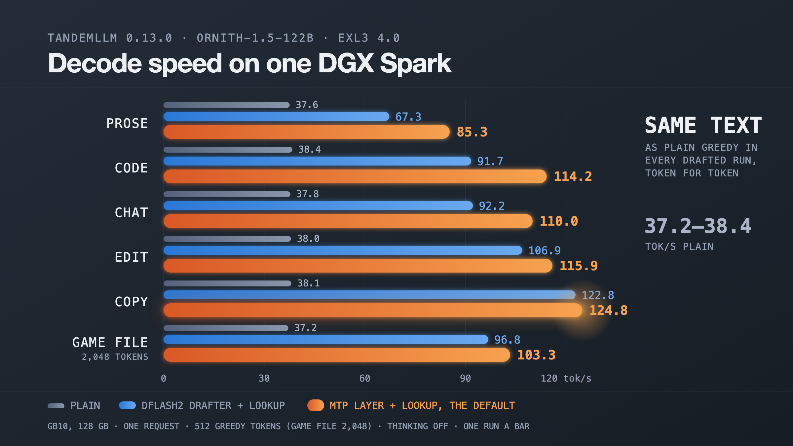

Every drafted text is the plain decode's. On the same pack the engine's top token agrees with exllamav3's own forward at 498 of 512 positions, so the two are close but not equal. [models/ornith-1.5-122b/measurements/0.13.0-summary.json](models/ornith-1.5-122b/measurements/0.13.0-summary.json) has the runs, DFlash2's row and what is not measured.

### Community weights

Since 0.8.2 the setup guide also lists packs other people published, each as one JSON file under `models/<model>/community/`, and `ops/use-profile.sh community/<id>` runs one with our drafters. The first is ThinkingCap Qwen3.8-27B Kearuga by 0xWhiteMage, an EXL3 pack at 4.0 bits a weight (16.38 GB, text only): 39.6 tok/s on prose and 95.9 on code, measured on 0.8.2. Since 0.12.1 a pack can also be built on Nemotron 3.5 Super VL: the first is styles01's EXL3 pack at 3.5 bits a weight (57.8 GB, text only), 25.9 tok/s plain and 33.2 on prose, 53.9 on code with LiLiCorr and the lookup, measured on 0.12.1. [docs/community-weights.md](docs/community-weights.md) says how to run a pack, how to add yours with one pull request, and how a maintainer verifies it.

## See it

| StairCut sizes the draft tree each round | the speed follows the kind of text |
|-|-|
| 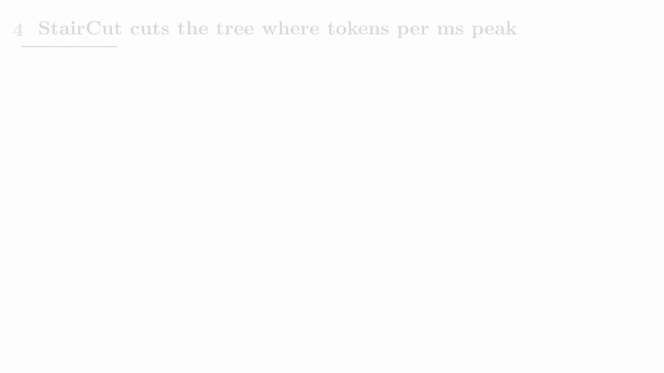 |  |
| **first turn of a ~42k-token opencode session: cold prefill** | **next turn: resumed from the cache, prefill starts near the end** |
| 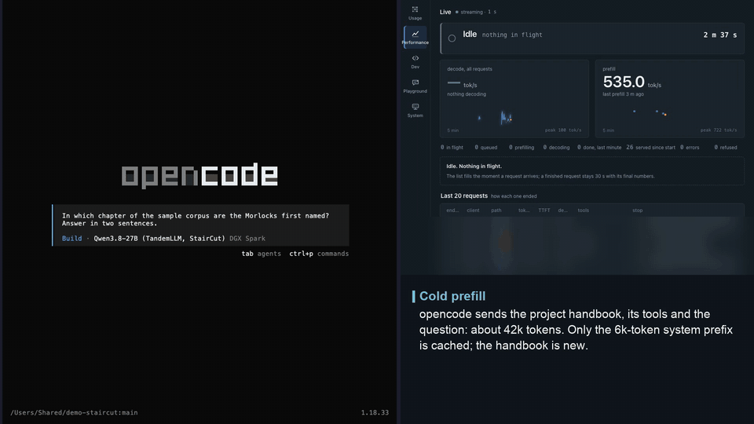 |  |

More clips: thinking and tool calls in [docs/server.md](docs/server.md), a verbatim quotation in [docs/speculative-decoding.md](docs/speculative-decoding.md), the dashboard in [docs/dashboard.md](docs/dashboard.md). The clips were recorded against the served engine on the published NVFP4 weights with StairCut on; sped-up parts are marked in each clip.

## Paper

StairCut, the router that sizes the draft tree each round, is described in:

> Khaled Bakeer. *StairCut: sizing speculative draft trees on a measured verification-cost staircase.* 2026. Zenodo, [10.5281/zenodo.23045275](https://doi.org/10.5281/zenodo.23045275).

The paper measured commit `431ddee` on branch `router-eng169`. StairCut is on `main` from merge commit `c111fa7`, behind flags that are off by default and on in `ops/serve.env`. On the benchmark row below, with the published NVFP4 weights and the persistent lookup store off, the paper reports these means over 50 requests:

| configuration | tok/s |
|-|-|
| StairCut | 49.89 |
| fixed block 8 (the narrow drafter alone) | 47.13 |
| fixed block 16 (the wide drafter alone) | 44.80 |
| plain greedy decoding | 13.69 |

Plain greedy decoding was measured on 28 September on an earlier build; its path with speculation off is unchanged since. On a teacher-forced bench of 25 workloads (fresh text, edits, quotations, copies; 32k context), where every configuration commits the same reference text, StairCut averages 90.45 tok/s against 81.95 for the fixed block 16 and 59.31 for the fixed block 8. On 30 prompts checked against plain greedy decoding, 17 outputs are identical to the end of the answer and 13 diverge at a near tie of at most one ulp ([docs/exactness.md](docs/exactness.md)). A long prompt sent a second time resumes from the cache and reaches its first token in 0.3, 0.6 and 1.1 s at 32k, 64k and 128k tokens, against 44.4, 93.7 and 208.3 s cold ([docs/caches.md](docs/caches.md)). Against Qwen's BF16 release the weights cost +0.0221 nats on prose and +0.0426 on code ([docs/quantisation.md](docs/quantisation.md)).

[CITATION.cff](CITATION.cff) has the citation.

## Results

The Paper section above has the current numbers: StairCut against the same drafter at a fixed block width and against plain greedy decoding, all on the published NVFP4 weights on one DGX Spark.

How we measured:

- The workload is `serve-single-i256-o256-v1`: 256 prompt tokens, 256 generated tokens, thinking off, temperature 0, seed 42. It sends 50 requests after 3 warm-ups, one at a time.
- A request's speed is `(completion_tokens - 1) / (end-to-end time - time to first token)`. The tables show the mean over the 50 requests.
- The lookup drafter's persistent store is off, so none of the benchmark's own text can help. The release gate also runs every row with a clean store, one that never held the benchmark's text.
- These are single-request numbers. Parallel requests are not in them; long prompts are in [docs/caches.md](docs/caches.md).

[docs/measurement.md](docs/measurement.md) explains the method. It also explains why every change runs against the current release in the same hour, 50 requests a side, before it ships.

Tool calling is measured with [tool-eval-bench](https://github.com/SeraphimSerapis/tool-eval-bench). On its 69 scenarios Qwen3.8-27B in the EXL3 6.0 pack scores 92 with thinking off and 95 to 97 with it on. The conductor's `tools` profile scores the same as the raw path, and 91 against 84 in the bench's hard mode. [docs/tool-eval-bench.md](docs/tool-eval-bench.md) has every row, its settings and the command behind it.

## What makes it fast

A decode step of a 27B model reads every weight once, and on this board that read is the cost: 15 GB at NVFP4, against about 240 GB/s the GPU can read. The engine does two things about it. It cuts the bytes a step reads, and it makes each step produce about 4.6 tokens instead of one.

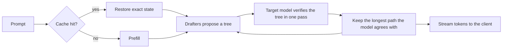

The parts:

- Weights. The served set is NVFP4 for every projection, quantised once from Qwen's BF16 release with GPTQ, plus an FP8 (e4m3) output head, loaded over the vendor's FP8 checkpoint. A quality gate against BF16 decides whether a set ships.
- Kernels. Our own Triton and CUDA kernels run the 4-bit and 8-bit matrix products and the recurrent layers. The projection kernels give a row the same bits whatever other rows share the batch, from 1 to 32 rows.
- Speculation. A DFlash2 block drafter that guesses 15 tokens, and a lookup drafter that copies from the conversation and a text corpus. StairCut (`QWEN38_LEN_SWITCH=1 QWEN38_LEN_MODE=wide`, off in the code, on in `ops/serve.env`) cuts every round's tree to the size that maximises expected tokens per millisecond on the measured verify cost. The guesses form a tree, and the model verifies the whole tree through all 64 layers, recurrent ones included. A second, narrow drafter (block 8) is loaded but released at the first round; with the StairCut flags off, the older length router picks one of the two widths per request. [docs/speculative-decoding.md](docs/speculative-decoding.md) describes both.
- Caches. The next turn of a conversation resumes from the state the last one left, with no re-reading. Each restore gives back the stored state bit for bit.
- Server. An OpenAI-compatible API. Tool calls come back typed by their JSON schema, structured-output masks apply to every verified row, and a long prefill stops when the client leaves.
- Dashboard. The engine serves its own web page. It shows what each request is doing right now (prefilling at 76 %, thinking, calling `write_file`), and keeps a year of speed and usage.

Start with [docs/architecture.md](docs/architecture.md), a one-page tour. [docs/README.md](docs/README.md) lists every page, one part each.

## Install

On a new DGX Spark, two commands install TandemLLM and start it in setup mode, with no model loaded yet ([docs/setup.md](docs/setup.md)):

```bash
curl -fsSLO https://raw.githubusercontent.com/0xBakeer/TandemLLM/v0.13.0/install.sh
bash install.sh --setup --yes
```

Then open the Setup Guide in a browser and pick a model there. The guide shows each model with its weight packs, checks that your choice fits in memory, downloads it and starts the engine.

- On the box itself, open `http://127.0.0.1:8000/dashboard/#/setup`.
- From another computer, open an SSH tunnel to the box with `ssh -L 8000:127.0.0.1:8000 <user>@<box>` and open the same address on that computer. You can also install with `--host 0.0.0.0` and open `http://<box>:8000/dashboard/#/setup` from any computer on your network. Until you set an admin password, anyone who reaches the port can run the setup.

The installer prints these addresses when it finishes.

[install.sh](install.sh) first checks the board: GPU, driver, CUDA compiler, the free disk its downloads need, and 64 GiB of free memory to start (8 GiB with `--setup`). It clones the engine at the tag `v0.13.0` into `~/TandemLLM/src`, from the repository `--repo` names, and builds a venv with pinned packages. With `--setup` it downloads only Wren's model (Qwen3.5-2B, 4.3 GB), the setup guide's assistant, and starts setup mode on `127.0.0.1:8000`. The Setup Guide then downloads the weights you pick, checks every weight file, leaves setup mode and starts the engine. The config is `~/TandemLLM/run/ops/serve.env`, the release's `ops/serve.env` with this machine's paths. Run the installer again to update: it skips finished steps, and a download that stopped continues where it stopped.

Where the tag `v0.13.0` is missing, `curl` fails with a 404 and the installer stops at its clone step with "no tag, branch or commit 'v0.13.0'". Pass `--repo` and `--ref` to install from another repository or release.

### Advanced: from the command line

The Setup Guide runs `ops/use-profile.sh` for you. To pick the weights from a shell instead, after the two commands above:

```bash
bash ~/TandemLLM/run/ops/use-profile.sh --list                 # every profile, the active one marked
bash ~/TandemLLM/run/ops/use-profile.sh <profile> --dry-run    # each file's URL and size, nothing downloaded
bash ~/TandemLLM/run/ops/use-profile.sh <profile>              # download, check, leave setup mode, start
```

Without `--setup`, the installer sets up the NVFP4 profile with StairCut in one run: the base checkpoint, the NVFP4 weights and both drafters go to the Hugging Face cache, then it starts the engine, waits for `/health` and runs a smoke test that prints tok/s.

| flag | what |
|-|-|
| `--setup` | install the code and Wren's model only, then start setup mode (the dashboard's `#/setup` page) |
| `--dir DIR` | install directory, default `~/TandemLLM` |
| `--port PORT`, `--host ADDR` | where the API listens, default `127.0.0.1:8000` |
| `--ref REF` | the engine version to check out (any git ref), default `v0.13.0`; `v0.2.0-staircut` is the paper's |
| `--repo URL` | the git repository to clone, default `https://github.com/0xBakeer/TandemLLM.git` |
| `--hf-token TOKEN` | a Hugging Face token (`HF_TOKEN` works too); only a private or gated repository needs one |
| `--no-corpus` | skip the lookup corpus |
| `--no-start` | install and configure, don't start |
| `--systemd` | also install a systemd user unit, `tandemllm.service` |
| `--yes`, `--dry-run`, `--uninstall` | non-interactive, print the steps only, remove the install |

Afterwards, `~/TandemLLM/bin/tandem start|stop|status|smoke|logs` controls the engine.

The dashboard at `http://<host>:8000/dashboard/` asks for no password. Until an admin password is set, anyone who can reach the port can read and change what it shows, the memory included, so keep the engine on a trusted network. [docs/dashboard.md](docs/dashboard.md#no-password) says what it shows.

The installer builds its lookup corpus from public text: one English and one German Wikipedia shard, plus Python sources from the venv's own packages, about 31 million tokens. The served corpus is not published, and the paper's numbers come from it. With the installer's corpus, or with `--no-corpus`, the lookup drafter proposes different continuations, so speeds can differ from the paper's. We haven't measured by how much. Other CUDA GPUs are best effort: the installer turns off the sm_121a-only skinny kernel there, and StairCut's cost tables come from the Spark.

## Quick start

You need a DGX Spark (GB10 GPU, 128 GB of memory shared by CPU and GPU) with Linux, Python 3.11 (under 3.12 `tests/test_grammar.py` fails), PyTorch 2.13 with CUDA 13.0 (and its compiler, for the one kernel that builds on first use), torchvision 0.28 (the CUDA 13.0 build that matches torch), Triton 3.7, transformers 5.12, Pillow 11.3, safetensors and numpy. Pillow decodes a request's images, and torchvision is the image processor's backend: the engine pins it (`--image-backend torchvision`) and refuses to start without it, because transformers would otherwise pick its PIL backend, whose patches differ slightly. In a PyTorch container that already has torch 2.13.0+cu130, add the two with `pip install pillow==11.3.0 torchvision==0.28.0+cu130 --extra-index-url https://download.pytorch.org/whl/cu130`; `--image-backend pil` (or `--vision off`) runs without torchvision. [install.sh](install.sh)'s lock lists every pinned version. The engine needs no other package. Run one engine per board: two engines loading side by side run the board out of memory.

The quickest path uses the published weights and drafters:

```bash
hf download Qwen/Qwen3.8-27B-FP8
hf download 0xBakeer/TandemLLM-Qwen3.8-27B-NVFP4 --local-dir ~/tandem/nvfp4
hf download 0xBakeer/TandemLLM-Qwen3.8-27B-DFlash2-b8 --local-dir ~/tandem/ft-b8
hf download 0xBakeer/TandemLLM-Qwen3.8-27B-DFlash2-b16 --local-dir ~/tandem/ft-b16
```

Then edit the path lines at the top of `ops/serve.env` to match your machine: `REPO` (this checkout), `PY` (a Python with the packages above), `NV=~/tandem/nvfp4/mlp.safetensors,~/tandem/nvfp4/gdn.safetensors,~/tandem/nvfp4/attn.safetensors`, `HEAD=~/tandem/nvfp4/head-fp8.safetensors`, `CKPT8=~/tandem/ft-b8`, `CKPT16=~/tandem/ft-b16` and `CORPUS`. Start it with `bash ops/start.sh`. That is the served profile, StairCut included.

To build the published weight set yourself, quantise from the BF16 release with GPTQ on the NVFP4 grid (about 80 GB of GPU memory with the default `--h-budget-gb 22`, and 25 minutes on an RTX PRO 6000; see [docs/quantisation.md](docs/quantisation.md)), then build the FP8 head. `<BF16>` is the snapshot folder of `Qwen/Qwen3.8-27B` in the Hugging Face cache, the path `hf download` prints last:

```bash
hf download Qwen/Qwen3.8-27B          # prints the snapshot folder: use it for <BF16> below
python tools/calib_corpus.py --out ~/calib
python tools/quant_nvfp4.py build --model <BF16> --methods gptq --out-dir ~/nvfp4-bf16 \
    --corpus ~/calib/calib-code.txt:80000,~/calib/calib-en.txt:60000,~/calib/calib-de.txt:16000
python tools/quant_head.py build --out ~/nvfp4-bf16/head-fp8.safetensors --ratios 1.0,0.95,0.90
```

The build writes `~/nvfp4-bf16/gptq/{mlp,gdn,attn}.safetensors`. `tools/quality_gate.py --plan` scores them against the BF16 model ([docs/quantisation.md](docs/quantisation.md)). The engine loads them over the FP8 checkpoint (`Qwen/Qwen3.8-27B-FP8`, above), as it does the published files. An older path quantises from the FP8 release with the clip search alone (`tools/quant_nvfp4.py stats` and `quant --mode clip`); it rounds every weight twice and costs more quality, and the same page describes it.

To try the engine with the released base drafter instead of the fine-tuned ones:

```bash
hf download z-lab/Qwen3.8-27B-DFlash2
python server/app.py --port 8000 --max-len 32768 --drafter dflash2 --dflash2-path greedy \
    --nvfp4 ~/nvfp4-bf16/gptq/mlp.safetensors,~/nvfp4-bf16/gptq/gdn.safetensors,~/nvfp4-bf16/gptq/attn.safetensors \
    --fp8-head ~/nvfp4-bf16/head-fp8.safetensors

curl -s localhost:8000/v1/chat/completions -H 'Content-Type: application/json' \
    -d '{"model": "any", "messages": [{"role": "user", "content": "Say hello."}]}'
```

`ops/serve.env` holds the full served setup, with StairCut, the fine-tuned drafters (block 16 drafts; block 8 is loaded and released at the first round), the tree and the corpus, and `ops/start.sh` starts it. The fine-tuned drafters are published on Hugging Face (links below). The lookup corpus of about 38 million tokens is not published; `tools/build_corpus.py` builds one, and without it the lookup drafter copies only from the conversation and the persistent store, so speeds differ from the paper's. [docs/operations.md](docs/operations.md) covers the service and the safety rules.

## Profiles

A profile is a `serve.env` file: which weights, which drafters, which settings.

| profile | file | weights | single request |
|-|-|-|-|
| NVFP4 (served) | `ops/serve.env` | the published set: every projection at NVFP4, FP8 head | 49.89 tok/s with StairCut (paper) |
| FP8 | `ops/serve-fp8.env` | the checkpoint's own FP8 projections and BF16 head | not measured on this release |
| balanced | `ops/serve-balanced.env` | the published set's NVFP4 MLPs and FP8 head, checkpoint FP8 GDN and attention | not measured on this release |

All three run the same drafters and settings and are held to the same exactness gate. The FP8 and balanced profiles source `ops/serve.env`, so they inherit StairCut with its verify prices (`ops/stair-tables-nvfp4.json`), which were measured on the full-NVFP4 profile. The router corrects their level online, but the staircase's shape for these two profiles is not measured, and neither is their speed on this release. [docs/quantisation.md](docs/quantisation.md) says what each weight set costs in quality, in nats of held-out loss.

## The dashboard in front of other backends

The dashboard also runs on its own, in front of any OpenAI-compatible engine or cloud API: vLLM, SGLang, llama.cpp, LM Studio, Ollama, OpenAI, DeepSeek, or another TandemLLM. Clients send their requests to one address, the proxy routes them by model id, and one ledger records tokens, time to first token, decode speed, cached tokens and cost for every backend. It needs no GPU and no torch:

```bash
pip install '.[host]'          # Python 3.11 or newer; the host extra adds psutil and NVML
tandem-dash                    # http://127.0.0.1:8080/dashboard/ opens on Setup
```

`ops/Dockerfile.dash` builds the same as an image of about 70 MB, configured by an env file (`ops/dash.env.example`). The System view shows the machine behind each backend, down to the GPU memory of its processes, through a collector on the same machine or a small one on the backend's own.

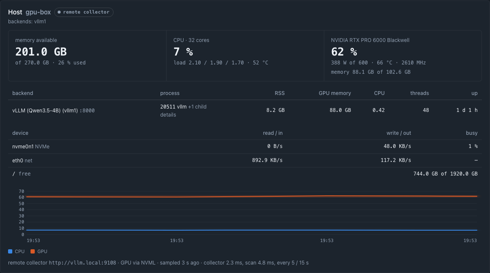

[docs/proxy.md](docs/proxy.md) has the setup, every variable, the keys at rest and what each kind of backend can show.

## Documentation

- [The manual](manual/tandemllm-manual.pdf), the whole book as one PDF; its source is in `manual/`
- [Setup](docs/setup.md): a new box, the setup guide in the dashboard, the model registry
- [Community weights](docs/community-weights.md): running packs other people published, and adding yours
- [Architecture](docs/architecture.md): the model, the byte budget, the decode loop
- [Quantisation and profiles](docs/quantisation.md)
- [Kernels](docs/kernels.md)
- [Drafters and tree verify](docs/speculative-decoding.md)
- [Exactness](docs/exactness.md): what the engine promises about its text, and the near-tie exception
- [Caches](docs/caches.md)
- [Server and API](docs/server.md)
- [Dashboard](docs/dashboard.md)
- [The Chat tab](docs/chat.md), in beta: the sandbox, the permission modes, the known limitations
- [Parallel requests](docs/parallel-requests.md)
- [The proxy](docs/proxy.md): the dashboard in front of other engines and cloud APIs (vLLM, SGLang, any OpenAI-compatible server, OpenAI, DeepSeek), routed by model id, with or without this engine (`pip install .` gives `tandem-dash`, no GPU needed), the host collector, the docker image
- [Operations](docs/operations.md)
- [Measurement](docs/measurement.md)
- [Tool calling](docs/tool-eval-bench.md): tool-eval-bench results on the raw path and the conductor; [how to run it](docs/benchmarks.md)
- [Adding a model](docs/adding-a-model.md)
- [Roadmap](docs/roadmap.md)

## Status

The current release is `v0.13.0`. It adds Ornith AI's Ornith-1.5-122B from our EXL3 pack at 4.0 bits a weight, a Qwen3.5 mixture-of-experts model that reads images: 37.2 to 38.4 tok/s plain and 85.3 to 124.8 with its MTP layer and the lookup. In `v0.12.2` a Chat-tab run that reads a large file stays inside the window, the port preview streams Server-Sent Events and long-polls, and LFM2.5 adopts its 0.9.x to 0.11.1 conversations again. `v0.12.1` serves styles01's EXL3 pack of Nemotron 3.5 Super VL at 3.5 bits a weight as the first community pack on that model, text only: 25.9 tok/s plain and 33.2 to 53.9 with LiLiCorr and the lookup. A request with images takes a side slot, and eleven pull requests from outside fix chatd, the Setup Guide, the GGUF reader and the image path. `v0.12.0` serves API clients that offer tools through the `tools` profile: the prompt as the client sent it, with the loop guards and the tool-call checks acting. A request with tools can ask for a JSON answer, an answer that changes several things outside the conversation makes one call at a time, and a key from a tool result is masked where the answer repeats it ([docs/tool-eval-bench.md](docs/tool-eval-bench.md) has the tool-eval-bench scores). `v0.11.4` adds Agents mode to the Chat tab: the main agent plans and gives each file write and each build or fix to a worker, whose run and report show in a Task card, and the engine keeps the worker's and the parent's rows while they take turns. File texts stay out of a chat's requests, a compaction cuts to under half its trigger, and a memory refusal compacts the chat instead of failing the run. `v0.11.3` hardens the Setup Guide: `tandem doctor` checks an install and repairs what is safe, a check before the restart stops nothing when the new setup cannot start, and a failed step says what broke, with Retry and Copy diagnostics; a restart shows one card with its phases, and the Setup Guide removes a model's weights. Super VL reads images, a cloud model's turns in the Chat tab have their speed, cache and cost, and Performance and Usage keep the engine's requests apart from relayed ones. `v0.11.2` starts chatd, the Chat tab's server, with the engine, and the Chat tab says when chatd is down; it fixes the installer's scripts and secrets file, keeps a second chatd from taking another one's sandbox containers, opens the app the model built in the preview pane, and fixes the Chat tab's Context panel, More menu, model picker and phone layout. The Setup Guide sets the number of chats and both windows with steppers, and Super VL takes a window up to 1,048,576 tokens. `v0.11.1` fixes how the Chat tab's server reaches the folders a chat's sandbox can write: no read or write there follows a symlink any more, so update a box that runs the Chat tab. It also gives Bolt's EXL3 packs from 2.5 to 6.0 their StairCut price files, so drafting no longer runs slower than plain decoding on them; it names each weight pack's maker in the setup guide; and it describes the install through the setup guide. `v0.11.0` adds NVIDIA's Nemotron 3.5 Super VL 120B-A12B, from two EXL3 packs or NVIDIA's NVFP4 release, with NVIDIA's LiLiCorr drafter for it; the engine reads NVIDIA's ModelOpt NVFP4 and FP8 checkpoints as stored. `v0.10.0` adds NVIDIA's Nemotron 3.5 Bolt 74B-A9B, with seven EXL3 sizes, NVIDIA's IQ2 GGUF and NVIDIA's LiLiCorr drafter ([docs/nemotron-h.md](docs/nemotron-h.md)); each chat's sandbox in the Chat tab gets a 1 GiB limit, and an attachment is never inlined past the window. `v0.9.2` fixes two install bugs on a new box: a download whose file list is globs (the shadow reader's and the narrator's models) failed its checksum step, and after `install.sh --setup` the 27B's EXL3 profiles refused to start without the full FP8 base. `v0.9.1` adds web search and media playback to the Chat tab, turns on the loop guard and memory notes in the shipped conductor profiles, and fixes the Setup Guide's install page; an EXL3 profile of the 27B downloads 3.54 GB of base tensors instead of 30.41. `v0.9.0` adds LiquidAI's LFM2.5-24B-A2B, with six EXL3 sizes and the BF16 checkpoint ([docs/lfm2.5-24b-a2b.md](docs/lfm2.5-24b-a2b.md)). `v0.8.3` is the code of `v0.8.2` with the repository cleaned for the public release. `v0.8.2` adds community weight packs, permission modes in the Chat tab (Ask, Auto as the default, and YOLO; [docs/chat.md](docs/chat.md)) and standalone EXL3 packs of the 27B (pull request #1 by 0xWhiteMage). It also stops a chat from waiting minutes for slot 0 while a side slot is free, and makes the model say it is TandemLLM when asked. `v0.8.1` lets a new DGX Spark download every file a profile needs, with no Hugging Face token (OPS-95). `v0.8.0` added Qwen3.8-Flash-Next with vision and three parallel slots, the Chat tab (in beta; [docs/chat.md](docs/chat.md) lists its known limitations), and the cache peek and prewarm. Saved chats of 0.7.2 carry over, because the disk tier now knows its files by their content. `v0.2.0-staircut` (merge commit `c111fa7`) is the paper's release: it brought StairCut and turned it on in the served profile. The engine runs on one board (DGX Spark) with one model at a time. [CHANGELOG.md](CHANGELOG.md) lists every release.

## Credits

Qwen made the model weights and their reference implementation. turboderp made exllamav3, which quantised our EXL3 sizes of the 27B, and the Flash-Next packs the engine serves. Inco AI made the base block drafter, DFlash2 for Qwen3.8-27B (`incoai/Qwen3.8-27B-DFlash2`, mirrored as `z-lab/Qwen3.8-27B-DFlash2`). NVIDIA made Nemotron 3.5 Bolt and Super VL, Bolt's IQ2 GGUF, Super VL's NVFP4 release and the LiLiCorr drafters; our LiLiCorr port follows vLLM's and llama.cpp's implementations, and exllamav3 quantised our EXL3 packs of Bolt and Super VL. The engine runs on PyTorch and Triton over CUDA. We build the lookup corpus from public, permissively licensed text. Everything else in this repository is our own work.

## License

- The engine code is dual-licensed: [AGPL-3.0-only](LICENSE) (version 3 only; see [NOTICE](NOTICE)) for everyone, or a [commercial license](COMMERCIAL-LICENSE.md) from the copyright holder for use without the AGPL's obligations.
- Contributions are accepted under the Contributor License Agreement in [CONTRIBUTING.md](CONTRIBUTING.md), so that both licenses stay possible.
- The documentation in `docs/` is licensed under [CC BY 4.0](docs/LICENSE).
- This repository contains no model weights. The base model (`Qwen/Qwen3.8-27B` and its FP8 release) and the base drafter (`incoai/Qwen3.8-27B-DFlash2`) are Apache-2.0. The published NVFP4 and EXL3 weights and the fine-tuned drafters are derived from them and are Apache-2.0 too: keep the attribution and the license when you pass them on. Nemotron 3.5 Bolt, Nemotron 3.5 Super VL and their LiLiCorr drafters are under NVIDIA's license on their Hugging Face pages (OpenMDW-1.1); our EXL3 packs of both are derived from them and carry the same license.

© 2026 Khaled Bakeer.
