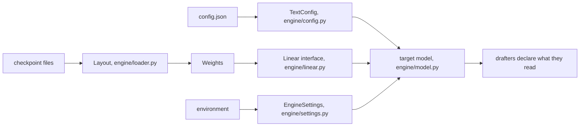

# Adding a model

TandemLLM serves models of the Qwen3.8 family: the 27B, a hybrid of Gated DeltaNet and attention layers, and Flash-Next, a mixture of experts on the same hybrid, from turboderp's EXL3 packs. LiquidAI's LFM2.5-24B-A2B (short convolutions, attention and a mixture of 64 experts, [lfm2.5-24b-a2b.md](lfm2.5-24b-a2b.md)), ships in 0.9.0 and is the first from another family. Flash-Next was the first model added through the adapter path below, and the path is written from what it took. This page lists the seams where a new model plugs in, what each one expects, and the tests a new model must pass before its numbers mean anything. Some of the engine is still specific to this family, and the last section says which parts.

## The adapter path in ten steps

A new architecture is a package under `engine/models/<name>/`, one registry entry, and data files. Nothing under `server/`, `engine/cache.py`, `engine/disk_cache.py`, `engine/spill.py` or `engine/methods/` changes for it. [architecture.md](architecture.md#methods-written-once-models-plugged-in) shows the layers; Flash-Next's package (`engine/models/flashnext/`) is the worked example.

1. Config. A reader that turns the checkpoint's `config.json` into the model's config object and stops on a field it does not know, naming it. Flash-Next's (`config.py`) keeps three lists: fields it reads, fields that only matter for training (`IGNORED`), and fields whose other values would change the arithmetic (`FIXED`).
2. Weights. A reader for the checkpoint's files and a `Linear` object for every weight the model multiplies by ([Weight formats](adding-a-model.md#weight-formats-the-linear-interface)). A new format needs a new class and a row-invariant kernel ([kernels.md](kernels.md)). Flash-Next's reader (`pack.py`) audits the pack before anything loads: a missing tensor, a truncated shard or a wrong sha256 stops it with the name.
3. A reference forward in torch, checked against the published implementation layer by layer. Flash-Next's (`ref.py`) equals `transformers`' `qwen4_exp` in fp32 within 5e-6 on a tiny random model, and its engine equals the official decoder layer on the served pack within BF16 noise.
4. The engine with the hot verbs: `forward`, `forward_tree`, `forward_block`, `commit_tree`, `rollback_to`, `picks`, `hidden_post_norm`, `kv.length`, `state` (the live state the cold verbs copy) and `reset`. Every verified row must equal the decode step's row bit for bit, or speculation is not lossless on it.
5. The cold verbs: `caps`, `cost()`, `cache_state()` with its sections and views, `resume_at(n)`, `settle()`, `discard_pending()`, `trim_pending(n)`, `manifest()`, `memory_parts()`, `resident_files()` and `precapture()`. Flash-Next keeps them in `serving.py` (`FlashNextServing`); the 27B's are installed on its class by `engine/models/qwen3_5/adapter.py`.
6. A draft head, if the checkpoint ships one. The shared MTP drafter (`engine/methods/mtp_drafter.py`) asks the head for `depth`, `reset()`, `prime()`, `capture_all()`, `launch()`, `read()` (the top-2 tokens and their probabilities a depth), `views()` and `resume(n)`; the engine offers it through `draft_heads()`. Flash-Next's head is `mtp.py`.
7. A server builder, `serve(a, ctx) -> dict`: load the weights, build the engine, the tokenizer and the drafter, and return them with the record `/health` shows.
8. The registry entry in `engine/models/__init__.py`: `Arch(name, architectures, model_types, config, engine, package, serve)`.
9. Data files: a StairCut price file for each profile and device (`ops/prices/<model>/<profile>.<device>.json`; without one the cut learns its prices online), the weight profiles (`ops/profiles/<name>.env`) and the Setup Guide's entry (`models/<id>/model.yaml`, [below](adding-a-model.md#register-the-model-for-the-setup-guide)).
10. Pass the tests under [The tests a new model must pass](adding-a-model.md#the-tests-a-new-model-must-pass).

## The seams



### Config

`engine/config.py::load_config` reads `config.json` into a `TextConfig` with every size the engine needs, from the layer count to the rotary settings. It also answers which layers are recurrent (`is_linear`, `linear_layers`, `attention_layers`). It accepts a vision-language config (the text model under `text_config`) and a text-only config (the keys at the top level).

A new family either fits `TextConfig` or extends it. The rest of the engine asks `TextConfig`, never the raw JSON.

### Layout

`engine/loader.py::Layout` says how a checkpoint names its tensors, in one place. The engine addresses every tensor by a canonical name (`embed_tokens.weight`, `lm_head.weight`, `norm.weight`, `layers.N.<module>.<proj>`), which is the language model's own naming with the checkpoint's wrapper prefix taken off.

| attribute | what it says |
|-|-|
| `prefixes` | wrapper prefixes to strip, first match wins (`model.language_model.`, then `model.`) |
| `skip_inside`, `skip_start` | tensors the language model never reads, such as a vision tower (`engine/vision.py` reads that one itself) |
| `mtp_file` | where the checkpoint keeps its prediction head |
| `embed`, `head`, `final_norm` | canonical names of the three model-level tensors |
| `projections` | the projection names a checkpoint may store as FP8 pairs or as plain matrices |

A checkpoint without `lm_head.weight` reads the embedding as its head only when the config says the two are tied. `tests/test_layout.py` builds tiny checkpoints of both kinds on the CPU and checks that they read to the same canonical names. It also pins the served checkpoint's key set: 1,250 language-model keys read, 333 vision keys skipped.

### Weight formats: the Linear interface

Every weight the engine multiplies by implements one small interface (`engine/linear.py`):

    class Linear(Protocol):
        shape: (N, K)
        nbytes: int                 # bytes read per use
        def matmul(x[..., K]) -> [..., N]

| class | format | file |
|-|-|-|
| `FP8Block` | e4m3 codes with one BF16 scale per 128 by 128 block, as the checkpoint stores them | `tools/fp8_linear.py` |
| `NVFP4Block` | e2m1 codes, an e4m3 scale per 16 weights, one fp32 scale | `tools/nvfp4_linear.py` |
| `FP8Head` | e4m3 with one fp32 scale per row, fp32 logits | `tools/head_gemv.py` |
| `BF16Block` | a plain BF16 matrix | `engine/linear.py` |

The model calls `w.matmul(x)` and never asks which format it holds. A new format is a new class with those three members, plus a kernel that keeps the row-invariance rule ([kernels.md](kernels.md)). A BF16 checkpoint loads through the same path: its projections become `BF16Block`s. `tests/test_bf16_load.py` checks that a tiny BF16 checkpoint on disk gives the same forward, bit for bit, as plain tensors.

### Settings

`engine/settings.py` is the registry of every `QWEN38_*` switch the engine reads: its default and the module that reads it. `SETTINGS.get(name)` is the only way engine code reads one, and `tests/test_settings.py` fails on any other read. `EngineSettings(env, prefix)` gives the same reads over another mapping or another prefix, which is how a profile file can be described or a second configuration built in a test.

### What a drafter reads

A drafter reads parts of the target: hidden states at some layers, the embedding, the head. Each drafter declares these through `Drafter.requires()`:

| key | meaning |
|-|-|
| `hidden_size` | the width of the hidden states its taps read |
| `tap_layers` | the target layers it reads |
| `tensors` | target tensors it reads by name, such as the head |
| `vocab_size` | the id space of its proposals |

At load, `engine.drafters.check_target` compares these with the target and refuses a mismatch by name. A DFlash2 drafter trained for another model fails there instead of drafting garbage. The lookup drafter's stores record the tokenizer's sha256 (`engine/tokfp.py`) and refuse to open under another tokenizer.

A new model needs its own block drafter. DFlash2 drafters are trained against one target's hidden states, and a drafter from another model accepts nothing. The lookup drafter works for any model once its corpus is rebuilt with the new tokenizer (`tools/build_corpus.py`).

### The tokenizer and the chat template

The server renders prompts with the model's own chat template and reads the model's own tool-call and reasoning formats. For Qwen3.8 that means the `<think>` block, which the template opens in the prompt, and tool calls in the model's XML form (`server/toolcall.py`). A model with another format needs its own parser behind the same OpenAI output. `tests/fixtures/qwen38_chat_template.jinja` is the fixture the server tests render with.

### The model layer: architecture registry and per-model state

`engine/models/__init__.py` says which architecture a checkpoint is. Each entry names the checkpoint's `architectures` strings and `model_type`s, a config reader and an engine class by import path, so registering a model imports nothing. `architecture(raw_config)` returns the entry, or fails with a message that names the checkpoint's architecture and every registered one.

| name | selected by | config | engine | server builder |
|-|-|-|-|-|
| `qwen3_5` | `Qwen3_5ForConditionalGeneration`, `qwen3_5_text` | `engine.config.load_config` | `engine.models.qwen3_5.adapter.Qwen38Engine` (engine/model.py's class with the adapter's cold verbs) | the server's own, `server/app.py` `_build_qwen3_5` |
| `qwen4_exp` | `Qwen4ExpForConditionalGeneration`, `qwen4_exp_text` | `engine.models.flashnext.config.load_flashnext_config` | `engine.models.flashnext.engine.FlashNextEngine` | `engine.models.flashnext.serving.serve` |
| `lfm2_moe` | `Lfm2MoeForCausalLM`, `lfm2_moe` | `engine.models.lfm2_moe.config.load_lfm2_moe_config` | `engine.models.lfm2_moe.engine.Lfm2MoeEngine` | `engine.models.lfm2_moe.serving.serve` |
| `nemotron_h` | `NemotronHForCausalLM`, `NemotronHPuzzleForCausalLM`, the Omni architectures, `nemotron_h`, `nemotron_h_puzzle` | `engine.models.nemotron_h.config.load_nemotron_h_config` | `engine.models.nemotron_h.engine.NemotronHEngine` | `engine.models.nemotron_h.serving.serve` |

The server has one loader (`server/app.py` `_load`, SRV-341). An entry's `serve` names the function that builds the model for it, `serve(a, ctx) -> dict`: the engine in the server loop's interface, the tokenizer, the drafter, the snapshot path, the device, the tree mode and accept rule, and its own record for `/health` (`weights_info`); `ctx.keys(path, weights)` sets the tokenizer's and the weights' fingerprints, `ctx.mark(stage)` writes the load ledger, `ctx.log(line)` the log. The engine says what the server may ask of it beyond the loop's verbs in `caps` (`engine/models/adapter.py` `Capabilities`: the caches and the KV pool, side slots, the cache grid, the shadow reader, joint verify); the loader turns off, with a log line, what a model cannot hold yet. Its cold verbs are `cost()`, `manifest()`, `precapture(drafter)`, `settle()`, `discard_pending()`, `trim_pending(n)`; the walk of a verified block is `engine/methods/walk.py` for every model. A model registered this way starts and answers without an edit under `server/` (`tests/test_load_shared.py` registers a third one on CPU).

`engine/models/state.py` is the cache state interface (`ModelState`), and every cache tier reads a sequence through it (`eng.cache_state()`, ENG-157). Its sections are the recurrent state by name, copied whole; its views are the position-indexed buffers with their token axis, sliced by length. It has `nbytes`, `clone`, `restore` and a signature that refuses a restore across shapes. The 27B's state is `Qwen38State`: sections `gdn.S` and `gdn.conv` (the same tensors, so a restore lands in the buffers its graphs captured), views K and V. Flash-Next's is `FlashNextCacheState` (`serving.py`): 36 GDN states and conv tails, the n-gram convolution and its token context, and `mtp.h_last` as sections (110.3 MiB); K, V and the indexer keys of its 12 attention layers as views, with the MTP layer's own rows from its drafter (29,952 bytes a token). A model without recurrent state has no sections. `tests/test_cache_any_model.py` runs a made-up state through every tier with no edit in the cache code.

A model's own code lives in its package under `engine/models/`. The disk tier's fingerprint v2 (`engine/disk_cache.py`) leaves `engine/models/` and `engine/methods/` out, together with knobs owned under `engine/models/` and `tools/fn_`, so adding a model sweeps none of the 27B's saved sessions (`tests/test_fn_fingerprint.py`). Fingerprint v3 (`engine/methods/manifest.py`) hashes what the adapter's `manifest()` lists: the model's files that compute stored rows, the knob registry, its own tile tables; the `tools/` kernels they import and the tables their knobs name follow. A new model writes its `manifest()` (Flash-Next: `engine/models/flashnext/serving.py`), and its fingerprint then moves with its kernels and tables and with nothing else (`tests/test_fp_v3.py`).

## The tests a new model must pass

In this order, each on the new model:

1. `tools/refcheck.py`: argmax agreement with the published reference implementation on teacher-forced positions. The reference runs in its own process, because only one model fits on the board at a time. On Qwen3.8 the engine agrees on 99.25 % of 400 positions and on all 242 confident ones.
2. `tools/quality_gate.py` for every quantised weight set ([quantisation.md](quantisation.md)).
3. `tools/verify_spec.py`, the agreement gate with its near-tie rule, with every drafter ([exactness.md](exactness.md)).
4. The CPU suite, including `tests/test_refactor_gate.py`. That test records the exact bytes of a tiny model's run (every logit and every byte of state after a prefill, a decode, a block verify, a rollback, a tree verify and a commit) and fails if any byte moves. A change that is supposed to change arithmetic re-records the fixture and says why.
5. `ops/gate.sh` and the client smoke set before the numbers are published ([measurement.md](measurement.md)).

Flash-Next took the same gates in its own form, and a new model should take them too:

- `tests/test_load_shared.py`: the model starts through the one loader, and no model name, `hasattr(eng` or `isinstance(eng` appears under `server/`.
- `tests/test_cache_any_model.py` and the model's own cache test: a restore from every tier equals a cold prefill.
- `tests/test_fp_v3.py`: the model's fingerprint v3 moves with its kernels and tables and with nothing else, and the 27B's does not move.
- The load-time self-check: a recorded decode replayed as chains and trees of every verify width, every row bit for bit (3,936 rows on Flash-Next 3.05). A difference turns speculation off for the process and names the layer and the row.
- `tools/fn_spec_check.py` and `tools/fn_server_check.py --compare`: speculative greedy equals plain greedy, in the engine and through the server, and seeded sampled answers equal their plain twins (`--sampled`).

## What is still specific to Qwen3.8

- `engine/model.py` implements this family's forward: the Gated DeltaNet layer with its gated norm, attention with a gated output and partial rotary, and the dense MLP. A new family needs its own layer code behind the same verify, commit and cache interfaces. A model with a mixture of experts also needs expert routing inside the verify.
- The second family, Qwen3.8-Flash-Next (`engine/models/flashnext/`, turboderp's EXL3 packs), is served through the same server and request loop with its MTP drafter, the same caches, the KV pool and side slots ([server.md](server.md#qwen38-flash-next-srv-87), [caches.md](caches.md#what-a-state-is)); it reads images through its own tower, which its builder hands to the server's image path (`ctx.vision`, VIS-97).
- The recurrent-layer kernels assume Gated DeltaNet's state shape (heads of 128 by 128).
- Tile tables and router prices are measured for each model's shapes on the GB10. A new model or a new board needs its own sweep (`tools/fp8_probe.py --sweep`, `tools/nvfp4_skinny.py`, Flash-Next's `tools/fn_tiles.py`) and its own price file. A kernel registry keyed by op, weight format and device (ENG-251) and device profiles (ENG-255) are planned, not built.
- Some modules read their switches into globals at import. Two engines with different settings cannot share one process yet.
- Runtime names still carry the old project name, from the `QWEN38_` and `QSE_` variable prefixes to the `Qwen38Engine` class. A later release renames them.

## Register the model for the setup guide

The dashboard's setup guide (`#/setup`, [setup.md](setup.md)) lists one tile per `models/<id>/model.yaml`. The folder is named after the model's id, and the file follows schema 1: the weight profiles (one per `ops/profiles/<name>.env`), the measured table, the tools that run beside the model with their memory and serve.env keys, the parallelism limits, the methods and the device presets. [models/README.md](../models/README.md) lists the fields; `models/qwen3.8-27b/model.yaml` is the worked example, with the source of every number next to it.

```text
models/<id>/model.yaml                  the registry entry
models/<id>/measurements/<build>-*.json the raw data the measured table came from (optional)
models/schema/model.schema.json         the schema, for an editor (python -m server.setup.registry --schema)
```

Check a new file with `python -m server.setup.registry --check`. It refuses a file whose numbers do not add up (two recommended profiles, a tool that needs one that is off, a docs link that is not there), and `tests/test_setup_registry.py` fails when the file names a serve.env key nothing reads or when a profile in `ops/profiles/` has no entry. Memory is in GiB and comes from the engine's own `[memory] load stages` line and the dashboard's memory split, never from a guess.
