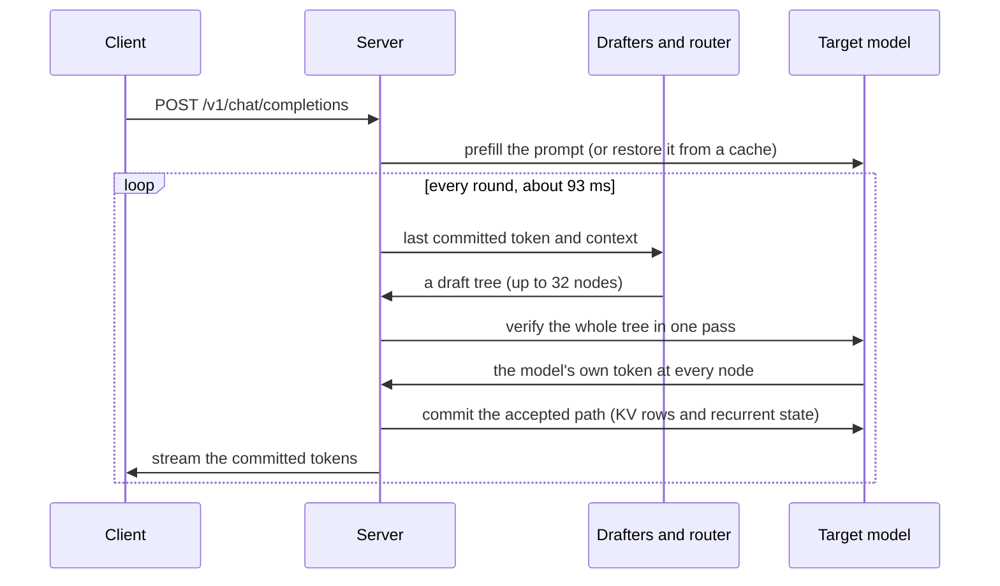
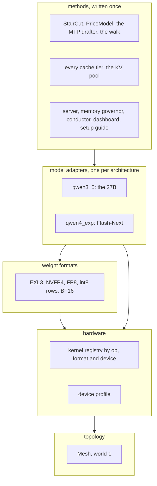
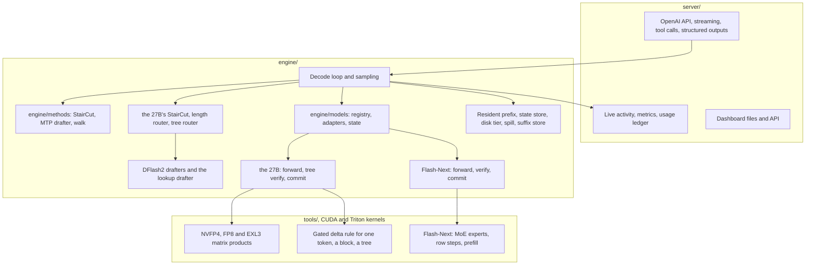

# Architecture

A decode step of Qwen3.8-27B reads about 27 GB of weights in the vendor's FP8 format. The DGX Spark reads memory at 273 GB/s on paper and about 240 GB/s in practice. Those two numbers put a floor of about 100 ms under every step, or 10 tok/s, before any code runs. TandemLLM exists to get under that floor while writing the model's own greedy text, with one documented exception at near ties ([exactness.md](exactness.md)).

It does two things. It cuts the bytes a step reads, from 27 GB to 15 GB. And it makes one step produce about 4.6 tokens: cheap drafters guess, and one pass of the big model checks all the guesses.

The engine serves a second model the same way, Qwen3.8-Flash-Next, a mixture of experts of the same family that reads about 4.23 GB a plain token from turboderp's 3.05 EXL3 pack. The box runs one of the two at a time. Most of this page describes the 27B. [The second model](architecture.md#the-second-model-qwen38-flash-next) says what differs, and [Methods written once](architecture.md#methods-written-once-models-plugged-in) shows how one server, one set of caches and one speculation method serve both.

## The model

`engine/config.py` reads `config.json` and nothing else. Its text model has 64 decoder layers, hidden size 5120, a dense SiLU MLP of width 17,408 in every layer, and a vocabulary of 248,320 tokens. The model has no mixture of experts. A 0.92 GB vision tower sits in the same checkpoint. The language-model loader skips it by name and `engine/vision.py` loads it on its own for image input ([server.md](server.md#images)).

Every fourth layer (3, 7, 11 and so on up to 63) is full attention, 16 layers in all. Gated DeltaNet fills the other 48. It is a recurrent layer that keeps a fixed-size state instead of a growing KV cache.

| layer kind | count | state per sequence |
|-|-|-|
| Gated DeltaNet | 48 | an fp32 state of 48 heads, each 128 by 128 (3.15 MB) and a 4-wide convolution tail (80 KB), per layer |
| full attention | 16 | BF16 keys and values, 4 KV heads of 256, so 4 KB a token per layer |

That split shapes most of the code. Published work on speculation and caching assumes attention, where undoing a token means moving a pointer back by one row. A recurrent state has absorbed every token and has no inverse, and the engine needs exact ways to undo, branch and restore it. [speculative-decoding.md](speculative-decoding.md) shows the undo and the branch, and [caches.md](caches.md) shows the restore.

## The byte budget

A decode step reads every weight once. This table sums the bytes from the checkpoint's safetensors headers.

| group | bytes a step |
|-|-|
| 48 Gated DeltaNet layers | 18.43 GB |
| 16 attention layers | 5.96 GB |
| the output head, BF16, 248,320 rows by 5,120 | 2.54 GB |
| total, FP8 as shipped | 26.93 GB |

The three MLP projections are 63.6 % of that. Quantising them first, then the rest, moved the budget down in steps, and each step had to pass the quality gate ([quantisation.md](quantisation.md)):

| weight set | bytes a step | floor at 273 GB/s |
|-|-|-|
| FP8 as shipped | 26.93 GB | 98.6 ms |
| NVFP4 MLPs | 19.44 GB | 71.2 ms |
| plus the FP8 (e4m3) head | 18.17 GB | 66.5 ms |
| plus NVFP4 GDN and attention projections | 15.01 GB | 55.0 ms |

State is small beside the weights. The 48 recurrent states are 151 MB together. KV costs 64 KB a token across the 16 attention layers, so 2.1 GB at 32k tokens and about 17 GB at the full 262,144-token context.

## The decode loop

Speed is one fraction:

    tok/s = tokens committed a round / (draft ms + verify ms + commit ms)

A round starts from the last committed token. Next, the drafters propose a tree of guesses after it. One forward pass then runs over the whole tree through all 64 layers. The engine reads the model's own choice at every node and keeps the longest path where the model agrees with the guesses. It always keeps one more token, the model's own choice after the last accepted guess, so a round yields at least one token. Then it commits the state of that path and starts again.

On the served profile (the published NVFP4 set, StairCut on) a round on the benchmark row takes 93.4 ms and commits 4.58 tokens, and the row's rate is 49.89 tok/s. The rate is the mean of the 50 requests' own rates ([measurement.md](measurement.md#the-row)), not the quotient of the two means (4.58 tokens in 93.4 ms is 49.0 tok/s). Without speculation, the same box writes 13.69 tok/s at 72.8 ms a token (measured on 28 September on an earlier build, whose path with speculation off is unchanged).

## The second model, Qwen3.8-Flash-Next

Flash-Next keeps the 27B's hybrid, Gated DeltaNet layers with an attention layer every fourth, and changes most of what sits around it. `engine/models/flashnext/config.py` reads its config and refuses any field it does not know by name.

| part | Flash-Next | the 27B |
|-|-|-|
| layers | 48: 36 Gated DeltaNet, 12 attention | 64: 48 Gated DeltaNet, 16 attention |
| MLP | 512 experts a layer, 10 routed and 1 shared run a token | dense, width 17,408 |
| residual stream | 4 streams of 2,560 joined by hyper-connection mixers | one stream of 5,120 |
| attention | sparse past 2,051 tokens: an indexer scores blocks and each row reads the 512 best | full |
| extra input | a hashed n-gram embedding (16 table rows a token) in front of layer 1 | none |
| draft layer | one multi-token-prediction (MTP) layer in the checkpoint | none; DFlash2 drafters beside it |
| state a sequence | 110.3 MiB of sections plus 29,952 bytes a token | about 147 MiB plus 64 KB a token |
| weights served | turboderp's EXL3 packs, 2.05 to 6.05 bits a weight | NVFP4 with an e4m3 head, or EXL3 |

A plain decode token on the 3.05 pack reads about 4.23 GB (arithmetic from the pack's headers, with the mixers as int8). The engine decodes 45.8 tok/s at 1k of context without speculation, about 21.8 ms a token (measured 2026-10-11, one run a class). Its verify rows equal its decode rows bit for bit, so greedy speculation on Flash-Next writes the plain greedy text token for token, with no near-tie exception ([exactness.md](exactness.md)). The one known difference is where a think budget closes: at the first block boundary past the cap (ENG-235). Through the server on 2026-10-12, one greedy request of up to 512 tokens a class with the MTP drafter and the lookup: prose 51, chat 64, code 83, an edit 132 and a copy 133 tok/s, against 41.5 to 45.7 plain. [quantisation.md](quantisation.md#flash-next-on-turboderps-exl3-packs) covers the packs and [speculative-decoding.md](speculative-decoding.md#staircut-on-flash-next-and-the-shared-price-files) the drafter.

## Methods written once, models plugged in

A second model could have meant a second server, a second set of caches and a second StairCut. The engine avoids that with five layers that depend only downward. A method (speculation, a cache tier, the memory governor, the server) reads a model through its adapter and through data files. It never branches on a model's name, never asks `hasattr` of an engine and never touches a private field. `tests/test_load_shared.py` registers a third, made-up architecture on the CPU and gets an answer on `/v1/chat/completions` with no edit under `server/`.

Half of it is built. Since 2026-10-12 the adapters, the state, the shared methods and the server's one loader serve every model. Four parts are still design, each with its ticket: format plugins, a kernel registry, device profiles and the mesh.

| layer | what | where | today |
|-|-|-|-|
| methods | StairCut with its price model and calibration, the MTP tree drafter, the walk of a verified block, fingerprint v3 | `engine/methods/` | built (ENG-245, ENG-243); the 27B still cuts with its own StairCut in `engine/lenrouter.py` until ENG-257 |
| methods | every cache tier over the model's state | `engine/cache.py`, `disk_cache.py`, `spill.py`, `kvpool.py` | built (ENG-157, ENG-241) |
| methods | one loader driven by the registry | `server/app.py` `_load` | built (SRV-341) |
| model adapters | the registry, `Capabilities`, `CostModel`, `ModelState` | `engine/models/` | built for `qwen3_5` and `qwen4_exp` |
| weight formats | the `Linear` protocol | `engine/linear.py`, `tools/*_linear.py`, `engine/models/flashnext/pack.py` | built; a format plugin with `read` and `bind` and one checkpoint reader are planned (ENG-253) |
| hardware | `KernelImpl` keyed by `(op, fmt, device)`, resolved once at load | none yet: each weight object holds its kernel, and tile tables sit under `ops/` per model | planned (ENG-251) |
| hardware | device profiles | `engine/methods/device.py` names the device for price files; the Setup Guide's device preset sits in each `model.yaml` | `devices/<id>.yaml` and a probe at start planned (ENG-255) |
| topology | `Mesh`, `Collectives`, `ShardSpec` at world 1 | none: one process, one GPU | planned (ENG-259), then two boxes (ENG-233) |

### Model adapters

`engine/models/__init__.py` keeps a registry of architectures. An entry names the `architectures` strings and `model_type`s that select it, its config reader, its engine class and, when the model brings one, its server builder, all by import path. `architecture(config)` returns the entry, or fails naming every registered one.

| name | model | engine | server builder |
|-|-|-|-|
| `qwen3_5` | Qwen3.8-27B | `engine.models.qwen3_5.adapter.Qwen38Engine` | the server's own, `_build_qwen3_5` |
| `qwen4_exp` | Qwen3.8-Flash-Next | `engine.models.flashnext.engine.FlashNextEngine` | `engine.models.flashnext.serving.serve` |

An adapter is the engine object with a fixed set of verbs. The hot verbs run every round, so they are the engine's own bound methods and never a wrapper: a decode and a verify call the same kernels through the same Python frames as before the layering, and CUDA graphs capture the same launches.

| hot verb | what it does |
|-|-|
| `forward(ids, start)` | a prompt chunk, a forced phrase or one decode token at the state's length |
| `forward_tree(block, parents, start)` | a draft block in depth-first order; logits of every row |
| `forward_block(block, start)` | a chain whose commit waits for `rollback_to` or the next call |
| `commit_tree(path)`, `rollback_to(keep)` | keep a verified path; cut a chain back |
| `picks`, `hidden_post_norm` | the verify's own greedy tokens; the rows a drafter syncs from |
| `kv.length`, `reset()` | where the sequence stands; start a new one in place (the KV rows stay) |

The cold verbs run between requests or around a cache copy. The 27B's are installed on its class by `engine/models/qwen3_5/adapter.py`, so `engine/model.py` keeps its bytes and its disk-tier fingerprint.

| cold verb | what it gives |
|-|-|
| `caps` | `Capabilities`: caches on or off, side slots, the cache grid (`anchor_grid`: 1,024 for the 27B, 4,096 for Flash-Next), the shadow reader, joint verify |
| `cost()` | `CostModel`: section bytes, view bytes a token, and the prefill workspace (floor, bytes a token, cap) |
| `cache_state()` | the sequence's state as `ModelState` (below) |
| `resume_at(n)`, `settle()`, `discard_pending()`, `trim_pending(n)` | continue at n after a restore; land a pending commit; forget an uncommitted verify; cut a pending chain |
| `manifest()` | the files and tables its stored rows depend on (fingerprint v3, [caches.md](caches.md)) |
| `memory_parts()`, `resident_files()` | the dashboard's memory split; files it keeps in the page cache on purpose |
| `precapture(drafter)` | the verify graphs it captures at load |

A model may offer more, and the server checks for each before it uses it: `draft_heads()` (Flash-Next's MTP layer), `side_slot()` (a slot over the same weights), `forward_tree_multi()` (several slots' blocks in one pass), `idle_captures()` (graphs to capture while the server is idle). Without them the server takes the 27B's path or leaves the feature off.

### ModelState: sections and views

The caches copy a sequence through `eng.cache_state()` (`engine/models/state.py`), and they know no model. A state has two parts:

| part | what | the 27B | Flash-Next |
|-|-|-|-|
| sections | fixed-size tensors by name, copied whole | `gdn.S`, `gdn.conv` | 36 GDN states and conv tails, the n-gram convolution and its token context, `mtp.h_last`: 115,662,864 bytes |
| views | position-indexed buffers with their token axis, sliced by length | K and V (and their e4m3 scales when on) | K, V and the indexer keys of 12 layers, the MTP layer's own: 29,952 bytes a token |

Every tier keeps sections in the state's order and views by length. A signature over names, shapes and dtypes refuses a restore across models. Derived buffers are not stored: Flash-Next's pooled indexer keys are rebuilt from the keys in `resume_at`. `tests/test_cache_any_model.py` runs a made-up state, whose sections and views have dtypes and shapes neither model uses, through four tiers with no edit in the cache code.

### Weight formats

Every weight the engine multiplies by implements `Linear` (`engine/linear.py`): a shape, the bytes a use reads, and `matmul`. The model calls `w.matmul(x)` and never asks the format. Today's classes: `FP8Block`, `NVFP4Block`, `FP8Head`, `BF16Block`, `EXL3Block` (`tools/exl3_linear.py`), and Flash-Next's `Int8Rows` for its mixers. Flash-Next's routed experts are not `Linear` objects: a layer's experts and its shared expert sit in one `MoEBank` (`tools/fn_kernels.py`), which the MoE kernels read directly. Each object holds its kernel, so a call costs nothing extra.

The planned format plugin adds two verbs to that: `read` (one reader for every checkpoint: headers, byte ranges, row and column slices, expert ranges) and `bind` (set the object's kernel once from the registry below). Until then the 27B reads through `engine/loader.py` and Flash-Next through `engine/models/flashnext/pack.py`.

### Kernels and devices, then the mesh

The planned registry will describe each kernel as a `KernelImpl`: the op (`gemv`, `moe_experts`, `attention_rows` and so on), the weight format, the row regime, the device features it needs, whether it is row-invariant, and its entry point with its tile table and torch reference. A format will resolve its op once at load, keyed by `(op, fmt, device)`. A device without a kernel will get the reference, and an exact model there will serve plain decode until a row-invariant twin exists, because the load-time self-check gates speculation ([kernels.md](kernels.md)).

A device profile will hold what the memory governor and the Setup Guide read about a board (memory, reserve, floor, whether page cache counts as available) and what the kernel build reads (bandwidth, compute capability, features). Today the DGX Spark's numbers sit in each `model.yaml` and in the profiles, and `engine/methods/device.py` turns the GPU's name into the id price files are keyed by (`dgx-spark` for the GB10).

The mesh marks where two boxes will split a model. At world 1, the only size built, it is absent from the code path: no collective runs and the graphs hold the same kernels. Its seams are ENG-259's and come before any work across boxes: weights read by slice, a shard tag on each state view, and the mesh in cache keys and price file names.

## The parts

| part | where | page |
|-|-|-|
| checkpoint layout and loading | `engine/loader.py`, `engine/config.py`; Flash-Next `engine/models/flashnext/pack.py`, `load.py` | [adding-a-model.md](adding-a-model.md) |
| the model registry, adapters and state | `engine/models/` | [adding-a-model.md](adding-a-model.md) |
| the quantiser and its gate | `tools/quant_nvfp4.py`, `tools/quant_head.py`, `tools/quality_gate.py` | [quantisation.md](quantisation.md) |
| matrix-product kernels | `tools/nvfp4_*.py`, `tools/fp8_linear.py`, `tools/exl3_linear.py`, `tools/head_gemv.py`; Flash-Next `tools/fn_kernels.py` | [kernels.md](kernels.md) |
| recurrent-layer kernels | `tools/gdn_*_kernels.py`, `engine/gdn.py`; Flash-Next `tools/fn_seq_kernels.py`, `tools/fn_prefill_kernels.py` | [kernels.md](kernels.md) |
| the 27B, verify and commit | `engine/model.py`, `engine/tree.py` | [speculative-decoding.md](speculative-decoding.md) |
| Flash-Next, verify and commit | `engine/models/flashnext/engine.py`, `serving.py`, `mtp.py` | [speculative-decoding.md](speculative-decoding.md) |
| drafters | `engine/drafters/`, `engine/methods/mtp_drafter.py` | [speculative-decoding.md](speculative-decoding.md) |
| StairCut and the routers | `engine/methods/staircut.py`; the 27B's `engine/lenrouter.py`, `engine/router.py`, `engine/prices.py` | [speculative-decoding.md](speculative-decoding.md) |
| sampling and penalties | `engine/sample.py`, `engine/penalty.py` | [exactness.md](exactness.md) |
| structured outputs | `engine/grammar.py` | [server.md](server.md) |
| caches | `engine/cache.py`, `engine/disk_cache.py`, `engine/spill.py`, `engine/kvpool.py` | [caches.md](caches.md) |
| settings registry | `engine/settings.py` | [operations.md](operations.md) |
| the server | `server/app.py`, `server/stream.py`, `server/toolcall.py` | [server.md](server.md) |
| live activity, metrics, usage | `server/live.py`, `server/activity.py`, `server/metrics.py`, `server/ledger.py` | [dashboard.md](dashboard.md) |
| the dashboard | `dashboard/`, `docs/contract/dashboard-v1/` | [dashboard.md](dashboard.md) |
| service scripts and gate | `ops/` | [operations.md](operations.md) |
| measurement tools | `tools/row3.py`, `tools/block_ab.py`, `tools/verify_spec.py`; Flash-Next `tools/fn_*.py` | [measurement.md](measurement.md) |

## One request, one engine

By default the engine holds one sequence at a time. Requests wait for the engine lock in a bounded queue (8 by default), and a request that waits longer than the queue timeout gets a 503. The numbers on this page describe that single-request loop. With `--parallel N` the engine holds N sequences over one copy of the weights and verifies them in one joint pass ([parallel-requests.md](parallel-requests.md)); it is off in every shipped profile, the Flash-Next ones included.
