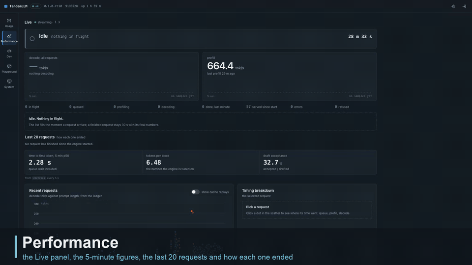

# Dashboard

The engine serves its own web page at `/dashboard/`. It answers the question a log cannot answer at a glance: what is the engine doing right now, for whom, and how fast. All of it is about 45 KB of gzip for the parts every tab loads, and the box needs no Node to serve it.

## Views

| view | what it shows |
|-|-|
| Performance | the Live panel on top, then time to first token, tokens per round and acceptance over the last 5 minutes, then speed history from the usage ledger. The Recent requests chart plots decode tok/s against prompt length; a replay (the response cache, a summary written ahead) decoded nothing and is never a point there, nor in any average, percentile or live rate, and the switch lists the replays with their TTFT. Side-lane requests (0.3.27-test) are not plotted either. The y axis ends at twice the 95th percentile of the points, and a point above it is a triangle at the top edge with its value in the tooltip |
| Usage | a year of tokens as a heatmap, with totals for today, 7 days, 30 days and the year, split into input, cached input, output and reasoning |
| Dev | the live server log, filterable, with a detail view for each request |
| Playground | a streaming chat against the engine's own API, with tools, parameters and the figures of each answer |
| Conductor | how `TandemLLM` decides, and every knob of it: the live decision feed, the task classes and their policy, the classifier stages and thresholds, the session monitor's journal and rules (the tool checks' floors, project rules and reminders, the reasoning arms, the empty-turn nudges, the session tasks S1, S2 and S4 with their texts, patterns and push) and what the session tasks hold per session right now, profiles and roles (each role's contract: kind, window, preemptible, latency budget, fallback, writes, the tokenizer hash and the forms of sharing it allows), the Packages screen (G2: one list of every package, task skill, test skill, card and library skill with its kind, source, switch, general flag, the tokens of the text that goes in on the engine's tokenizer against its limit, the classes that list it and its injections, shadow notes and library picks in the last 24 h and 7 d; a search that asks the library's own index and filters by kind, class, switch and over the limit; a package's detail with its text rendered or raw, frontmatter, reference, classes, recent rows and a library skill's BM25 neighbours; inline packages edited in a Markdown editor with the token counter and the limit, a file on the box read-only or copied to an inline package; attach and detach on the router's classes, general packages first; every save checked first with its diff shown, then a new version with a note, and the versions with restore; the Library tab: each profile's retrieval switch beside the picks its shadow journaled), session timelines with the export of every hidden text, the Memory screen (the session transcripts kept on the box, a keep switch, the Markdown and JSON export, the transcript settings; a session's turn snapshots counted in its line and named in each block's runtime section with the turn's outcome (J1); the Disk cache tab: what the disk tier holds against its budget, the NVMe's free space, the hit rate, the most-hit prefixes with a preview for opencode heads and packages only, its events, its settings -- on or off, the budget in GB, the time to live, admission, the free space it keeps, at least 50 GB -- and a clear button; the admin token is asked for to read them), precision and promotion, and the eval reports: the classifier's, and the suite report of `tools/tandem_eval.py` with its verdict, n and the indicative label, both arms per suite. Every edit is a new config version; writes ask for the admin token when the page has no session ([server.md](server.md#tandemllm-and-the-conductor)) |
| Backends | the proxy's registry ([proxy.md](proxy.md)): each backend's health, models, requests in flight and cost today; add one after a test connection, edit, delete; the key field is write-only and shows the key's last 4 characters; a field a `TANDEM_*` variable sets is locked and names it; the models with their public ids, output limits (empty: the provider's list, else none), prices (USD per million tokens, the list prices of the release one click away) and per-model switches; the background memory writer's switches on the form (mode auto, off, shadow or on, the spend cap a day with a no-cap box, runs a day, the prompt cap; a field a variable sets is locked), and on the backend's page the day's runs and spend, each model's resolved mode and why, and in shadow where the would-be blocks go; the ordered routing rules; the users and their keys, each shown once. With no backend it opens on Setup. On an engine without `--backends` it says how to turn the proxy on. Relayed requests appear in Usage (a backend and a user filter, the cost of priced models), in Dev and in Performance with a backend tag, "measured at the proxy", and "not reported by this backend" where the proxy sees nothing |
| System | the engine's settings and the box's state (memory, GPU, caches), with 30 minutes of history kept in the browser; below them the hosts: this machine with the engine's process and every backend on it, and each remote backend's machine, down to the GPU memory of its processes ([proxy.md](proxy.md#the-machine-behind-a-backend)) |

## Live activity



*Recorded on the served engine; requests outside the demo session are blurred.*

The Live panel streams `GET /v1/dashboard/live` over server-sent events. While a request runs it gets four events a second, otherwise one.

A line at the top says what the engine is doing now, in the server's own words:

- `Prefilling 36,864 of 48,210 (76 %)`, with the prefill rate and an estimate of the time left;
- `Thinking` or `Writing`, with the decode rate and the tokens so far;
- `Calling tool write_file`, with the size of the arguments written so far;
- `Waiting for client: running tool bash`, between two turns of an agent;
- `Idle` or `Draining`.

When the client's socket closes while the engine still works for it, the line says so in red: "client disconnected 12 s ago".

Under the two big figures (decode and prefill tok/s, each with a 5-minute sparkline) the panel shows tokens per round and milliseconds per round over the last second. Each request in flight gets a row: its state, its client, tokens split into thinking and content, time to first token, the rates, and a timeline strip with one segment per state. When an agent sends its next turn, the row says which request it continues and what the client did in between ("continues chatcmpl-7f3a after 8.4 s, client ran bash").

A list of the last 20 requests says how each one ended, in one sentence: "abandoned by the client after 73 s of silent prefill, 0 tokens sent". Abandoned, failed, timed-out and cancelled requests get a red mark. Refused and rejected ones get an amber mark. A row opens the request's detail in the Dev view.

It also reports on its own stream, "streaming · 4/s", "no update for 3.0 s" or "reconnecting since 4 s". A silent page is never mistaken for an idle engine.

## Where the words come from

Every state and every sentence comes from the server (`server/activity.py`), and the page only formats numbers. Our loop keeps the state it needs anyway, and a sampler reads it once per tick: no statement runs per token for the dashboard's sake. With the activity on and a stream open, the release gate found the text byte-identical and the round time unchanged within noise. `--live-activity off` turns the activity fields off; the counters and rates stay.

A tick costs 410 to 470 µs of CPU at 4 Hz. Each tick is encoded once and sends it to every open stream, and it allows at most 4 streams.

## The contract

`docs/contract/dashboard-v1/` holds a JSON Schema for every JSON response of `/v1/dashboard/*` and a valid example of each. Both sides test against it. The backend's tests validate real responses from the server. The dashboard's tests validate the examples and every response of its mock server (`npm run test:contract` in `dashboard/`). A change to a field bumps `contract_version`, and the contract's [README](contract/dashboard-v1/README.md) lists every change. The live and session endpoints are at version 1.1.

| endpoint | what |
|-|-|
| `GET /v1/dashboard/live` | requests in flight, the engine's state, the last 20 stops, 5 minutes of history |
| `GET /v1/dashboard/summary` | totals for today, 7 days, 30 days and the year |
| `GET /v1/dashboard/usage` | tokens and speed per day or hour, with filters by model and client |
| `GET /v1/dashboard/requests` | finished requests, newest first |
| `GET /v1/dashboard/system` | settings, memory, caches, ledger and disk |
| `GET /v1/dashboard/logs` | the server log, as JSON or as a stream |
| `GET /v1/dashboard/metrics` | the `/metrics` page, for the Performance view's 5-minute figures |
| `GET /v1/dashboard/session` | whether an admin password is set (`password_set`), whether the login is on, and the session's expiry |
| `POST /v1/dashboard/session` | a session cookie for the admin token (only with a password set and the login on; the page has no sign-in screen yet) |

## Access

### No password

The dashboard asks for no password anywhere: no sign-in screen, no sign-out button, no token dialog. Open `http://<host>:8000/dashboard/` and every view works, the Conductor's editors and the Memory screen (notes, transcripts, the disk tier) included. You can read and edit them straight away.

This holds while no admin password is set on the server, which is the default ([server.md](server.md#the-admin-rule)). Then anyone who can reach the port can read and change everything the dashboard shows:

- per-request counts and timings from the usage ledger: tokens, speeds, cache hits, finish reasons, the kind of client and a short hash of its API key;
- what runs now: each request's state, its client, the names of the tools it calls (not their arguments), and the last 20 stops;
- the server log. No line carries prompt or answer text, unless the server runs with `--log-content`, which lets exception messages quote a request;
- the engine's settings: its command line and every `QWEN38_*` and `QSE_*` variable, with the home directory written as `~`. Variables named like a token, key, secret or password show `<redacted>`;
- memory, GPU, cache and disk state, and the Prometheus counters of `/metrics`;
- the conductor's documents, the memory notes and the session transcripts, which it can also edit, archive and delete.

Keep the server on a trusted network. Never put it behind a reverse proxy that faces the internet while no password is set.

### With a password set

Setting `QSE_ADMIN_TOKEN` in `secrets.env` and restarting turns the admin rule back on for every admin route. The dashboard has no sign-in for that yet: with the login off its read-only views keep working, while edits and the Memory screen show the server's 401 as an error, and a banner says a password is set. Unset the token and restart to open the dashboard again. API clients send the token as `Authorization: Bearer <token>`.

TandemLLM's own calls to itself (the router's question to the engine, `client_kind` `internal`, 0.3.43-test, VIS-60) are left out of Usage, the summary, the request counter, the model and client filters and Dev's Recent requests; the "show internal" switch on Usage and on Recent requests lists them, each with the request it served (`parent_request`). In the Live panel the cached share is never above the client's prompt (VIS-58): the prompt is what the client sent, and the notes TandemLLM added show as their own figure (`15,957 cached · +4,625 hidden`).

## Usage ledger

`server/ledger.py` writes one SQLite row per request: the model, the kind of client (curl, an OpenAI SDK, opencode, the dashboard), token counts, timings, draft acceptance and the finish reason. It never stores prompt or answer text. Usage and Performance read it through the dashboard API. `--usage-ledger PATH` turns it on, and `--usage-retention-days` bounds it (at least a year plus a margin, so the Usage view has its year). A benchmark server started without the flag writes nothing.

## Building and testing

The app is written in TypeScript with Lit components and built by Vite. Its charts are hand-drawn SVG, and it loads nothing from a CDN. `dashboard/dist/` is committed, and the server serves it from there. The `dashboard-dist` workflow (`.github/workflows/dashboard-dist.yml`) builds it from source on every pull request and push to main that touches `dashboard/` and fails when the result differs from the committed `dist/`, so a dashboard change comes with its rebuilt `dist/`.

```bash
cd dashboard
npm ci
npm run dev:mock        # the app against a mock engine, token "mock" (?mock=nologin: the login off)
npm test                # unit, contract and build tests
npm run build           # type-check and build dist/
npx playwright test     # end-to-end, Chromium and WebKit, desktop and phone
```

A mock engine can play scenarios for the Live panel (an agent turn with a chunked prefill and a tool call, a client that leaves during a prefill, one request per stop reason) and failure modes (expired session, server errors, dropped streams). Those end-to-end suites also run against `server/app.py --fake-engine`, which serves the real API with a scripted engine and no GPU. [dashboard/README.md](../dashboard/README.md) has the developer details.
