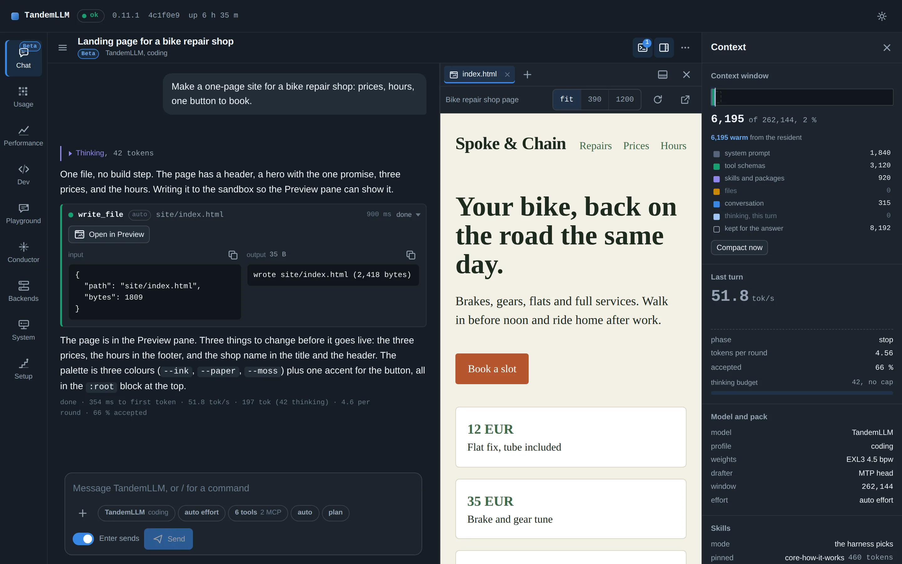
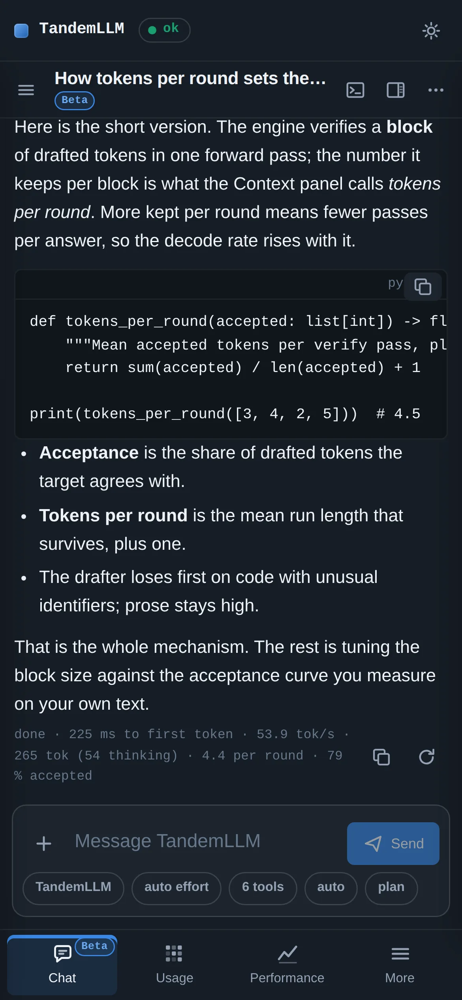
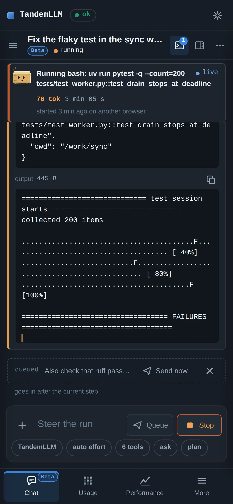

# Gallery

The dashboard at 1440×900 and on a 390×844 phone, dark theme. `dashboard/e2e/readme-shots.spec.ts` renders the pictures from the dashboard's mock, and `dashboard/scripts/readme-shots.sh` converts them to WebP. The Setup Guide speeds come from the measured rows in `models/*/model.yaml`. All other numbers come from the mock.

## Chat

The model writes `site/index.html` in its sandbox, the preview pane renders it, and the context panel shows what fills the window.

## Setup Guide

The models step: one tile per model, each with its measured speed in tok/s.

Each size's tok/s and KL, here Nemotron 3.5 Bolt.

Community weights with their maker: turboderp's Flash-Next packs.

## Performance and Usage

Live decode speed and every running request.

History: decode speed, first-token time, prefill, tokens per block, draft acceptance.

Tokens per day for a year.

## Phone

  
  &nbsp;&nbsp;
  

The Chat tab on a phone: an answer with code, and a run calling a tool.
