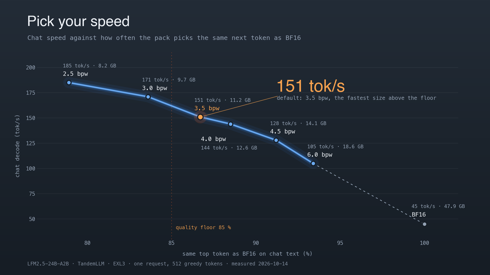
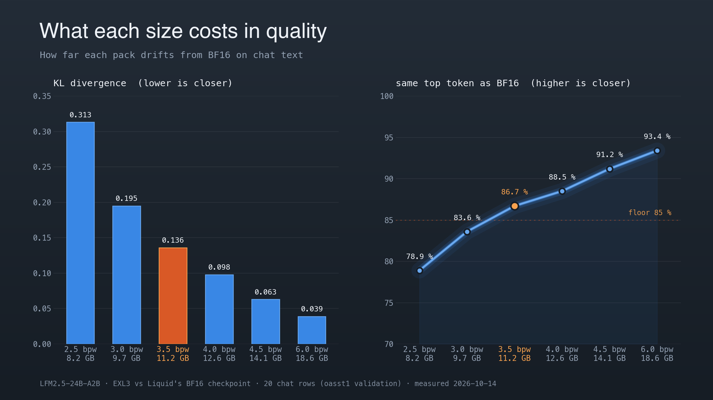

# LFM2.5-24B-A2B

LiquidAI's LFM2.5-24B-A2B is the third model TandemLLM runs, beside Qwen3.8-27B and Qwen3.8-Flash-Next. Support ships in release 0.9.0. The model has 24B parameters; 4 of its 64 experts run for each token. It is a chat model and the fastest model on this engine.

Code: `engine/models/lfm2_moe/` (registry name `lfm2_moe`, selected by `Lfm2MoeForCausalLM` in `config.json`). Setup Guide entry: [models/lfm2.5-24b-a2b/model.yaml](../models/lfm2.5-24b-a2b/model.yaml). Measurements: `models/lfm2.5-24b-a2b/measurements/0.8.3-summary.json`.

## The model

| part | value |
|-|-|
| layers | 40: 30 short-convolution layers, 10 attention layers (indices 2, 6, 10, ..., 38) |
| short convolution | `in_proj` 2,048 to 3 x 2,048 (B, C, x); y = C * conv(B * x), 3 taps, one filter a channel; `out_proj`. State: the last 2 inputs B * x a layer, 240 KiB a sequence |
| attention | 32 query heads, 8 KV heads of 64; q and k RMS-normed per head; rotary over the whole head (theta 1e7). KV: 20,480 bytes a token, 2.5 GiB at 131,072 tokens |
| MLP | layers 0 and 1: dense SwiGLU, 11,776 wide. Layers 2 to 39: 64 SwiGLU experts, 1,536 wide, 4 a token, no shared expert |
| router | sigmoid of each expert's logit; a per-expert bias selects the 4; the 4 sigmoids are renormalised |
| head | tied to the 128,000-token embedding |
| context | 131,072 tokens |

A decode token reads 4.9 GB of the BF16 weights: experts 2.87 GB, convolution projections 1.01, head 0.52, dense MLPs 0.29, attention 0.21 (`PackIndex.decode_bytes`). The decode step runs about 400 kernels, so it is one CUDA graph.

## Profiles

DGX Spark, 2026-10-14. Decode step: `tools/lfm_check.py bench`, one request, 256 tokens, from its graph. Chat: one greedy request through the server, 512 tokens, thinking off, plain / lookup. Quality: exllamav3 `model_diff` against BF16, 20 rows of 2,048 tokens of oasst1 chat and of wikitext-2. Engine KL: `tools/lfm_quality.py`, 100 rows of oasst1 chat.

| profile | on disk | weights at load | decode step, tok/s | chat, tok/s | chat KL | chat top-1 | wikitext KL | engine chat KL |
|-|-|-|-|-|-|-|-|-|
| `lfm25-exl3-2.5` | 8.20 GB | 7.64 GiB | 188.2 | 185.4 / 175.6 | 0.313 | 78.9 % | 0.463 | 0.336 |
| `lfm25-exl3-3.0` | 9.68 GB | 9.4 GiB | 175.0 | 171.3 / 168.5 | 0.195 | 83.6 % | 0.335 | 0.217 |
| `lfm25-exl3-3.5` (default) | 11.16 GB | 10.56 GiB | 153.5 | 150.9 / 143.7 | 0.136 | 86.7 % | 0.226 | 0.151 |
| `lfm25-exl3-4.0` | 12.64 GB | 12.06 GiB | 145.9 | 143.7 / 139.4 | 0.098 | 88.5 % | 0.201 | 0.108 |
| `lfm25-exl3-4.5` | 14.12 GB | 13.31 GiB | 128.8 | 128.2 / 124.7 | 0.063 | 91.2 % | 0.113 | 0.070 |
| `lfm25-exl3-6.0` | 18.63 GB | 17.37 GiB | 106.9 | 105.2 / 103.5 | 0.039 | 93.4 % | 0.080 | 0.048 |
| `lfm25-bf16` | 47.9 GB | 44.95 GiB | 44.8 | 44.5 / 43.3 | 0 | 100 % | 0 | 0 |

- Packs: exllamav3 1.6.0, mul1 codebook, head 6 bits (8 for 6.0), default calibration. One Hugging Face repository a size, `0xBakeer/TandemLLM-LFM2.5-24B-A2B-EXL3-<bpw>`, pinned by commit (`QSE_WEIGHTS_REVISION`). The repositories are public; a download needs no token. Every file is checked against the hub's sha256.
- Default: `lfm25-exl3-3.5`. Rule: the fastest profile in chat as served (lookup on) with chat top-1 against BF16 of at least 85 %. 3.5: 143.7 tok/s at 86.7 %. 3.0: 168.5 tok/s at 83.6 %, below the floor.
- Setup Guide tile: the fastest cell of the default profile's served row, 147.5 tok/s (3.5, prose).
- `-hq` 4.0 (attention and convolution projections +2 bits, dense MLPs +1, 4.06 bpw, 12.81 GB): chat KL 0.082, top-1 89.7 %; served chat 131.2 tok/s against 144.0 for 4.0 and 127.6 for 4.5 in one window. Not offered.
- The KL values are high for these rates. The same recipe on the 8B sibling at 4.10 bpw gives KL 0.0955 against 0.0862 for a reference conversion. The cause on the 24B is not known.
- Half-integer rates: below 4 bpw exllamav3 1.6.0 gives some tensors 1.5, 2.5 or 3.5 bits a weight (a tile is 16 K + 8 int16 wide; an odd weight takes one bit more than an even one). The 2.5 and 3.5 packs use them. The EXL3 kernels decode them as exllamav3 does (`tools/exl3_linear.py`, `dq8_frac`; bit codes 15, 25, 35) in the decode step, a verify block and the prefill. The pack reader refuses an unsupported rate or codebook by tensor name.

Switch: `ops/use-profile.sh lfm25-exl3-3.5`, or the Setup Guide (`#/setup`).

## Chat, reasoning and tools

- Template: the checkpoint's `chat_template.jinja`. It opens `<think>` at the end of every prompt; the server splits reasoning from the answer as for Qwen ([server.md](server.md#reasoning)).
- Thinking off (`chat_template_kwargs: {"enable_thinking": false}`, or the conductor's): the server closes the block right after the generation prompt.
- Tool calls: a Python list between `<|tool_call_start|>` and `<|tool_call_end|>`, for example `<|tool_call_start|>[get_weather(city='Berlin', days=3)]<|tool_call_end|>`. `server/toolcall.py` (`PythonicCalls`) rewrites each block into the JSON tool tier as the text arrives; the client gets OpenAI `tool_calls`. Values are Python literals (and `true`, `false`, `null`), read with `ast.literal_eval`, never run. A block that is not a list of keyword calls stays text.
- Sampling default when a request names none: temperature 0.1, top_k 50, repetition penalty 1.05 (`TEMPERATURE`, `TOP_K`, `REP_PENALTY`).
- Conductor: on by default, with the model fit below ([Conductor](#conductor)).

## Conductor

The conductor (Laya's three decision models, the narrator, the session monitor) is on by default. The router's documents target Qwen3.8; LFM2.5's adapter declares how the router fits it (`Capabilities.conductor` in `engine/models/lfm2_moe/serving.py`, read by `server/conductor/modelfit.py`; [server.md](server.md#the-model-fit)):

| key | LFM2.5 | effect |
|-|-|-|
| `served_classifier` | false | Laya alone answers the class question, also where the router document leaves its stage off |
| `fallback` | `lean` | a turn no stage classified at its bar thinks at the profile's default level, with no effort sentence, and its tool turns too; since 0.11.3 its class's core still goes in (SRV-534) |
| `packages` | `core` | a class's core skill and the client's pins; no general package, no package question |
| `no_package_classes` | `chat` | no package on the chat class |
| `effort_notes`, `rules`, `memory` | false | the level sets the switch and the budget alone; no rules, no memory card or index |

Why, measured on `lfm25-exl3-2.5`, 2026-10-14 (`models/lfm2.5-24b-a2b/measurements/conductor-0.9.0.json`):

- With thinking off the model answers the router's class prompt as a chat request. Its one-id answers were right on 0 to 2 of 8 labelled requests at confidence 0.08 to 0.44 or wrong at up to 0.99. Laya stays under its 0.8 bar on short chats, so a short chat fell back to the profile's default class: `chat` through curl (everyday packages and memory notes, 2,036 to 2,347 hidden tokens), `code_edit` at xhigh in the Chat tab (coding packages, 5,825 to 6,022).
- The router puts its notes at the tail of the user's message. The same note texts on the raw path, 4 short asks, greedy: 5,817 reasoning tokens at the tail, 2,969 as the system message, 2,155 without them. The package note alone at the tail: 7,363; the memory notes alone: 2,614. The reasoning follows the package's checklist line by line; with thinking off it moves into the answer.
- Chat-tab tasks (5 tasks, 2 runs each, reasoning tokens): the fit with the class rules as its only note (75 to 84 tokens) 3,083 and 6,416 in two windows; with the effort sentences added 8,343; with the general packages added 12,934 (5,788 to 7,654 hidden tokens a turn); the router as written 13,426. The raw path in the same windows: 2,748 to 3,670. Runs at temperature 0.1 vary.

The model fit against the raw path and the router as written (`QWEN38_CONDUCTOR_FIT=off`). Same server, one request at a time; short asks greedy at 8,192 tokens at most; tasks at the sampling defaults (temperature 0.1), each run twice:

| set | raw | router as written | model fit |
|-|-|-|-|
| 4 short asks, thinking on: reasoning tokens (right) | 2,155 (4/4) | 9,098 (4/4) | 2,234 (4/4) |
| 4 short asks, thinking off: answer tokens (right) | 541 (3/4) | 679 (3/4) | 553 (3/4) |
| 4 short asks in the Chat tab, 10 tools: reasoning tokens (right) | 525 (3/4) | 2,665 (3/4) | 553 (3/4) |
| 7 Chat-tab tasks x 2: success, reasoning tokens, tool errors | 14/14, 7,535, 1 | 12/14, 68,170, 9 | 14/14, 9,850, 0 |
| 3 Chat-tab tasks with an "open it" follow-up x 2: success, `present` in the follow-up, tool calls, reasoning tokens | 6/6, 6/6, 19, 8,627 | 4/6, 5/6, 145, 113,211 | 6/6, 6/6, 20, 7,228 |

The follow-up rows ran on the :8000 server after the deploy (raw and fit) and on the side server (router as written); there the router's testing packages had the model check the page through the shell: 15 shell calls in the follow-ups and 13 tool errors over the 6 runs. The raw column is the model fit's window; in the router's window the raw tasks gave 14/14, 7,352, 0. Rates in the model fit's window (no other request on the box): 171.6 tok/s on the short asks against 166.7 raw, 161.1 on the tasks against 165.7. The tasks: files, a Python script, a search, an HTML canvas animation, an analog clock, a landing page, a JSON edit; the check reads the files each run wrote.

Not yet: the packages, the memory notes and the effort sentences at a place this model does not read as part of the request (the system message cost 1.38 times the raw thinking where the tail cost 2.7 times); Laya's class question on short chats (below its bar, so they fall back).

## How the engine runs it

- One row path: the decode step and every row of a verify block run the same kernels a row at a time (`engine/models/lfm2_moe/kernels.py`). EXL3 projections use `tools/fn_kernels.dense`, experts its MoE bank kernels, BF16 projections a 16-row GEMM. A verify row has the decode step's bits, so greedy speculation writes the plain greedy text.
- Self-check at load: a recorded 24-token decode verified as one block, every row compared bit for bit. A difference turns speculation off.
- Rollback: a verify block writes nothing into the convolution state. The commit rebuilds the state from the accepted path's last two inputs and moves the path's KV rows. Rollback is exact.
- Prefill: chunks of 4,096 tokens on batched kernels (cuBLAS or the EXL3 GEMM, experts grouped, SDPA with a lower-right causal mask). The next token agrees with the row path; the bits do not. 8,192 tokens prefill at 7,360 tok/s on 4.0.
- Dense splits: `ops/lfm25-dense-splits.json`, from `tools/fn_tiles.py --dense` at each pack's shapes. Decode step with / without, tok/s: 2.5 188.2 / 171.2, 3.0 175.0 / 159.1, 3.5 153.5 / 143.4, 4.0 145.9 / 136.1, 4.5 128.8 / 121.6, 6.0 106.9 / 106.9. The graph saves 5 % against eager launches.

## Speed by kind of text

One greedy request a cell through the server, 512 tokens, thinking off, suffix store off, plain / lookup, tok/s. Edit: a file back with one name renamed. Copy: a text back unchanged. Every lookup text equals the plain one.

| profile | prose | chat | code | edit | copy |
|-|-|-|-|-|-|
| `lfm25-exl3-2.5` | 185.6 / 177.0 | 185.4 / 175.6 | 185.1 / 179.3 | 181.1 / 350.5 | 181.9 / 271.3 |
| `lfm25-exl3-3.0` | 171.7 / 165.7 | 171.3 / 168.5 | 171.3 / 169.2 | 168.2 / 327.8 | 168.8 / 413.8 |
| `lfm25-exl3-3.5` | 151.3 / 147.5 | 150.9 / 143.7 | 150.9 / 147.2 | 146.9 / 268.7 | 148.8 / 286.6 |
| `lfm25-exl3-4.0` | 143.6 / 140.1 | 143.7 / 139.4 | 143.8 / 139.2 | 141.3 / 291.1 | 141.8 / 326.4 |
| `lfm25-exl3-4.5` | 128.4 / 123.3 | 128.2 / 124.7 | 128.0 / 124.5 | 126.5 / 281.2 | 126.9 / 339.4 |
| `lfm25-exl3-6.0` | 105.4 / 104.2 | 105.2 / 103.5 | 105.0 / 105.5 | 104.1 / 210.0 | 102.8 / 280.1 |
| `lfm25-bf16` | 44.6 / 43.4 | 44.5 / 43.3 | 44.5 / 44.5 | 44.3 / 153.7 | 44.2 / 157.8 |

The lookup costs up to 5 % in prose and chat and takes edit and copy asks to 1.8 to 3.6 times the plain rate.

Verify staircase, 4.0, chain blocks from their graphs, median of 20, 1,024 tokens of context, before the dense splits (`tools/lfm_check.py staircase`):

| rows | 1 | 2 | 3 | 4 | 6 | 8 | 12 | 16 |
|-|-|-|-|-|-|-|-|-|
| ms | 7.42 | 10.62 | 13.79 | 16.86 | 21.40 | 27.47 | 36.17 | 45.88 |
| experts read, 38 layers | 152 | 259 | 333 | 391 | 491 | 563 | 664 | 735 |

Each row adds about 3 ms because a block reads the union of its rows' experts. At 8,192 tokens of context the blocks cost 0.5 to 3.5 ms more. A block pays when it is accepted for about 1.4 tokens a row.

## Speculation

- Drafter: the lookup alone (the request's text and the suffix store) through the shared tree drafter with no head (`engine/methods/mtp_drafter.py` `NoHead`), cut by StairCut.
- Prices: one file a profile, `ops/prices/lfm2.5-24b-a2b/<profile>.dgx-spark.json`, from its staircase and bench (`tools/lfm_check.py prices`).
- No-head rules: a round with no lookup match is the plain step and is priced as one; each round's own match decides through the cut's calibrated acceptance; the class-wide skip is not consulted. The lookup's confidence carries its match length, so a long copy match scores above a short phrase match.
- Identity: `tools/fn_server_check.py --compare` on 4.0, lookup against plain, 20 requests (greedy, thinking, streaming, every `tool_choice`, JSON, penalties with `logit_bias`, logprobs, seeds, a stop string): every answer equal, largest logprob difference 0.0.
- A draft head plugs in through the adapter's `draft_heads()` in place of `NoHead`.

## Parallel requests and caches

- Three sequence slots over one copy of the weights (`QSE_PARALLEL=3`). A slot taking a plain step joins the round as one row (`joint_plain`); when every decoding slot does, the round is one joint decode step from a graph (`JointDecodeGraph`).
- 4.0, lookup on, store off, 256 tokens each (`tools/lfm_parallel.py`): 1, 2 and 3 requests at once decode 139.9, 169.1 and 177.8 tok/s in total; every text equals its request alone.
- Resident prefix and state store: 30 convolution states (240 KiB) as sections, K and V of the 10 attention layers as views, 4,096-token grid. A warm answer equals the cold one with equal logprobs at 4,096 and 12,288 tokens (`tools/fn_cache_check.py`).
- Disk tier: 12,288 tokens restored in 0.96 s against 2.6 s cold, answer and logprobs equal. Session spill: 13,650 tokens drained in 309 ms (0.19 GB), read back in 163 ms. One tier folder a pack.

## Not supported yet

- A draft head (none published for this model).
- Vision: the model reads text only.
- The shadow reader: it reads Qwen's token ids and was validated on Qwen text; off on this model.
- The KV pool: off in the profiles (`QSE_KV_POOL=off`), not verified on this model. Each slot reserves its window at load.

## Checks

| check | where | result |
|-|-|-|
| reference forward against transformers' `Lfm2MoeForCausalLM`, tiny random model, fp32 | `tests/test_lfm2_moe_ref.py` | prefill and 3 decode steps within 2.1e-5 |
| verify tree against sequential decode; commit and rollback | `tests/test_lfm2_moe_ref.py`, `tests/test_lfm2_moe_engine.py` | equal (engine: bit for bit) |
| BF16 engine against transformers in BF16, 8 chat prompts x 128 tokens, teacher-forced | `tools/lfm_check.py hf`, `tests/gpu/test_lfm2_moe_box_gpu.py rung_b` | top token 98.05 % (1,004 of 1,024); 19 of 20 differences near ties; KL 0.0064 |
| 4.0 pack against exllamav3's forward, same tokens | `tools/lfm_check.py exl3`, `rung_c` | top token 97.85 %; all 22 differences near ties |
| trellis decode against exllamav3 `LinearEXL3` | `tools/lfm_check.py xcheck` | bit for bit |
| verify rows against decode steps at every start | load-time self-check | 24 rows bit for bit |
| pack reader, synthetic and real packs | `tests/test_lfm2_moe_pack.py`, `tests/test_lfm2_moe_packs_on_disk.py` | pass |
| row kernels against torch twins; row invariance; one graph a decode step | `tests/test_lfm2_moe_kernels.py`, `tests/gpu/test_lfm2_moe_gpu.py` | pass |
| Pythonic tool calls, parser and chat handler | `tests/test_toolcall_pythonic.py`, `tests/test_lfm25_api.py` | pass |
| half-integer rates against `LinearEXL3`; kernels against the reference | `tests/gpu/test_lfm2_moe_gpu.py` | bit for bit at 1.5 to 8 bits; kernels within 3e-3, rows invariant up to 32 |
| shared kernels at whole rates against the previous tree | same random blocks through both trees | 51 of 51 outputs bit for bit |
| a served profile over HTTP | `tools/lfm_live.py` | health, answer, reasoning, tool calls |

A near tie: the reference's two best tokens are within 8 bf16 steps of its largest logit ([exactness.md](exactness.md)).
