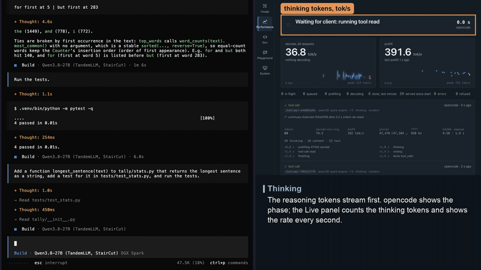
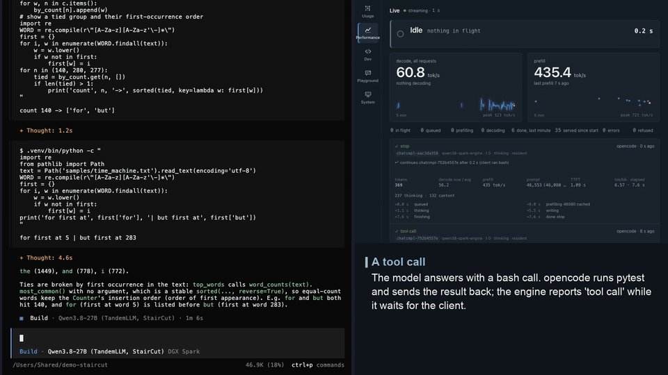

# Server and API

`server/app.py` speaks the OpenAI HTTP API, so any OpenAI client can use the engine by changing its base URL. It is built on the Python standard library (`ThreadingHTTPServer`), with no web framework. This page covers the routes and the request fields, then tool calls and structured outputs, then how the service behaves under load.

## Routes

| route | who may call it | what |
|-|-|-|
| `POST /v1/chat/completions` | anyone | chat, streamed or not |
| `POST /v1/completions` | anyone | plain text completion |
| `GET /v1/models` | anyone | the served model name, and `TandemLLM` when the conductor is on |
| `GET /health` | anyone gets the status; the full body follows the admin rule | status, queue counters, cache report, memory |
| `GET /metrics` | the metrics token when one is set, else the admin rule | Prometheus metrics ([server/METRICS.md](../server/METRICS.md)) |
| `GET /v1/cache/stats` | the admin rule | the caches' counters |
| `POST /v1/cache/clear` | the admin rule; with a password set, only as a bearer header | empty the caches in RAM; `?tier=disk` the disk tier, `?tier=all` both |
| `POST /v1/cache/peek`, `/v1/cache/prewarm` | the admin rule | a chat body's warm tokens and their tier before it is sent; the conversation read back from the NVMe while the engine is idle ([caches.md](caches.md#peek-and-prewarm)) |
| `GET /dashboard/` | anyone | the dashboard's static files, which hold no data |
| `/v1/dashboard/*` | anyone by default; with a password set and `--dashboard-login on`, the admin token or a dashboard session | the dashboard's data ([dashboard.md](dashboard.md)) |
| `GET /v1/conductor/*` | as `/v1/dashboard/*` | the conductor's config, decisions, sessions and reports (below) |
| `PUT`/`POST /v1/conductor/*`, every `/v1/conductor/memory/*` route | the admin rule | new config versions, restores, labels, decision-model loads |
| `POST /v1/systemone`, `/v1/predict` | the admin rule | typed decisions from the engine's own decision models (below); only with `QWEN38_DECIDER_MODELS` set |
| `GET /readyz` | anyone | whether a decision model is loaded and warm; only with `QWEN38_DECIDER_MODELS` set |
| `POST /v1/laya/ask`, `GET /v1/laya` | anyone, as the chat API | Laya for the model's own scripts: a typed verdict on a short text (below); only with `QWEN38_DECIDER_MODELS` set and the `deciders` document's `api.mode` on |
| `POST /v1/laya/drive/end`, `GET /v1/laya/kit/<file>` | anyone, as the chat API | X1: a playtest driver session's end (its journal row) and the playtest kit (below); the same conditions |
| `GET /v1/library`, `/v1/library/search`, `/v1/library/{name}` | anyone, as the chat API | the package library for the model's own scripts: search it, read a skill and its reference (below) |

### The admin rule

The admin password is the admin token, `QSE_ADMIN_TOKEN` in `secrets.env` (mode 600, never in the repository). It is the one switch, and by default it is not set.

- With no password set, the default, every route in the table answers anyone who reaches the port: the dashboard, the conductor's writes, the memory (notes, transcripts, the disk tier), the decision models, both cache routes and the full `/health`. The dashboard asks for no password anywhere. Keep the server on a trusted network: anyone on it can read and change the configuration and the memory. Only `/metrics` keeps its own token when `QSE_METRICS_TOKEN` is set, for Prometheus.
- With a password set, the admin routes need the admin token as a bearer header or a dashboard session. `POST /v1/cache/clear` takes only the bearer header. Requests from the box itself (loopback, no proxy headers) need no token; the watchdog and the measurement tools depend on that. A bad password stops the start: it must be at least 32 characters.

The dashboard has no sign-in screen in this release. With a password set, its reads still work while the login is off, but its edits and the memory views show the server's 401 as an error and the page shows a banner. The sign-in for that case comes later; until then, use the API with the bearer header or leave the password unset.

The dashboard login (`--dashboard-login`, from `QSE_DASHBOARD_LOGIN`, off by default) matters only with a password set: then `on` makes `/v1/dashboard/*` need the token or a session too. With no password it changes nothing. [dashboard.md](dashboard.md#access) says what the dashboard shows.

## What the API supports

`server/compat.py` gives every OpenAI request field one of three answers, and `tests/test_compat.py` pins the table.

- Honoured: `messages`, `model`, `stream`, `stream_options`, `max_tokens`, `max_completion_tokens`, `stop`, `temperature`, `top_p`, `seed`, `presence_penalty`, `frequency_penalty`, `logit_bias`, `logprobs`, `top_logprobs` (up to 20), `n` (up to 16, not streamed), `tools`, `tool_choice`, `parallel_tool_calls`, `reasoning_effort`, `response_format`, `modalities` (text output only). Messages may carry `image_url` parts (see Images below).
- Accepted and without effect by their own definition: `user`, `metadata`, `store`, `service_tier`, `prompt_cache_key`, `safety_identifier`, `prediction`.
- Refused with a 400 that names the field: `audio`, `functions`, `function_call` (use `tools`), `web_search_options`, `verbosity`, and for completions `suffix` and `echo`.

Fields that are not OpenAI's pass through without a 400, because clients send extensions meant for other servers. The engine reads its own: `top_k`, `min_p`, `repetition_penalty`, `no_repeat_ngram_size`, `max_reasoning_tokens`, `reasoning_format`, `draft_temperature` and `chat_template_kwargs`, and the other servers' thinking-budget shapes (`reasoning`, `thinking`, `thinking_budget`, `enable_thinking` and more, see Thinking budgets from the client).

## Reasoning

The model thinks inside `<think>` tags. `--reasoning-format` (or `reasoning_format` in the request) picks how the thinking reaches the client:

| value | content | `reasoning_content` |
|-|-|-|
| `tags` (default) | thinking inside `<think>...</think>`, then the answer | empty |
| `reasoning_content` | the answer only | the thinking, as OpenAI-style deltas |
| `both` | as `tags` | as `reasoning_content` |

A client kind can have its own format when it names none and the server's is `tags`, under a conductor plan (`QWEN38_CLIENT_REASONING`, `kind=format,...`, `*` for every kind not named; default `*=reasoning_content,hermes=tags`; empty: `tags` for every client). On the raw path the same rule holds for a plain API client, an SDK, curl or an unnamed one such as a benchmark: the reasoning goes to `reasoning_content` and its stop strings read the answer alone. Every other kind keeps the server's format there (SRV-617; up to 0.11.4 every raw request kept it). Since 0.3.50-test every client but the Hermes agent gets `reasoning_content` by default: an OpenAI SDK or curl client printed `message.content` and showed the model's thinking as its answer, and opencode with the installer's provider config showed it as literal `<think>` text (SRV-245, SRV-219). A client that wants the tags inline sends `reasoning_format: tags`. The answer starts with its first character; the blank lines the template writes after `</think>` are not sent. A small `max_tokens` counts the thinking: a response cut inside it has `finish_reason: length`, an empty `content` and the reasoning in `reasoning_content`.

Under a conductor plan a request's `stop` strings apply to the answer, never inside the reasoning, and the blank lines that start the answer are not matched (0.3.50-test, SRV-245: `stop: ["\n\n"]` ended a response at the first blank line of the thinking, 55 tokens and no answer). The raw path matches them on the whole text, as the release did. State lines never go into a plain API client's `content` (curl, an OpenAI SDK, an unnamed client): they go to `reasoning_content`, or are left out with `tags`; a memory line still goes into the answer. Open WebUI 0.11.3 folds `<think>` blocks out of the content after the fact and forwards the piece that carries `</think>` to its live view as the text of a new message, where it stays until the round's stream ends; in `reasoning_content` it has no tag to show, and every tool round's reasoning is its own block. For that client the template's blank lines go out as one content piece where the reasoning ends, so Open WebUI closes and times each round's block even when the round goes straight to a tool call (a blank message is not shown). A request's own `reasoning_format` always wins (0.3.45-test, SRV-193).

Open WebUI's terminal tools end `run_command`'s description with the terminal's working directory (`The current working directory is: <path>`), which Open WebUI fetches again for every user message. The description sits in the system prompt's tool block, about 4,800 tokens into the prompt, so the first `cd` of an agent changed the prompt there and the next user message read the whole conversation again: 41,749 tokens, 56 s, live on 0.3.46-test, where the conversation's own rows matched only up to that line. Under a conductor plan that is on (0.3.47-test, SRV-209, `QWEN38_CLIENT_CWD`, default `note`), the sentence leaves the description and the same sentence goes into the turn as a router note, when the directory differs from the last one noted (the first turn, a `cd`, a `cd` back): the tool block stays the same for the whole session, and the note replays where it was put, like every router note. The model reads the same words, at the turn they became true. Shadow, off, raw and `QWEN38_CLIENT_CWD=off`: the tools as sent.

*Recorded against the served engine (published NVFP4 weights, StairCut on); sped-up parts are marked in the clip.*

The chat template opens the block in the prompt, so the model only ever writes `</think>`. Our server re-emits `<think>` as the first delta so that clients which fold on a matched pair see one. `reasoning_effort` (low, medium, xhigh) goes into the chat template, and the served default is `medium`. At `xhigh`, one request spent all 8,192 of its tokens thinking and never answered. `--reasoning-effort none` (or `off`, SRV-477) turns thinking off for every request that says nothing about thinking (no switch, effort word or budget in any shape): such a request gets `chat_template_kwargs.enable_thinking: false` before anything reads it, and one that says anything keeps it. `/health` then reports `reasoning_effort: off` and `sampling.thinking_default: off`.

### Thinking budgets from the client

A client may cap the thinking in any of the shapes clients send, and `server/thinking.py` reads them all into one budget:

| shape | sent by | read as |
|-|-|-|
| `max_reasoning_tokens`, `thinking_budget` | this engine, DashScope | a cap in tokens |
| `chat_template_kwargs.thinking_budget`, `.max_thinking_tokens`, `.reasoning_budget`, `.thinking_token_budget` | template-argument clients | a cap in tokens |
| `reasoning: {max_tokens, effort, enabled, exclude}` | OpenRouter-style clients | `max_tokens` a cap, `effort` a word, `enabled: true` alone medium, `enabled: false` off |
| `thinking: {type, budget_tokens}` | Anthropic-style clients | `enabled` with `budget_tokens` a cap, `enabled` or `adaptive` alone on without a cap, `disabled` off |
| `reasoning_budget`, `max_thinking_tokens`, `thinking_token_budget`, `thinking_budget_tokens` (top level) | other servers' clients | a cap in tokens |
| `reasoning_effort`, `reasoning.effort`, `chat_template_kwargs.reasoning_effort` | OpenAI SDK, opencode, Hermes agent | the effort level's cap: `minimal` and `low` 1,024, `medium` 8,192, `high` 16,384, `xhigh` and `max` none; `none` is thinking off |
| `enable_thinking: false` (top level or in `chat_template_kwargs`) | DashScope, template-argument clients | thinking off |

Precedence: whether the model thinks is decided first, by `chat_template_kwargs.enable_thinking` when it is set, else by the top-level `enable_thinking`, else by any off form. The cap is then the first number in the table's order, else the first effort word's cap (`chat_template_kwargs` before `reasoning_effort` before `reasoning.effort`), else `enabled: true` or a `thinking.type`. A number beats a word. 0 is no cap. A word the template knows (low, medium, xhigh; `minimal` renders as low, `max` as xhigh) also goes into the template; `high` leaves the template at the server's default and is the cap alone. Before this, `high`, `none`, `minimal` and `max` reached the template, which raises on them, and the request got a 500. An unknown word or a negative number is a 400 that names the field. `reasoning.exclude` is read and not honoured: the reasoning goes out in the request's `reasoning_format`.

Under TandemLLM's router, a client's number always wins. An effort word is a ceiling (0.3.22-test, decided 2026-10-03): where the router decides the effort (`decisions.effort: on`), the turn gets the router's level, but never a cap above the word's (`medium` holds an xhigh turn to 8,192 reasoning tokens; a low class under `medium` keeps its 1,024). The answer reserve still applies after. The journal row's `extra.client_word` says when the word held the router down. A profile's `thinking.client_word` (`ceiling`, the default, or `ignore`) decides it per client: the shipped coding and overnight profiles say `ignore`, because opencode sends `medium` on every turn whatever the user picked, and there the router's level alone is the turn's, as before. `enabled: true` without a word yields to the router. Elsewhere (the raw engine, `X-Tandem: raw`, a profile with the effort decision off or in shadow) the word is the cap.

Thinking off is the client's (0.3.40-test). `none` and every other off form (`enable_thinking: false`, `reasoning.enabled: false`, `thinking.type: disabled`) close the thinking block in the template under every profile, the ceiling rule's lowest word. The router's journal row then says `thinking: off_client` with no budget, and `extra.client_thinking` names the field and the class's level that did not run ("client turned thinking off"); the dashboard reads "thinking off (client)". The class's effort sentence ("Reasoning effort is set to xhigh. Please think carefully …") is not added to such a turn (`effort_note_skipped:client_off` in the row's notes); the rest of the note (a package's rules, the class's rules) still is. Before, the row read `thinking: on` at the class's level and the prompt carried the xhigh sentence into a turn that could not think (Open WebUI's agent model sent `reasoning_effort: "none"`, 2026-10-06).

The answer reserve: when a client asked for a budget in any shape and the reasoning would otherwise run into the output limit (`max_tokens`, `max_completion_tokens`, or the server's default), the reasoning closes early enough to leave the answer `--answer-reserve` tokens after the closing phrase (`QSE_ANSWER_RESERVE`; `auto`, the default, is min(2,048, a quarter of the limit); 0 turns it off). The phrase is counted in because it streams where no monitor hides it. An uncapped request gets the limit less the reserve and the phrase as its cap. The close is the session monitor's hidden one where a monitor acts (SP1: the vendor's phrase goes into the model's context, the client receives `</think>` and the answer; the journal's `CLOSE_REASONING` has task `client`, or `reserve` when the reserve lowered the cap), and ThinkBudget's streamed phrase otherwise (no monitor, shadow, `X-Tandem: raw`, `n` > 1). The server log has one `[think] <id> client budget ...` line per such request, and with the router its journal row has `extra.client_budget` (field, kind, asked, reserve, limit, cap). `usage.completion_tokens_details.reasoning_tokens` counts the visible reasoning through `</think>`, the streamed phrase included and the hidden one not.

A request with none of these fields is served as before, token for token: the template gets the same arguments and the loop the same budget. `enable_thinking` alone asks for no budget.

## Tool calls

The request's `tools` go into the chat template, and the model answers a call in its own XML form:

    <tool_call>
    <function=read>
    <parameter=offset>
    150
    </parameter>
    </function>
    </tool_call>

*Recorded against the served engine (published NVFP4 weights, StairCut on); sped-up parts are marked in the clip.*

`server/toolcall.py` turns that into OpenAI `tool_calls` with `finish_reason: "tool_calls"`, on both the streamed and the JSON path. Under a conductor plan a request that offered no `tools` never gets `tool_calls`: a call the model writes anyway is read out of the answer and dropped, the finish stays `stop`, and the journal row names it in `extra.calls_refused` (0.3.50-test, SRV-247: a curl client with memory on received the model's own memory search as a call to a tool named `tool`, with the session's share address in its arguments). It reads the strict form, a lenient form and a JSON call object, and it reads only the answer, never the thinking. On a stream, a call goes out as argument deltas while the model writes it: the id and the name first, then each string value in pieces. A whole-file write therefore shows progress instead of minutes of silence.

Argument values carry their schema's types. The model writes every value as text, so `offset` arrives as the characters `150`. Our parser looks up the request's own schema, and a parameter whose schema does not allow a string is returned as JSON: `150`, `true`, a list. A typed value is held back on the stream until it is complete, then sent whole. On an 8-task agent run, a strict client that validates arguments against the schema refused 58 of 80 calls before this change, and 0 of 26 after.

`tool_choice` works as OpenAI defines it. `none` renders the prompt without tools. `required` and a named function become a constraint on the answer, the same token masks structured outputs use, so the model cannot answer without the call. `parallel_tool_calls: false` keeps one call. Beside a `response_format`, auto is the calls or the document (Structured outputs below).

## Structured outputs

`response_format` with `json_object` or `json_schema`, and `structured_outputs` with a `regex`, a `choice` list or a JSON schema, constrain the answer to a regular language. `engine/grammar.py` compiles each form to a finite automaton over bytes, because the tokenizer is byte-level and a token can end halfway through a character. A token is allowed in a state when walking its bytes never reaches the dead state. The engine computes that for the whole vocabulary at once per state and caches it, so a state costs a few milliseconds once.

A `</think>` the model writes again in its answer, alone on a line, is not sent (0.3.43-test, SRV-187): Open WebUI's parser closes a reasoning block at the first `</think>` and showed the second one as the text `</think>` between two tool rows. The tag in a sentence, in inline code, in a fenced code block, inside a `<tool_call>` or a `<tandem_memory>` block, or closing a `<think>` line the answer opened itself, stays; the stream holds back at most the start of a line that can still become the tag. Only under a conductor profile: the raw path sends what the model wrote. The journal row counts the tags taken out (`extra.stray_close`).

The constraint applies to the answer, after the reasoning. A JSON answer (`json_object`, `json_schema`) is parsed whole by its client, so a request that names no `reasoning_format` gets `reasoning_content` for it: the thinking goes to `reasoning_content` and `message.content` (or the concatenated content deltas) is the JSON alone, which `json.loads` and the SDKs' structured-output helpers read as they are. A client that sends `reasoning_format: tags` (or `both`) keeps `<think>...</think>` in the content. Such a request also gets the answer reserve a client's own thinking budget gets (see Thinking budgets from the client): the reasoning is closed early enough to leave the JSON its share of `max_tokens` (the journal's `extra.json_reserve`), and it carries no state lines. Until 0.3.41-test the content opened with the think block and a small `max_tokens` could end inside the JSON (SRV-169: a 270-token think block, then `finish_reason: length` at 300).

With `tools` offered and `tool_choice` auto, a document (`json_schema`, `json_object`, a `structured_outputs` form) constrains the answer to the calls or the document alone (SRV-619): one automaton, the union of the tool-call language that `required` uses (any offered function, its required parameters in declared order, typed values; more than one call unless `parallel_tool_calls: false`) and the document's. The model thinks freely, then its own first answer token picks the branch: the automaton is the product of the two languages, and where both are still open the mask follows the row's argmax before the mask. A call's first token (the `<tool_call>` id, `<`) commits to the calls; any other token (the document's `{`, a code fence, prose, the end token) commits to the document; whitespace leaves the choice open. The plain union let the masked-out fence's next best token decide, and that was the call marker, not `{`: on a first live run the model said "I can just output the JSON directly" and then answered with a `run_code` call that built the JSON (TC-65). Prose and code fences are outside the language. The mask stays a function of the prefix and the target's row, so speculation changes no token. The log line `[structured] <id> branch=calls|document` and the journal's `extra.structured_branch` say which branch an answer took. The call markers keep the model's own ids under this constraint (`<tool_call>` is one token; spelled out byte by byte it is off the model's distribution). A call goes out as `tool_calls`, the document as the content, with the thinking in `reasoning_content` as above. `tool_choice: none` is the document alone; `required` and a named function are the calls alone, the document checked and left out. An agent loop that asks for its final answer as JSON with its tools still attached (the OpenAI SDKs' structured-output helpers, tool-eval-bench's structured scenarios) was a 400 through 0.11.4 (`structured outputs with tools are not supported`) and fell back to prompt-only JSON, fenced or with prose around it. A model whose calls are not the XML format (`--tool-format pythonic`) keeps the 400.

Each mask applies to every verified row of a draft tree, not only to one row per step. Constrained output under speculation is therefore the text plain constrained decoding writes, with the same near-tie exception as any greedy text ([exactness.md](exactness.md)). JSON schemas with recursion (`$ref` cycles) are refused, and `json_object` allows a fixed nesting depth.

## Streaming

A streamed response sends one chunk per token, carries `usage` on the last chunk when the client asks for it (`stream_options.include_usage`, and by default with `--usage-default on`), then a chunk with `finish_reason` and `data: [DONE]`. A verify round accepts several tokens at once, so they reach the socket together. Half the gaps between tokens are therefore microseconds, and the other half a whole round.

`usage` counts what the client sent and what it received. `prompt_tokens` is the client's messages (with its tools) as the chat template renders them; the conductor's notes (the router's note for the turn, the session's replayed notes, the closed think block of a turn it turned thinking off, the monitor's SP4 note, an earlier answer's hidden tokens put back) are not in it, and when there are any `prompt_tokens_details.hidden_tokens` says how many the model read besides (absent when none, so a raw request's `usage` has its old shape). `cached_tokens` is the client's tokens served from a cache: the cached span less the hidden tokens inside it, which the server tracks by position (the notes, the end anchor's replay, a reasoning the client left out, SP4's note); when the positions are not known it is at most `prompt_tokens`, as before. `timings.cache_n` and `prompt_n` stay the engine's own counts of the whole prompt, and the ledger keeps them as `engine_cached` and `forwarded_tokens` (schema 8). Until 0.3.50-test the hidden rows inside the cached span counted as client tokens: an opencode turn that re-read 3,827 of its 24,706 client tokens reported all 24,706 cached (SRV-233); it now reports 20,879. The ledger keeps the client's count in `prompt_tokens` and the conductor's in `conductor_hidden_tokens`. Until 0.3.41-test the router's notes were counted: a "hi" reported 238 prompt tokens under the chat profile (926 on 0.3.39-test), 11 raw (SRV-165).

`finish_reason` is one of `stop` (end of text or a stop string), `length` (`max_tokens`), `tool_calls`, `timeout` (the request's wall-clock cap), or `error`. On `error` the partial text has already been sent and an `error` object sits beside the finish reason. A client that hung up is logged as `abandoned`, not as an error.

`server/stream.py` turns tokens into characters. A character can span tokens, because the tokenizer works on bytes, and a stream that sent every decoded prefix would send a replacement character (U+FFFD) that never goes away. Our detokenizer holds back a trailing partial character until the next token completes it. Every character it sends is final.

## A long prefill, and a client that leaves

A long prompt prefills for minutes: 208.3 s at 128k tokens on the published NVFP4 set ([caches.md](caches.md)). After every prefill chunk the handler checks its socket. If the client has gone, the prefill stops there, the request ends `abandoned`, and the engine is free at once. Rows already prefilled stay in the resident prefix ([caches.md](caches.md)), so a retry continues from there. A request whose client left while it waited in the queue is dropped before it runs.

A streamed prefill that has run for 5 s (`--prefill-heartbeat-s`) also sends an SSE comment after each chunk, at most once a second:

    : prefill 12288/95131

Clients ignore comment lines. Proxies see a live stream and do not time it out.

## Admission and limits

TandemLLM holds one sequence, so requests wait for it in a bounded queue.

| limit | served value | what happens |
|-|-|-|
| `--max-queue` | 8 | the next request gets a 503 with `Retry-After: 5` |
| `--queue-timeout` | 240 s | a request without a stream that waited that long gets a 429 with `Retry-After: 10`; a streamed chat request and a client's side request wait as long as `--request-timeout` (see "A turn behind a running turn") |
| `--request-timeout` | 3,600 s | a generation that runs that long ends with `finish_reason: "timeout"` |
| `--max-len` | 262,144 tokens | a prompt that does not fit gets a 400; `max_tokens` is clamped to what fits |
| `--default-max-tokens` | 32,768 | used when the request sends no `max_tokens` |

At load the server allocates the KV buffer for the whole context, so the context length is a memory decision taken before the first request ([operations.md](operations.md)).

The memory gate (OPS-47) runs before every prefill: back under the ceiling, then the prompt's workspace under the declared peak, shedding caches cheapest first (`store`, `anchors`, `end`, `stash`, `park`, `pin`, and since 0.3.26-test `roles`), or a 503 with `Retry-After`. On 2026-10-04 it refused every request, 12-token ones included, at "needs 82.0 GiB, peak 77.0 GiB", until :8000 was restarted at 16:41. The cause was the shadow reader's model pool: it had read 123,000 rows of a 195,694-token conversation, and every KV growth and every chunk's attention temporaries (larger with each chunk, as the context grows) took a new segment of its own MemPool. A live MemPool never gives its free segments back (torch 2.13, measured: 556 MiB stayed reserved after every tensor in it was freed; `empty_cache` returned it only once the pool was deleted), so 17.6 GiB of free memory sat in it and counted as the engine's reserve. Now:

- After each idle-window burst, a shadow pool with more than `QWEN38_SHADOW_POOL_SLACK_GIB` (2) free parks its sessions on the disk and unloads the model, which drops the pool; the next turn loads it again and reads on from the disk.
- `roles` is the gate's last level: the same release, then `empty_cache`.
- Before a refusal the gate runs `gc.collect()` and `empty_cache` once more. A prompt whose workspace fits in the free reserve of the engine's own allocator (free memory inside a role's pool does not count) is admitted (`stale_admit` in the memory events): the allocator serves it from blocks it already holds.
- Every refusal is an error line in the Dev tab's log, with allocated, reserved and how many refusals in a row.

The abandoned 195,694-token prefill was not the cause: the log shows the shadow's ten reading bursts after it, and the first refusal right after them.

### The side lane (0.3.27-test)

A short request no longer waits for a long turn to end. On 2026-10-04 between 16:43 and 16:48 one opencode turn thought for minutes. A second session's first turn queued behind it and got a 429 after 256 s, twice. Before queueing, the router asked Qwen its two questions for that turn (the package and the library choice, `server/conductor/classify.py`): both waited in the same queue and gave up at their 8 s timeout, so the ledger shows them as `abandoned` after 9.0 s, client `anon`, model `qwen38-spark-engine`.

A request goes to the side lane (`server/preempt.py`) when it finds the engine busy and is short: at most `--side-lane-prompt-max` (2,048) prompt tokens and `--side-lane-new-max` (64) output tokens, one choice, no images, thinking off, and either a raw request (the router's questions are raw) or a client's side request (opencode's or Hermes' title). It becomes a job, and the generation that holds the engine serves it at its next safe point: between two decode blocks, or between two prefill chunks (`--side-lane decode` leaves the prefill out, `off` turns the lane off). The guest is prefilled from position 0 on the prefill's grid and decoded one token a forward, with no drafter. Its answer is plain greedy decoding of its prompt (or the client's sampling), so it follows the exactness promise ([exactness.md](exactness.md)).

The generation gets the engine back as it was. `engine/cache.py` `Borrow` copies what the guest can write: the KV rows below the guest's prompt plus its output plus 64, the recurrent state, the convolution tails, a walked chain state in its scratch buffer, and the references the next block reads (a pending commit is copied unsettled, so the next verify folds the same record into the same bytes). The drafter is never touched: the guest runs without one and with the drafter's tap off. A copy costs about 0.3 GB for a 2,000-token guest and is freed after it. `tests/test_side_lane.py` checks on the random model that the next block's logits, the state and every KV row are bit for bit an uninterrupted run's, after a guest between blocks, after a partial accept and between prefill chunks; `tools/lane_check.py` checks a long request on the real engine against runs without guests: its tokens are the runs' tokens up to the first fork, and a fork must be a near tie, each run taking the other's runner-up with a top-2 gap within `--tie-nats` (0.125), as [exactness.md](exactness.md) judges one.

Three guards. A job waits for a later safe point when the engine's reserved memory plus the guest's copy and workspace would pass the declared peak (a long prefill near its peak). A disk-tier write that has not copied the rows below the guest yet stops where it is (`DiskTier.guard_rows`); the head's chunks are copied seconds after a prefill, so during a decode nothing stops. A job no holder takes (the turn ended, or the lock is held outside a generation) is run by its own request thread under the lock, at the side rank, with the resident rows lent and given back the same way.

The ledger row of such a request has `lane` (`decode`, `prefill` or `self`); its `queue_ms` is the wait for the safe point. The `[req]` line adds `lane=`, `wait_ms=` and `lent_ms=` (how long the turn waited). Side-lane rows are not speed samples: a short plain decode beside a turn says nothing about the engine's decode rate. A client's side request too long for the lane (opencode's summary) is never refused for its wait: it waits as long as a request may run.

### A turn behind a running turn (2026-10-05)

The side lane serves short requests only. A second session's full turn still waits for the running turn to end, and until 0.3.31 it got a 429 after `--queue-timeout` (240 s), as on 2026-10-04 at 16:47: minutes of waiting, then a refusal, then the same again.

A streamed chat request is no longer refused for its wait. It waits as long as one request may run (`--request-timeout`, 3600 s on :8000). After 10 s in the queue its stream opens (status 200, the headers) and an SSE comment goes out every 10 s: `: waiting, position 1, about 40 s, 30 s so far`. A comment is not an event, so no client reads it as a token, and a client or proxy with an idle-read timeout keeps the connection. When the profile shows progress lines, the waiting line carries the estimate: "waiting: another request is running, position 1, about 40 s" (kind `queue_eta`, switched with `queue`; the voice says "about 40 s left"). A new line goes out when the reason or the position changes, and once a minute otherwise. A request that has waited less than 2 s gets no line (`queue_wait.QUIET_S`). When TandemLLM's own work holds the engine the line says so in plain words ("TandemLLM finishes its background work first", "TandemLLM decides how to handle the request first"); the live view keeps the technical holder. That work (the shadow reader's burst, a summary prepared ahead) yields at its next chunk, so its estimate is the median of the waits requests really had behind it, longer than the wait so far, and there is none before five were measured; below 10 s an estimate reads in seconds ("about 3 s"). Each request's time behind that work is the ledger's `wait_own_ms` (schema version 5). Until 0.3.41-test such a holder counted 0 s and every estimate was rounded up to 10 s, so the line read "about 10 s left" every time while the ledger's waits were 0.1 to 3 s (SRV-177). At the limit the open stream ends with an `error` object (code 429) beside `finish_reason: "error"`, as any refusal after an early open does. A request without a stream cannot show that it is alive, so it keeps `--queue-timeout` and its 429. A full queue (`--max-queue`) is still refused at once with a 503.

The estimate (`server/queue_wait.py`) comes from the hold times of the requests since the start, per rank (a turn, a side request). For the request that holds the engine, having run `e` seconds, it is the median of `d - e` over the recorded times `d` longer than `e`: how much longer requests that ran this long went on. Each waiter ahead adds its rank's median; the prepare and shadow jobs yield at their next chunk and add nothing. With fewer than 5 recorded times, or fewer than 3 that ran longer than the holder has, the line gives no estimate, only the position. The numbers are rounded (10 s steps, then minutes) so they do not read as exact.

The holder's own work (0.3.51-test, SRV-249). The hold times know nothing about where the holder is: on 0.3.48-test a one-line question waited 35.8 s behind a thinking turn that had run 14.8 s, and the line said "about 20 s". Replayed over the box's ledger (3,716 client requests, the waiter arriving at 10, 25, 50, 75 and 90 % of each hold), the hold-time estimate was a median 0.52 of the real wait for waits of 10 to 60 s (78 % of them under it) and 0.17 for waits over a minute. When the handler sees the holder (`queue_wait.Live`: its prefill marks, the tokens it has written and its decode rate, whether it thinks, its `max_tokens`), the estimate is the prefill it still has to read at its live rate plus the tokens it still has to write at its own rate: the 75th percentile of what earlier requests of the same kind (thinking or not) wrote past the tokens it has written, never more than its `max_tokens` allows (before its first token, at the median rate of the earlier ones). In the same replay that is a median 1.06 of the real wait for 10 to 60 s (42 % under) and 0.59 over a minute; waits under 10 s read about twice their length, at most one line. Without that view, or with too few finished requests of its kind, the hold times stay.

Not done in the single-sequence server: interleaving two full turns. `--parallel N` (below) serves them at once instead. The engine holds one sequence; serving a second turn between the first one's blocks means a prefill of its whole prompt (tens of thousands of tokens) and a copy of every KV row it can reach, each time it gets a slice. The side lane's `Borrow` does that for a 2,048-token guest (about 0.3 GB, seconds); for a full turn it would cost more than it saves and would hold two conversations' state in memory at once. The client is told how long the wait is instead.

### Parallel requests (0.3.38-test, `--parallel N`, off by default)

How to turn it on, what it costs and what was measured: [parallel-requests.md](parallel-requests.md). This section is how it works.

`--parallel N` (`QSE_PARALLEL` in `ops/serve.env`; unset or 1 is the server above, one sequence) builds N - 1 side slots beside the engine (`server/slots.py`). A slot is one sequence's complete state over the one copy of the weights: a `Qwen38Engine` with its own KV, recurrent state, verify scratch and verify graphs, and its own drafter stack over the same drafter checkpoints (their weights are shared), reading the same lookup corpus and suffix store. Slot 0 is the engine as it always was: the 262,144-token window, the resident prefix, the disk tier, the spill and the side lane. A side slot has a window of `--side-max-len` tokens (65,536) and none of slot 0's caches; it shares the state store.

Which slot a request gets. A request queues for slot 0 the way it always did (the ranks above). While it waits, it takes a free side slot when its prompt plus `max_tokens` plus a margin (64 tokens, 8,192 more when the conductor shapes the request, for its note and package) fits the side slot's window (a request with images counts each image's rows, SRV-629), it is not a side-lane guest, and it does not continue slot 0's resident conversation (the next turn of that conversation waits for slot 0 and resumes there in place; on a side slot it would prefill its whole conversation again). A request on a side slot sees its slot's engine, drafter, window and per-request values through the same `STATE` the handler always reads (`SlotState`), so it is served by the same code: the conductor, the monitor, tool calls, structured outputs, streaming.

The GPU turn. Every slot's GPU work runs in its turns (`Turn`): a request offers the turn back before every decode block and after every prefill chunk, and it is handed to a waiting slot that is one quantum (`--turn-quantum-ms`, 50) behind in GPU time, as Linux's CFS shares a CPU. Whoever holds the engine lock (a request on slot 0, the summary prepared ahead, the shadow reader, a decision model's batch) holds the turn as slot 0, so nothing that runs under the engine lock runs beside a side slot's work, a CUDA graph capture included. Before the turn changes hands the device is synchronized (`--parallel-settle on`), so the length routers' timings hold only their own slot's work.

Lockstep rounds. While two or more slots decode, their draft calls run as one packed draft (`--parallel-draft on`, `engine/drafters/draft_graph.py` `packed_draft`: the drafter's projections and the head once over every slot's block, from CUDA graphs per set of drafters; slots on different drafter arms draft apart), and each one then submits its tree and waits; the last one to submit runs one verify pass for all of them (`engine/model.py` `forward_tree_multi`): every projection (the MLP, the head, the recurrent and attention layers' input and output projections) runs once over all the slots' rows, so the weights are read once; the convolutions, recurrences, attention over each slot's own KV, the norms and the commits stay each slot's own. Each slot's tree is cut to its share first, best nodes first with their ancestors (16 nodes at 2 slots, 10 at 3, 8 at 4), so a joint pass stays at or under 32 rows, where every projection kernel's result for a row does not depend on its neighbours ([kernels.md](kernels.md)). A chain-shaped block keeps its chain kernel and verifies alone in the round. When the turn has been idle for `--batch-timeout-ms` (2) with blocks waiting, the round runs without a slot that is not drafting (a forced close, a single-token step). A slot that decodes alone never waits and verifies with its own graphs, so one request at a time takes the path it takes without `--parallel`. The length router is not told a joint pass's time (it would learn a cost no lone block pays).

Admission by bytes. Before a request prefills, its worst case is reserved: its prefill's workspace (the memory policy's estimate for its length, at least 1.15 GiB). With other requests in flight it waits, in one-second slices with its turn given up, while MemAvailable less what the caches may still grow into, the other requests' reservations and its own would fall under `--parallel-floor-gb` (15); after `--queue-timeout` it gets a 503. That sum is capped by the engine's room to `--mem-peak-gib`: every cache asks the memory policy before it grows and every prefill, a side slot's too, passes the policy's gate, which keeps the reservation plus that prefill's workspace under the peak, so the engine as a whole never takes more than that room. The state store's snapshot is one of those caches, so it is no longer part of each request's need. Until 0.3.50-test a request counted the workspace floor plus a whole store entry (2.1 GiB for 576 tokens) against 6.4 to 8.4 GiB of cache budgets: at the box's idle MemAvailable (about 27 GiB) a 576-token title request waited 63 and 83 s beside a 9,000-token one (SRV-250). The wait is queue time: the ledger's `queue_ms` holds it and `wait_mem_ms` names it, `prompt_ms` starts at the admission; the client gets a waiting line ("waiting: memory for a second request, N GiB short, position 1"); the log says `waits for memory` and `admitted after N s`, and a request with nothing else in flight `admitted alone`. A request with nothing else in flight is admitted as it always was (the engine's memory policy, OPS-47, still gates it). A side slot is built at start only when the same floor holds with its bytes added: about 104 KiB a token of window and 7.5 GiB beyond it, most of that the pools of its 121 verify graphs (measured 6.9 to 7.5 GiB for an 8,192-token slot). The memory policy's ceiling and peak go up by what the side slots took, so slot 0's caches are not shed for them.

What it shows. `/health` and the dashboard's System page carry `parallel` (the slots, the turn, the rounds by size, the admission) only when side slots exist; the Parallel view shows each engine lane's slot and the engine's slots with what each does and the passes they shared. The `[req]` line and the ledger rows are the request's own.

The text. Each request writes what it writes alone up to a near tie: a joint round verifies the request's tree cut to its share, a different tree shape than the one it verifies alone, and the shape of the verified tree can move a near tie ([exactness.md](exactness.md)). The rows of a batched projection are the bits they are alone (checked on the box: `tools/parallel_verify_check.py`, CPU: `tests/test_parallel_verify.py`).

Limits of phase A: side slots were text only (they read images since SRV-629); the side lane serves only slot 0's safe points; a side slot does not resume from slot 0's resident prefix (it resumes from the state store); the joint pass runs without CUDA graphs; each slot's accept, commit and stream run one after the other on the host, and socket writes happen while the turn is held. A side slot captures its verify graphs at their first use (`--side-precapture off`), so its build takes seconds.

Timing (`QSE_PARALLEL_TIMING=1`, for measurements: every joint pass is synchronized and timed): `/health`'s `parallel.meeting` carries, per number of slots decoding, a slot's round (`round_ms`, submit to submit), its draft (`draft_ms`), its work after the verify (`post_ms`), the verify as it sees it (`verify_wait_ms`) and the joint pass's GPU time by blocks (`pass_ms`), and its tokens a round (`accept`: `joint<N>` or `alone`). `tools/parallel_bench.py` reads them per window.

## Qwen3.8-Flash-Next (SRV-87)

`--model <an EXL3 pack of Qwen3.8-Flash-Next>` serves Flash-Next through this same server. It picks the model by the checkpoint's own config (`engine/models`, `qwen4_exp`), and `server/app.py`'s loop drives it through an adapter in the 27B's engine interface (`engine/models/flashnext/serving.py`). Every route is this server's own code, and so are the reasoning split and the think budget, tool calls and grammar masks, penalties and `logit_bias`, logprobs, seeds, stop strings and pattern stops, the live view and the usage rows.

Speculation is the pack's MTP layer as a tree drafter: StairCut over a 4-deep chain through the hot draft head (`QWEN38_FN_DRAFT_HOT`), with the lookup in the same tree (`QWEN38_FN_LOOKUP=1` in the profiles), gated by the load-time self-check. A sampled request walks the greedy tree (`--sampled-tree det` is implied). A verified row is the decode step's row bit for bit, so greedy and seeded answers are the plain-decode answers token for token (`tools/fn_server_check.py --compare` of a `--drafter none` and a `--drafter mtp` server: 19 of 20 requests the same; the 20th, a think budget at low effort, closes at a block boundary).

Its caches are the 27B's (ENG-157): the resident prefix with its end anchor and its pinned and parked anchors, the state store, the disk tier and the session spill, on Flash-Next's grid of 4,096 tokens (its prefill chunk, `caps.anchor_grid`). A disk tier and a spill need a folder of their own per profile, since a file of another fingerprint is swept. Since ENG-241 the KV pool (`--kv-pool on`) and side slots (`--parallel N`) work on Flash-Next too, and its profiles turn them on: three slots over one engine, each answer its single-stream answer ([parallel-requests.md](parallel-requests.md#on-flash-next)). Flash-Next reads images (VIS-97): the pack's own vision tower on the EXL3 kernels, the image rows and their three-axis rotary positions in the prompt, through the image path below; its profiles run with `VISION=on`, and a pack whose files hold no tower (the 4.05 branch keeps it in `vision_k6.safetensors`, which the reader takes) starts with vision off and says so. On 3.05 the image chats answered the same with the MTP drafter and without (5 of 5: two single-image chats, a two-image chat of 2,089 prompt tokens and a second turn from the caches), and a text-only answer is the same with the tower loaded and without. Against transformers' Qwen4ExpVisionModel on the dequantised weights the tower's outputs sit within the official model's own BF16 noise (0.048 to 0.090 from the fp32 model, against 0.046 to 0.104). In the language model the text rows after an image keep the text's own agreement (KL 0.019 after 140 image rows and 0.0025 after 2,184 with the sparse attention on, top-1 97.9 %; the text floor 0.022), and every verify pick equals the decode (`tools/fn_vision_check.py`, VIS-97). Not yet on Flash-Next: the conductor's shadow reader, which is validated on the 27B's reasoning only.

Nothing in the server branches on the model (ENG-E8). One loader serves both models (`_load`, SRV-341): the model's builder brings its weights and engine with the tokenizer and the drafter, and the engine's `caps` say what it cannot hold yet. Both models share the walk down a verified block (`engine/methods/walk.py`). What the dashboard and the caches ask of an engine goes through the adapter's verbs: `cost()` (the snapshot bytes, `cache.snapshot_cost` on `/health`), `cache_state()`, `settle()`, `discard_pending()`, `trim_pending(n)`. For the 27B, `engine/models/qwen3_5/adapter.py` installs them on its class, so `engine/model.py` keeps its bytes. Flash-Next's package builds its own engine and drafter for the loader (`serving.serve`, named by its registry entry: the pack, the hot draft head, the self-check), and `/health`'s `weights` names the pack, its MTP drafter, the load time and the self-check.

## Images

A user, assistant or tool message may carry `{"type": "image_url", "image_url": {"url": ...}}` parts, where the URL is `https://` or `data:image/...;base64,`. The server fetches and decodes them before the request queues and runs the checkpoint's own image processor (`preprocessor_config.json`: 16-pixel patches, 2 × 2 merge, 65,536 to 16,777,216 pixels). The chat template writes one placeholder per image and the server expands it to one prompt row per merged patch: a 640 × 480 image is 300 rows, and those rows count as prompt tokens in `usage`. The vision tower (27 blocks, 0.92 GB, BF16 as the checkpoint stores it) runs inside the prefill, when the first chunk that holds the image runs; the live view reads "Encoding image 1 of 2" while it does.

A bad image is a 400 that names the part, for example `messages[1].content[0].image_url`: a scheme other than https or data, a download that fails, broken base64, a body in none of the five formats it reads (PNG, JPEG, WEBP, GIF, BMP), more than `--image-max-mb` (20), a header that declares more than `--image-max-decode-pixels` (64 million), more than `--max-images` (16) in the newest message, images in the newest message that together take more than `--max-image-rows` (65,536) prompt rows (earlier messages' images over either cap are left out instead, below), an image in a system message, a video part, and any image when the server runs with `--vision off`. `--image-act-gb` (6) is the admission check: an image whose encode would need more memory than that, by the tower's byte math, is refused before it queues; the largest image the processor admits needs about 3.4 GiB. A waiting request keeps its images' patches on the host in the tower's dtype (BF16, 12 KiB a prompt row), so the row cap also bounds what a full queue holds.

An https URL is a request the server makes for the client, so it is fenced. The host must resolve to public addresses only: loopback, private, link-local, shared (100.64/10), multicast and reserved ranges are refused, including IPv4 addresses inside IPv6. The connection goes to the address that was checked, with the certificate checked against the host name, so a second DNS answer cannot move it. A redirect is followed only to another https URL that passes the same check, at most 3 times. A URL with credentials in it is refused. `--image-fetch-timeout` (15 s) covers the whole download, redirects included. `--image-https-private on` lets URLs reach private addresses, for a server that should read images from its own network; `--image-https off` accepts data: URLs only.

A long conversation is not refused for the images it has gathered. A coding agent that reads a screenshot every few turns sends every earlier image again on every turn, so once it had read 17 the 17-image request was a 400 and so was every request after it: the session could never continue (opencode, 2026-10-03, `17 images; the limit is 16 a request` on `messages[210]`). Since 0.3.21-test, when the images are over `--max-images` or `--max-image-rows` and the excess is in earlier messages, the oldest images are left out and the request is served. A left-out image is never fetched or decoded, and in the prompt it is the text `[an earlier image was left out: TandemLLM keeps the newest 16 images of a conversation]` in place of its placeholder, so no placeholder token is left without an image (the router, the session monitor and the transcripts still read the messages as the client sent them; only the rendered prompt changes). Images go in steps of half the cap (8 at the default), counted from the conversation's start: at 17 images the oldest 8 go, and the next 7 images change nothing before the prompt, so the prompt's head that the caches resume stays the same for several turns instead of moving at every turn. Over the row cap, the newest message's images are counted first, then the earlier ones newest first; the first that would go over the cap and everything older are left out, rounded up to a whole step. The choice is a function of the message list alone, so the same history always renders the same prompt. The newest message's own images are never left out: if they alone are over a cap, the request is the 400 it was (`17 images in the newest message; the limit is 16 a request`, naming the first image over). Each request that leaves images out says so: a log line `[images] <request id>: left out the oldest 8 of 17 images` (counts only, never a URL), the response header `X-Tandem-Images-Left-Out: 8`, the journal row's `extra.images_left_out` on a conductor request, and the counter `qse_images_left_out_total`.

Text requests do not touch any of this: the engine's image state is empty for them and every forward is the text one, bit for bit.

## TandemLLM and the conductor

With `--conductor-config DIR` (off by default; `ops/start.sh` passes serve.env's `QSE_CONDUCTOR_CONFIG` to the :8000 service only), the server serves one model, `TandemLLM`: the weights with a conductor in front ([server/conductor/](../server/conductor/)). `/v1/models` lists `TandemLLM` alone. The raw engine's name (`--served-model`, `qwen38-spark-engine` on the box) is a hidden alias: it is not listed, `GET /v1/models/qwen38-spark-engine` answers with `TandemLLM`'s card, and a request that names it, or any other model, runs exactly as a `TandemLLM` request, so no client breaks. Every response carries `X-Tandem` (`raw`, `shadow` or `on`: the resolved profile's mode, which also caps the session monitor's mode below) and `X-Tandem-Profile`. The monitor runs the profile's task modes, caps and the thresholds that map onto its policy file. Every response, `/health` (with its `cache` block), the dashboard's System view and the Live stream say `TandemLLM` as the model; `/health`, the cache block and the System view give the base engine's own name as `base_model`. The usage ledger records `model_served = TandemLLM` for every request, beside the name the client sent (`model`) and the mode it ran in (`conductor_mode`).

Raw is a header, not a model name. `X-Tandem: raw` (or the locked profile `raw` or `bench` named in `X-Tandem-Profile`) serves the release's path byte for byte: no class, no note, no effort change, the monitor raw. The one difference is where a plain API client's reasoning goes (SRV-617, above). Benchmarks and the paper's numbers use it ([benchmarks.md](benchmarks.md) for tool-eval-bench): `tools/client_smoke.py --x-tandem raw` and `tools/session_replay.py --x-tandem raw` send it, and `tools/row3.py --no-server` refuses a server that lists `TandemLLM`, because the atlas runner sends no headers (a server row3 starts itself runs without the conductor and is the raw engine). `tools/flagoff_identity.py` runs the engine in-process and is not affected.

A request resolves to a profile: the `X-Tandem-Profile` header (an unknown name is a 400 with `param: X-Tandem-Profile`), else the profile mapped to the client (opencode gets `coding`, Open WebUI `chat`, the Hermes agent `hermes`, the Chat tab `chat-app`), else `settings.tools_profile` (`tools`) when no profile maps the client kind and the request offers a function tool with `tool_choice` other than `none` (an OpenAI SDK, curl, a benchmark; SRV-621), else `settings.default_profile`. The tools rule needs the profile in the store and no memory switch on it; `tools_profile: ""` turns it off. Its decision rows carry `extra.profile_source: tools`. `X-Tandem: raw` or `shadow` lowers the mode and nothing raises it. `raw` and `bench` are locked.

The `tools` profile (SRV-621) is `general` with `prompt: client`: the engine reads the prompt the client sent, the raw path's ids. The plan drops its notes, cards, identity and memory lines, a moved tool description, a router budget and a closed think block, and journals them by kind (`extra.prompt.dropped`). No earlier note replays. Side requests and compactions go as sent, and a regenerate keeps the client's sampler. No class question and no effort decision run: the class question's side call cost a full tool-eval-bench run 1.23 times raw's time. Nothing else of the router runs: no packages or rules, no memory (the key is absent), no session transcript (`transcripts: off`), no state lines, no loop escape. D1, D1b, D2, E1, C3, C4 and C5 act, and each act is a journaled monitor event, so a request without one gets the raw request's prompt. The secret echo mask (SRV-625, under Session transcripts) is on; it changes the answer, never the prompt. A box with its own documents stores the profile at its next start (shipped defaults); a stored settings document without `tools_profile` reads it as `tools`.

Before the request queues, the router decides which kind of task the turn is. A turn that only carries tool results keeps the session's class, and so does a tool's media that opencode sends as a user message right after the tool results (the caption `Attached media from tool result:` and the image or file, no text of its own; journaled `kept: tool_media`, SRV-161: before it, every photo3d session ran about 90 % of its turns as `chat` at low effort), so in an agent session only a new user message asks a model: the decider's `choice` question first (any model behind the Jev question shape: role `decider`, by default `self`, the engine's own decision models below, asked in process; `engine:<family>` names them too, and an HTTP endpoint another server's; used at 0.80), then the engine itself with `X-Tandem: raw` and thinking off and `structured_outputs.choice` (used at 0.55), else the session's class. No word list decides anything. The class sets the thinking budget, thinking off (the generation prompt's `<think>\n` becomes the template's closed empty block at the tail; the template renders `reasoning_effort` as the first system tokens and `enable_thinking: false` drops that sentence, so the router never re-renders), and a note with the effort sentence, a skill or package and rules. A class may list several packages: one marked `general` in the packages document (the coding package, 2026-10-02) goes in whole on every turn of the class, before the task skill, and so does one the class names in its policy's `core` (0.3.48-test, FX6: the class's defining skill, `threejs-scene` for three_d; a core name the class does not list is ignored, a profile's routing `core` replaces the class's). The router's second question (`package_question`) picks one among the rest, or none. On the prose classes its answer holds for the session's class (0.4.7-test, FX15, the class policy's `package_sticky: class`; the router's `classifier.package_sticky` is the default for a class without one, absent `message`): a later user message the class question keeps in that class takes the same package (`how: sticky`, no question, and its note is already live), and the question is asked again when the class question moves the session to another class or after an answer of none. The coding classes keep `message`, a question on every new user message, as 0.4.6-test did: an agent session's next message is often another task that wants another skill. UX3 measured 2.4k tokens a turn on the prose classes (34 options), 3.3 s when it missed its head on slot 0. Like the class question it runs on an idle side slot when slot 0 holds a conversation (`_guest_of_slot0`: up to `--resident-guest-max` tokens, sharing less than a chunk, whatever its share of the conversation's length), so it never writes over the rows the conversation's next turn resumes from. On 2026-10-06 "Create a new folder and create there a pagoda garden" went to three_d at 0.464 while threejs-scene was still one of those options: the question answered `none` at 0.747, no 3D skill went in, and the model built a flat SVG page. The question's Qwen stage gets the class question's prompt with the packages as the classes; a router's `classifier.package_prompt` replaces it, with `{class}` (the routed class), `{question}` and `{classes}`. Measured on 51 prompts (n = 1): three prompts that name the class (`schema.PACKAGE_PROMPT_CLASS` among them) cost 8 to 27 test-skill picks on code_edit and debug, and still left three of four unsure 3D prompts under the 0.6 accept, so none is the default. The journal row has `extra.package_general`, `extra.package_core` and `extra.package_choice`; a document without the flags is read as before. The packages fit the request's tools (0.3.50-test, SRV-243): the router reads what the tools can do off their schemas (`signals.tool_caps`: a shell is a tool with a `command` argument, opencode's `bash`, Open WebUI's terminal `run_command`; a file write is a tool with a path and a content argument), and a package names what its steps need in `requires_tools` (`shell`, `write`; absent: a shell when its text calls TandemLLM through `{tandem_url}`, since Laya, the library and the memory are reached with curl, else nothing). A package the tools cannot carry out stays out of the turn, or gives way to its `fallback` (the shipped `coding` to `coding-answer`: write each file complete, check it by reading), and the note says which tools the chat has and to deliver the files in the answer, in code blocks (router `tool_fit.note_none`, `note_write`). `cards.harness` and the library card need a shell too, and so do the memory's routes and its skill (SRV-247). A plain Open WebUI chat (search_web, fetch_url) asking for a landing page got the testing and Laya packages on 0.3.48-test: it called `terminal` and `write_file` ('Tool not found'), fetched the library's address with fetch_url and printed the page twice, 518 s. The row has `extra.tools` (`offered`, `caps`, `dropped`, `fallback`); `tool_fit.mode: shadow` journals what would go, `QWEN38_TOOL_FIT=off` keeps every package. The other direction (SRV-615): a package whose result an offered tool delivers stays out when the user wants it done. A package names its result in `deliverable` (`send`, `schedule`, `post`); when one is about to go in on a request that offers a client tool whose declaration makes the deliverable (`signals.tool_effects`, C5's reading: a recipient and a message, a time and a subject, or the name's verb; a post counts as a send), the class question's stages get one more question, "done with one of these tools, or the text itself?", with the tools' names and the first sentence of each description (`tool_fit.deliverable_question`, accepted at `deliverable_accept`, 0.6). `tool` keeps it out, `text` puts it in, so "draft an email to Sarah, I will send it myself" keeps write-message; with no answer it stays out (`how: schema`). Without such a tool (Open WebUI's search_web and fetch_url, opencode's tools) the package goes in and nothing is asked; a client that forces a function keeps it out unasked. The tool turns of the same user message keep the decision; a pin wins (`kept_out_skipped: pinned`). On tool-eval-bench's TC-03 ("let Sarah know the meeting moved to 3pm", get_contacts and send_email offered) the chat profile put write-message in at 0.995 and the model wrote a message to copy. The row has `package_choice.kept_out` (`name`, `why: tool_delivers`, `deliverable`, `tools`, `how`, `p`) and `extra.deliverable_stages`. It ships as `tool_fit.deliverable: shadow`, which asks and journals under `shadow.tools.kept_out` and keeps the package in; `on` acts and `off` asks nothing. With it on, the chat profile passed TC-03 and scored 91 as on 0.12.0, with TC-47 and TC-51 failing (n = 1, cause not tested); the counter is `qse_conductor_package_kept_out_total{why,mode}`. The `tools` profile has packages off and asks nothing. The reading line (0.3.48-test, `classifier.reading`, under the profile's `classify` decision): a class a model stage picked on the turn the class starts, below `reading.below` (0.8, the confidence a class switch needs), with another class at `reading.other` (0.15) or more, both with a `reading` phrase in the router document (three_d "a 3D three.js scene", design_ui "a flat web page", drawing "a 2D drawing"), gets one sentence in its note: build it as the picked class and open the answer with one short line such as "Building it as a 3D three.js scene. Say if you wanted a flat web page.", never a blocking question. The row has `extra.reading`; `mode: shadow` journals the sentence and adds nothing. The note goes into the last turn before its `<|im_end|>`, and later turns of the session replay it at the same token position, so the resident prefix keeps matching. A later user message's note carries only the parts (the effort sentence, each package, the rules) that no live note of the session holds with the same text (`QWEN38_NOTE_DEDUP`, `parts`): a coding message whose task skill differs from the last one's adds that skill, a few hundred tokens, not the whole note again. The replayed notes have a budget (`injection.max_replay_tokens`, 16,000), and over it the oldest note goes, which changes the prompt at that note's position, so the turn reads everything after it again. Before 0.3.47-test's second build the whole note came back with every new task skill (the general packages are about 4,800 tokens), and the third copy crossed the budget: live in an Open WebUI agent chat, a turn read 35,442 tokens again (49 s); replayed with one build, the fifth code message of a 20,000-token conversation read all of it (cached share 0.000, 60.7 s). `block` keeps the old rule for an A/B. The proxy follows the same rule. The router's session is the client's conversation id (opencode's `x-session-id`; Open WebUI's `X-OpenWebUI-Chat-Id`, which it sends when its connection to TandemLLM has the header `X-OpenWebUI-Chat-Id: {{CHAT_ID}}`, see [operations.md](operations.md#open-webui)), else a hash of the conversation's head: its messages up to and including the first user message, which every turn sends again. Every chat that opens with the same message has that hash, so until 0.3.48-test they were one session (SRV-225: a new Open WebUI agent chat's first row counted 27 turns and 21,216 session tokens of earlier chats and replayed their notes). Since 0.3.49-test a head holds a list of conversations: a conversation's very first turn (its one user message is the last message) starts a new one (`h:<hash>#2` and so on) when the newest one of that head has had a turn, and a later turn finds its own by a hash of its whole first turn as the client sends it back (the first message, the answer, its tool calls and results), which two chats with the same opening do not share; the first turn's tool rounds stay with the newest. A first turn regenerated without an id is the same request as a new chat; it starts afresh, which costs it nothing (the class is decided the same way and the notes go in at the same place). The decision row's `extra.session` says how the session was found (`id`, `new`, `continued`, `alias`); `QWEN38_SESSION_GENERATIONS=off` is the old rule. Until 0.3.15-test it was the first two messages, and a chat with no system message (the raw model's, Hermes', Open WebUI's) became another session on its second turn, when the first answer is the second message: turn 1's note was not replayed, the prompt parted from the resident rows at the note, and the follow-up resumed from nothing (0.3.14-test's live check, 2026-10-02 22:07: `cache_n` 0 after a 1,413-token answer). It is never streamed, never counted in `usage`, never stored in the suffix store, and a request with a note skips the response cache. Who it is (0.3.43-test, SRV-191): on the turn whose message asks who or what the model is or which model this is (English, German, French, Spanish, Italian, Dutch; `schema.IDENTITY_ASK`), the router adds one more note, `you are Qwen3.8-27B, running in TandemLLM, the engine and harness that serves you here; say that in one short sentence in their language`, replayed at its place on every later turn of the session like the others (its own decision type, on under every profile that is on; `QWEN38_MODEL_NAME` names another checkpoint). The raw and bench profiles never see it, and a session that never asks carries nothing new. The Qwen stage (0.3.43-test, SRV-189) reads every class's probability off the answer's first token and its alternatives (`top_logprobs`), so the journal row shows the whole distribution; a code class below 0.7 for a request that names nothing of code and names a piece of prose (an essay, a letter, "700 words") is not taken, the best class outside the code classes is, and the stage row says `guard`. On the labelled sets plus 32 prose prompts (374 prompts, the live stage) it changed two answers, both essays routed as code_edit, and nothing else. A client's own number in any shape (`max_reasoning_tokens`, `reasoning.max_tokens`, `thinking.budget_tokens` and others) and its thinking off or on always win; its effort word yields to the turn's level (see Thinking budgets from the client). The budget is a real cap per effort level (SRV-159; before it medium, high and xhigh differed by their sentence alone): low 1,024, medium 8,192, high 16,384 reasoning tokens, xhigh none below the D2 backstop, off thinking off; a profile's `thinking.budgets` overrides a level (the journal's `budget_source` is then `profile`, else `class`). When the reasoning reaches the cap, the session monitor closes it at SP1 with the vendor's phrase hidden (`texts.vendor_close`, the path the D2 backstop takes): the model's context carries the phrase, the client receives `</think>` and the answer, and the journal has `CLOSE_REASONING` with task `route` and reason `budget(N)`. Without a monitor that acts (none, shadow) or for `n` > 1 the cap is ThinkBudget's, whose phrase streams.

A first message under the accept bar (0.3.51-test, SRV-255). The class question's answer below the Qwen stage's `accept` (0.45) used to send the turn to the profile's default class, chat, also when its top class builds something. Router v17 widened chat's description (SRV-235), and the request "Create a new folder and create there a pagoda garden" read three_d 0.378 (0.464 under v16): the turn went to chat, without the 3D skill, and the model wrote an ASCII pagoda into a file until the argument loop guard stopped it. `classifier.below_accept` (`mode`: `default`, the old rule, or `build`; `margin`) keeps a session's first classified message on its top class when that class builds something (its policy names packages: code_edit, debug, design_ui, drawing, three_d) and leads the second by `margin`; the row says `kept: below_build`. The shipped router has `build` and 0.1. On 341 labelled prompts (`tools/class_fallback_eval.py`, router v17's answers) the chat fallback had 307 right, the top class always 308 (two more right, one newly wrong), the top build class 309 (two more right, none newly wrong); 0.1 of lead changed none of them. A document without the key keeps the old rule.

A compaction (0.3.21-test): opencode's compaction request is the class `summarize` (structural; thinking off, no package, nothing replayed) in both shapes it comes in: no tools, no system text and the history as one user message (2,000 characters or more), which counts only when the client is opencode (the ledger's client kind; since 0.3.41-test, SRV-175: a pasted document with "summarize" in a fresh chat from any other client has the same shape and was journaled as a compaction, thinking off, with the line "the conversation was compacted"; it is a plain turn now, its class decided like any new message), and opencode 1.18.34's, where its `compaction` agent's prompt is the system message (`You are a context summarization agent. You are given a conversation between a user and an agent.` at its head, `signals.COMPACTION_SHAPES`), the history as the one user message after it, no tools. Before 0.3.21 the second shape was routed as a design turn (seven packages, high effort, 2,116 reasoning tokens on 2026-10-03). The first user message after a compaction (`continue`, opencode's own `Continue if you have next steps ...`) keeps the session's class, journaled `source: sticky, kept: after_compaction`, and asks no classifier: the compaction carried the task over, and those few words are not a new task (`continue` was chat at 0.998, which has no package, and every turn after the compaction went without the design packages). The class's block is not in the compacted history (the prompt parts from the old note's position), so it goes in again as on a session's first turn, and the turns after it replay it. The next message a person writes is classified as any other. The same `continue` in a session that was not compacted is a new user message like any other.

What a classifier reads (SRV-153): a digest of the new user message (its head and its tail), sized per stage (the decider's to its own `limits()`, `(context_tokens - question_tokens) x 3.5` characters, 1,120 for Laya; Qwen's to the router's `digest_chars`), followed by one context line the router writes from what it already knows: `prev=code_edit@0.93 tools=read,edit,bash files=.py,.md checker=calccheck:FAIL compaction=no` (the session's class and confidence before this turn, the last three tool names, the extensions of the files the last eight calls named, the newest checker result, whether a compaction came since the last classification; `none` for what is not known yet). The line is at most 120 characters and comes out of the tail's share, so the digest keeps its size; it never holds a path, a file name or a file's text. `classifier.context_line` in the router document switches it, off by default: with Laya alone it failed SRV-153's ship rule (2026-10-01, Laya on the box CPU: the 216 short prompts answered right at the 0.80 threshold 50.0 % without it and 32.4 % with it, and of 12 follow-ups that change the task 10 were right without it and 1 with it, because the line pulls Laya to the previous class); the Qwen stage with the line is still to be measured. The journal's `digest` is the text the stages read and `extra.context_line` the line. Before SRV-153 the router built one 2,000-character digest and the decider cut it to its limit from the front, so on a long message it never saw the tail; sized per stage, Laya's best guess on the long set was right 33 of 60 times instead of 29 (requests at the tail 14 of 20 instead of 7), and its confident wrong answers went from 3 to 0.

Qwen in the conversation (the in-context stage, 2026-10-02): a new user message in a long prompt or a follow-up is classified by the engine itself inside the conversation it already holds, instead of the digest cascade (Laya was confident on about 15 % of follow-ups and 22 % of long prompts). `classifier.context_stage` in the router document switches it: `mode` (`off`, the seed and every router stored before it; `on`), `min_tokens` (8,192: a prompt at least that long goes to the stage), `followups` (true: a user message after an earlier answer goes to the stage whatever its length), `accept` (0.55) and `question`. A short first message keeps the decider; a tool-result turn, a compaction, classify off and the test box never use the stage. Images in the conversation (opencode's screenshots in a photo3d or spiral session) go through it as the turn's prompt carries them: the stage expands every placeholder before its parting point into the same rows, rotary coordinates and `key_ids` the turn's prompt gets, and the tower's output comes from the embedding cache when the turn asks for it again (on the random vision model with an image in the history, the follow-up re-read 31 rows without the stage and 7 after it, bit-identical). Under the engine lock, right before the turn's own prefill, the stage prefills the turn's prompt as the client sent it with the session's earlier notes replayed (the prompt the resident prefix holds), cut after the last message's `<|im_end|>`, plus one hidden user turn (the question, one `A: id - description` line per class) and the template's closed think block, and reads the answer from the last row's logits: every class is a letter, a single token, so the softmax over the letters is the whole constrained answer (`server/conductor/incontext.py`, nothing decoded). It extends the resident prompt like any turn and takes its anchors on the grid; the turn then shares every token up to the insertion point and resumes at the grid line below it, so it re-reads at most a grid chunk plus its note and tail instead of everything since the previous prompt (on the random model, a turn that re-read 50 tokens re-read 18 after the stage, whose own prefill was 52; the turn's logits, recurrent state, KV rows, anchors and the drafter's rows equal the turn without the stage bit for bit, `tests/test_context_stage.py`). The stage takes the state store's prefix snapshots only at lines up to the parting point and no session snapshot, never streams, never counts in `usage`, never reaches the suffix store or the turn's context. The journal's stage is `qwen_context` with its label, confidence, every class's probability, `ms`, `prompt_tokens` (the stage's prompt), `prefilled` and `reused` (what its prefill forwarded and resumed), and `reason` (`followup` or `long`); the row's source is `qwen_context`, and `extra.context_stage` says why it was due. Below `accept`, failing (the error is the stage's), or never run (the request ended before the engine lock: `qwen_context_not_run`), the class is the session's, as when no stage answers; a confident answer still needs the stickiness switch (0.8) to move a session. With the stage off nothing of this runs and the prompt is never counted, and raw is untouched.

Effort by task size (SRV-157): a class's policy may carry `effort_by_size` (`code_edit`: small `high`, medium and large `xhigh`), and the class's effort is the ceiling (a level above it is cut to it). The size comes from four structural signals in the router document's `effort.size`: the prompt tokens the session added after its first request (from the ledger's count of each turn; opencode's own head, about 24k tokens, is not the task), the distinct files its tool calls named, the most gates one known checker's RESULT line named, and the turn index. Each is small below its first threshold (20k tokens, 3 files, 4 gates, 30 turns), medium up to its second (60k, 8, 8, 100), large above; the task's size is the largest any signal reached and never falls within a task, and a compaction starts it over. The profile's `thinking.by_size` says what it does: `off` nothing, `shadow` (the default, also for every profile stored before it existed) the class's effort with the size and the effort it would set in the journal (`extra.size`, `shadow.size`), `on` the size's level as the turn's effort (budget and sentence as before; a client's own budget still wins). The Routing screen edits the levels per class and the thresholds; the Profiles screen the mode; the test box shows the size; `tools/tandem_eval.py` reports turns per effort level per run and per suite.

The effort of a tool-result turn (F2, 2026-10-02): the router document's `structural.tool_turn_effort` (`inherit`, `off`, `low`, `medium`, `high`, `xhigh`) sets the level of a turn whose newest message is a tool result, SRV-161's tool media in a user message included (never a compaction). `inherit`, the default and what every router stored before it gets, is the class's level as before. A level gives that turn its thinking switch and its cap (low 1,024 by the hidden close, or the profile's `thinking.budgets` for the level), after the size's pick and before a checker FAIL raises it a level; the note stays the class's, so the prompt is the same token for token. The first turn and every new user message keep the class's. A profile's `thinking.tool_turn_effort` overrides the router's, its `inherit` meaning the class's. The journal row keeps `effort` (the turn's level), `extra.effort_source: tool_turn` and `extra.class_effort`; shadow journals the level it would set. A client's own number still wins, its effort word yields as it does to the class's. Routing › Stickiness and structure and Profiles › Thinking edit it.

A client's side request (S1, 2026-10-02): opencode sends its title and summary calls to its small model, beside the session's turns, and when TandemLLM is that small model they used to reach the router as turns. On 2026-10-02 at 18:08 opencode's title request (no tools, temperature 0.5, 1,821 tokens with the note) was classed `code_edit` at xhigh, got the coding package, wrote 5,567 tokens, and the session's real turn waited 54 s behind it. The router now knows such a request by its shape, not by its words: no `tools`, and the client's own fixed instruction opening the first (system) message (`server/conductor/signals.py`, `SIDE_SHAPES`, whitespace runs counting as one space): opencode 1.18.34's title agent ("You are a title generator. You output ONLY a thread title. Nothing else.", the title request then carries "Generate a title for this conversation:" and the first user message), its summary agent ("Summarize what was done in this conversation. Write like a pull request description."), and the Hermes agent 0.21.0's title_generator ("You name chat sessions. Given the user's opening message, write a title that lets them find this conversation again in a list."). The router document's `structural.side_shapes` (a list of `{id, client, kind: title|summary, match, max_tokens}`, `match` at least 24 characters of the client's fixed text) replaces the built-in list, so another client is a document change. A side request asks no classifier, gets no package and no rules or note, and touches nothing of the session (its class, turns, notes and size stay the turn's); thinking is off unless the client asked for a number of reasoning tokens (an effort word, a switch or 0 counts as none); its output is capped by the shape (64 tokens for a title, 256 for opencode's summary; the client's own `max_tokens` when it is lower); it gets no state line. The journal row is `kind: side` (in the decisions feed beside the router's turns, not in the Overview's or the sessions' figures), `decision` the shape, `action` `SIDE_REQUEST`, `cap` the cap, `extra.side` the shape, client, kind, cap, thinking and whether it went first. In the queue a side request whose prompt is at most 8,192 tokens (the resident prefix's guest size, so it never replaces the session's rows either) goes ahead of every waiting turn: it holds the engine for its prefill and at most 64 tokens without thinking, a few seconds, where waiting behind a turn would leave the title until the turn is done, and the turn's stream says so ("waiting: opencode's title request runs first"). A longer one waits until no turn does. `structural.side_requests` (`on`, also for every router stored before it; `off` serves the requests as turns, as before) switches it; it changes only these requests. A profile in shadow journals the side request and serves it as the client sent it.

The config (profiles, the router's classes and thresholds, roles, packages, settings, and the session monitor's policy as the `monitor` document, whose version 0 is the policy file below) lives in versioned JSON files under the directory, outside any repository. `PUT` makes a new version with a required note, `POST .../restore` makes an old one current again, and the next request uses it. A file that fails to parse or validate keeps the last good version and shows in `GET /v1/conductor/config`. Every decision, the router's and the monitor's, goes to one journal (below) for 30 days; `GET /v1/conductor/sessions/{key}/export?format=md` lists what the model saw that the client did not. The contract is [contract/conductor-v1](contract/conductor-v1/README.md), and the dashboard's Conductor view edits all of it.

Every role in the `roles` document signs one contract (SRV-133, Harmony 1): its `kind` (reasoner, decider, probe, clerk, librarian, tool; a task asks for a kind, never a model), `memory_claim_gib` (its declared peak; the residency planner reads it when the residency document claims nothing for the role), `window` (when it may use the GPU: `idle` between requests, `in_decode` beside a decoding Qwen, for a decider or a probe only, or `any`), `preemptible`, `latency_budget_ms` and `fallback` (`PASS`, `stale`, `skip` or `next-role`: what the asking task does past the budget), `writes` (only the reasoner may write `client_visible` tokens; the others write hidden notes, memory files or nothing), `tokenizer_sha256` and `sharing`. The tokenizer hash decides the forms of sharing a role may declare: `text` always, `tokens` (ids, digest chunks, the stores) only with the hash the engine records for its own tokenizer, `states` (Qwen's hidden rows) only for a probe inside the engine. A role without a claim or a window is refused, as is any unknown value. A roles version stored before the contract loads with defaults (window idle, preemptible, fallback PASS, writes nothing, tokenizer none, sharing text, the budget its timeout, the kind from its name) that the journal records once per start and the Profiles screen marks; saving the roles makes them explicit. Each decision model the engine serves declares the same fields in code (`DecisionModel.role()`), and the registry refuses to serve one that breaks the contract. `GET /v1/conductor/roles` reports what each role may share.

Session transcripts (SRV-137): with the conductor on, every TandemLLM request that carries tools (and every compaction) is written as one markdown block per request under `~/.qwen38-spark-engine/memory/sessions/<yyyy-mm>/<session>/transcript.md`, with `meta.json` beside it: the request's new messages (everything after the last assistant message), each tool result and call clipped at 4,000 characters with its original size, the answer or its tool calls (the reasoning as its token count; a turn the D1 loop guard cut keeps its first and last 200 characters), and a runtime section with every hidden note and the journal row it is in, the acts and the checker's RESULT line. A chat without tools changes the session's counters only (decision 2 of that day); `settings.memory.transcripts` sets the scope (`tools`, `all`, `none`), the retention (30 days, at 04:00; a session marked keep stays) and the clip. Every block passes the secret-pattern refusal first: a private key, a bearer or basic header, a service token, a JWT, credentials in a URL or a connection string, a password or secret assigned to a string becomes `[redacted:<kind>]`, the block says how many, and the journal counts them per kind, never the value. The block is built and written by a thread of its own after the request ended; a raw request is never seen, and a write that fails is journaled and never reaches the client. The files are `0600` under the engine's home and the ledger's backup never holds them; a memory directory inside a git work tree is refused (a test's or a second server's conductor directory keeps its memory inside itself). The Conductor view's Memory screen reads them through `/v1/conductor/memory/*`, which needs the admin token for reads too.

The secret echo mask (SRV-625) is the answer-side twin of that refusal. The tool results of the request's conversation (role `tool`, the text parts too, the string values of a JSON result decoded) are read with the same shapes plus short forms: `sk-` and `rk_live_`-style keys with a body of six characters or more, a bearer value, an unquoted password, secret, token or API-key assignment, a PIN of four to twelve digits. A span is one token-like run with a letter in it; a short form's, and an unquoted environment or connection-string value's, needs a digit too (a PIN only digits), so prose (`bearer tokens`), code (`token = tokenizer(text)`, `X_TOKEN = int(...)`) and plain numbers (`MAX_TOKENS=128000`) are no span. Each result is read once, by the digest of its text. A span from those results that the answer repeats verbatim, as a whole word, is masked: `sk-abc123` becomes `sk-[redacted]` (the kind's prefix stays), a password `[redacted]`. The answer itself is never read for shapes: a span the conversation's tool results did not hold is never masked, whoever wrote it. The mask covers the content and the reasoning (`reasoning_content`, and the block in `tags`), since both reach the client; tool-call arguments go out as the model wrote them. Streaming holds back only a tail that is still the start of a span (a span that ends a delta waits one character for its boundary), as the stray `</think>` filter does (SRV-187); the text before a tool call, the reasoning at its close and the answer at its end are flushed. A word that starts like a span reaches the client one character later; an answer that repeats nothing has the same bytes. A non-streamed answer is masked whole. The profile key `secret_mask` (`off`, absent; `shadow` counts only; `on`) is on in the shipped `tools`, `coding`, `chat-app` and `chat` profiles and absent in `general`, `hermes`, `overnight` and the locked `raw` and `bench`; a raw request is never read. The journal row gets the counts per kind (`extra.secret_mask`, `extra.secret_mask_shadow` in shadow) and the log one line `[secret_mask] <id> masked api_key=1`; never a value. A box keeps its stored profiles: the mask reaches a stored `coding`, `chat` or `chat-app` with a new version that sets the key.

The disk tier (C1, [caches.md](caches.md#disk-tier)): `GET /v1/conductor/memory/disk` answers whether it runs, its settings and their version, its bytes against the budget, the NVMe's free space against the 50 GB floor, the hit rate, the 20 most-hit entries and the last events; `POST /v1/conductor/memory/disk/clear` empties it. Its settings are `settings.memory.disk_cache` (`mode`, `budget_gb`, `ttl_days`, `admit_after`, `min_free_gb`), applied at the start of the next request.

### The model fit

The router's documents target Qwen3.8. A model's adapter may declare how the router fits it, `Capabilities.conductor` (`engine/models/adapter.py`); `server/conductor/modelfit.py` reads it once at the start and logs `[conductor] model fit (...)`. A model that declares none (the Qwen models) gets the router as its documents say.

| key | default | meaning |
|-|-|-|
| `served_classifier` | true | the served model answers the class and package questions (the `qwen` stage); false: the decider alone, asked also where the router leaves its stage off |
| `fallback` | `class` | a turn no stage classified at its bar gets the default class's policy; `lean`: the profile's default level and no effort sentence, on its tool turns too; the class's packages, core and rules go in as `packages` and `rules` allow (SRV-534: the profile's default class on a new session, so a Chat-tab turn on Super VL with Laya refused gets code_edit's core, not nothing) |
| `packages` | `all` | `core`: a class's core skill and the client's pins; `none`: the pins alone |
| `no_package_classes` | none | classes with no package (pins excepted) |
| `effort_notes` | true | the level's sentence goes into the note; false: the level sets the switch and the budget alone |
| `rules` | true | the class's rules and note go into the note |
| `memory` | true | the memory card and index go in under a profile with memory on |

`QWEN38_CONDUCTOR_FIT`: `model` (default) the adapter's fit, `off` the router as written, `key=value,...` the adapter's fit with those keys replaced (a list takes `+`: `no_package_classes=chat+writing`). A wrong key or value stops the start. The journal row says what the fit changed: `extra.model_fit`, `model_fit_lean`, `package_fit_dropped`, and the notes `effort_note_skipped:model_fit`, `rules_skipped:model_fit`. LFM2.5's fit and its measurements: [lfm2.5-24b-a2b.md](lfm2.5-24b-a2b.md#conductor).

### TandemLLM's steps shown to the user (`ui.states`)

A client shows Qwen's reasoning and its answer; what the conductor did around them was on the dashboard only. With a profile's `ui.states: on` (the Profiles screen, off by default, and off for every profile stored before it) each step is one short line the client renders, sent at the moment it happens (`server/conductor/states.py`), in the reasoning or, with `ui.states_channel: content`, in the content (below):

| kind | line | when |
|-|-|-|
| `route` | `deciding: code_edit, high effort` (`thinking off` for off) | a classifier answered this turn (not a class kept on a tool turn); before the prefill |
| `compaction` | `compaction seen` | opencode's compaction request |
| `package` | `retrieving: skill photo-to-3d` | this turn's note carries a skill or package |
| `steer` | `steering: gate progress` | a session task (S1, S2, S4) adds its note |
| `cap` | `thinking closed at the 16,384 cap` | the turn's cap (the router's, the client's, the reserve's) closes the reasoning |
| `backstop` | `thinking closed at the 32,768 backstop` | D2 closes it |
| `loop` | `loop detected, steering` | D1 closes a reasoning loop |
| `close` | `closing reasoning` | any other close |
| `continue` | `empty answer, continuing` | SP2's hidden continue (E1); for E1's lift of calls written inside the thinking: `tool call written in the thinking, sending it` |
| `check` | `checking the tool call` (`checking 3 tool calls`) | SP3 checks the held calls |
| `repair` | `repairing the tool call` | C4 repairs a call |
| `regenerate` | `asking for the tool call again` | SP3 has the model write the calls again |
| `give_up` | `giving up` | before the GIVE_UP sentence |
| `memory` | `reading memory: 2 notes` | defined for the memory reads (R2), not emitted yet |
| `queue` | `waiting: opencode's title request runs first, position 1` (`another request is running`) | the request waits for the engine; again when the reason or the place changes |
| `prefill` | `reading 35,189 tokens at ~750 tok/s, about 47 s left` | a prefill with at least `prefill_every_s` left once its rate is measured, then every `prefill_every_s` |
| `thinking` | `thinking 4 min, 9,800 tokens` | every `thinking_every_s` or `thinking_every_tokens` of an open reasoning block |

`ui.kinds` switches a kind off (every kind is on when `ui.states` is). The texts are templates, with no model and no latency; each line in the journal has a `summary` field for a clerk-written line later, empty now. A line goes out framed as `"\n› <text>\n\n"`: the marker `›` (U+203A) and a space, then a blank line, which renders as a paragraph of its own in opencode's markdown and as a plain line in the Hermes agent. It goes where the reasoning goes at that moment, in the request's `reasoning_format`: a `reasoning_content` delta (`reasoning_content`, and `both` too), or inside the `<think>` block of the content (`tags`, and `both` too). Once the block has closed, a line goes to `reasoning_content` only (opencode shows it as a second reasoning part after the text, where the tool checks happen); `tags` has no place for it and leaves it out. The memory lines (`remembered`, `proposed`, `forgot`) are the exception: they go into the content after the answer in every channel but `inline`, so every client shows a write (0.3.43-test, SRV-185). A turn with thinking off gets its lines in `reasoning_content` alone. A non-streamed answer carries them too: those said before the generation at the head of the reasoning, the rest at its end (in `reasoning_content`, and inside the content's `<think>` block for `tags` and `both`). The lines run only for a profile in mode `on`, one choice (`n` = 1), never raw or shadow. They are not tokens: never in `usage`, the suffix store or the response cache's key; the journal row has them as `extra.states` (kind, text, milliseconds since the request began), the transcript as a `### states` block.

Qwen never sees them. opencode's chat-completions provider sends each earlier assistant message's reasoning back as `reasoning_content` (its parts joined with nothing between them); the Hermes agent keeps the reasoning on the message it sends back; the checkpoint's template renders an assistant message's `reasoning_content`, trimmed, into the prompt. Whenever the conductor is configured, the handler therefore takes every framed line out of the assistant messages' `reasoning_content`, `reasoning` and string content before the router, the monitor or the template read them: the frame is self-delimiting, so the strip is exact wherever a line sits (at either end, between two joined parts, between two characters of Qwen's text), and a client that trims the reasoning loses only whitespace at the ends, which the template trims anyway. Only a line whose text is one of the templates is taken; a line of Qwen's own that starts with `›` stays. The prompt, the resident prefix it resumes and the notes' replay positions are then exactly what they would be without the feature (`tests/test_ui_states.py` renders both on the checkpoint's template and runs both through the handler: the same prompt ids, the same usage). The journal row says how many characters were stripped (`extra.states_stripped`). A request without a framed line is not touched, so with the flag off, and on the raw path, every byte is as before.

Outside the thinking (`ui.states_channel`, S1, 2026-10-02: the lines must be outside the thinking): `reasoning` keeps the placement above, and every profile stored before S1 keeps it; `content`, the seed profiles' value and so a new profile's, sends every line as a content delta of its own, never through the tool-call buffer or the `<think>` opener: before the reasoning starts, between two of its parts, after it. opencode (`reasoning_content`) shows them in its text part: the AI SDK ends the reasoning part at a content delta and opens a new one at the next reasoning delta, and all content of a response (its lines and its answer) lands in the one text part it opens at the first content delta, which sits above the reasoning parts. Sent back, opencode's reasoning parts are joined with nothing between them, so the reasoning is Qwen's exactly, and the content's lines are stripped like the reasoning's. In `tags` (and `both`, whose content is the `tags` text) a line said before the block opens goes out before `<think>`, one said after `</think>` after it, and one said while the block is open waits for its close and goes out right after `</think>`: outside it there is no place the client sends back as it was (Hermes keeps every block's reasoning, joined with a blank line, and the prompt would change); of the thinking lines only the newest waits. A non-streamed answer carries all its lines at the head of its content. `tests/test_state_channel.py` checks the stream, the strip on the checkpoint's template, and the replay through the handler (the same prompt ids, the same usage).

In time order in opencode (`ui.states_channel: inline`, X1, 2026-10-03). Screenshots of 09:23 and 10:03 (opencode 1.18.34, `content`): every line of a turn in one text block at its top, and in a turn that thought and then answered, the line and the whole answer above "Thought: 20.1s". Read in opencode's binary (its bundled `@ai-sdk/openai-compatible`, the module `createOpenAICompatible` comes from, and its `SessionProcessor`): the provider opens one text part per response at the first content delta (`text-start`, id `txt-0`) and never ends it before the stream does, so the answer is appended to the part the first line opened; a reasoning delta that follows a content delta or a `tool_calls` delta ends the open reasoning part and opens a new one (the processor makes a part with a fresh ascending id), and parts render in the order they were made. The TUI titles a reasoning part with its first line when that line is `**title**` and a blank line: `+ Thought: <title> · 1m 31s` collapsed, `Thinking: <title>` while it streams. `inline` sends each line as a `{"tool_calls": []}` delta (the provider ends the open reasoning part on it; the list is empty, so no tool part) and a reasoning delta `\n**› text**\n\n`, never content: each line opens a reasoning part of its own, titled by it, at the moment it happens, Qwen's reasoning goes on in that part, and the answer's text part opens where the answer starts, after them. A line said after the answer began opens a part after the text part. The strip takes the title form out like the others (opencode sends the reasoning parts back joined with nothing between them), so the prompt ids are the ones without the lines. `tags` and `both` have no reasoning parts: there `inline` is `content`, byte for byte (Hermes). A non-streamed answer carries the lines at the head of its content, as `content` does. `tests/test_state_inline.py` checks the stream, the parts through a port of opencode's rules, the replay, Hermes, the waiting line, and runs opencode's own parser in node when the machine has node and an opencode binary (`tools/opencode_bundle.py` takes the provider module out of the binary, `tools/opencode_parts.mjs` feeds it a recorded stream): opencode 1.18.32 and 1.18.34 give the same parts.

Open WebUI's status line (0.3.51-test, SRV-237, SRV-249). Open WebUI 0.11.4 times a reasoning block from its first `reasoning_content` delta to its first content delta and shows that as "Thought for N seconds"; the waiting and reading lines went out as reasoning, so a summary with thinking off that read 12,874 tokens showed "Thought for 14 seconds" (its block held only the two reading lines), and a one-line answer that waited 35.8 s showed "Thought for 34 seconds". Open WebUI hands a stream chunk that carries an `event` key to its event emitter, and an event of type `status` is the line under the model's name that its tools and web search use, kept with the message. For the client kinds in `QWEN38_STATUS_CLIENTS` (default `open-webui`; empty: the profile's channel, as before) every line said before the model's first generated token (the router's and the packages' lines, the waiting and the reading lines) goes out as `{"choices": [], "event": {"type": "status", "data": {"description": ..., "done": false}}}`, and at the first token one last event, `done`, says what the wait was ("Read 12,874 tokens in 14 s", "Waited 31 s, then read …"). The reasoning block then opens with the model's own first piece, and a turn that does not think shows no "Thought for" at all. Lines after the first token keep the profile's channel. A refusal after a wait closes the status line before its error chunk.

The progress lines (`queue`, `prefill`, `thinking`; S1) are templates with numbers, no model: the narrator never writes them. `ui.progress` sets them: `mode` (`on`, also for a profile without the key; `off`), `prefill_every_s` (10), `thinking_every_s` (120) and `thinking_every_tokens` (4,096). They go only into a stream. The prefill's rate is the live view's (the first chunk left out, `server/activity.py`), so the first line comes after the second chunk, and a prefill with less than `prefill_every_s` left at that point says nothing. The thinking line counts from the first token. A request that has to wait for the engine opens its stream at its first waiting line, before it has the engine: what would have been a refusal after that (the queue's timeout, a prompt too long, the memory gate) ends the stream with an `error` object (its code, 429 for the queue) beside `finish_reason: "error"` and `[DONE]`, and the ledger keeps the refusal's status. Before the engine is held nobody knows whether a `tags` answer opens a block, so in the reasoning channel a `tags` request shows no waiting line (`reasoning_content` and `both` show it as reasoning). The in-context stage's prefill (Qwen classifying inside the conversation) runs before the turn's stream starts and shows no progress line.

### The narrator writes the lines (`ui.narrator`, P1)

With a profile's `ui.narrator: on` beside `ui.states: on` (the Profiles screen, off by default and absent from every stored profile), each state line is written by a small model inside the engine instead of the template: the `narrator` role, MiniCPM5-2B (`QWEN38_NARRATOR_MODEL=minicpm5-2b`, the checkpoint under `QWEN38_NARRATOR_DIR`). It is a plain Llama-architecture decoder in PyTorch (`engine/generative/llama.py`), BF16, eager, greedy, with its own tokenizer and chat template (thinking off) and its own KV cache of 1,024 rows; its greedy text equals transformers' `LlamaForCausalLM` on the same weights (`tools/narrator_reference.py`). It gets the step's kind, what that kind means and its facts in words (the class's label and the effort, a cap, the tools and files of a check, the counts) and answers with one line; nothing of Qwen but text reaches it.

The limits: at most 14 words and 24 tokens, inside the role's `latency_budget_ms` (150 ms by default, the roles document), counted from the call to the last token; a request spends at most four budgets on its lines. A line the model cannot finish in time, at its token cap, with too many words or markup, or with an error, is the template (the journal row's `extra.states[].narrator` says why, with the milliseconds and the tokens). The model is not loaded at the start: the first narrated line starts its load through the residency planner (role `narrator`, a 6 GiB claim, never during a hold or beside a decision model's load) and is the template, as every line is until it is loaded. The roles document's `narrator.mode` says how it runs: `on` writes the lines, `shadow` keeps them in the journal only while the client sees the templates, `off` never asks it.

It runs on the request's own thread when the line goes out (before the prefill for the router's line, between two of Qwen's rounds for the monitor's, after the last token for the tool checks): Qwen waits meanwhile, nothing of Qwen runs beside it, and the engine's lock is held at most the budget and one step a line. Its weights and cache live in a memory pool of their own on a stream of their own, left out of the engine's ceiling like the decision models'. A narrated line goes out framed as `"\n› <text>\u2060\n\n"`: a WORD JOINER (U+2060, invisible and not whitespace) closes the text, so the strip takes a narrated line of any text, which no template matches, wherever it sits. `GET /v1/conductor/narrator/status`, `POST /v1/conductor/narrator/load|unload` and `POST /v1/conductor/narrator/try` (`{events: [{kind, facts, extra?}], budget_ms?, max_tokens?}`, the lines in the idle window) are its routes; `tools/narrator_measure.py` is the live check.

### The narrator sums up each thought (`ui.narrator: thoughts`, N2)

Asked on 2026-10-03: for each stretch of thinking, a line like "thought about 2 min about X and Y" in two short sentences, the small model reading only the thought. With a profile's `ui.narrator: thoughts` beside `ui.states: on` (off by default; the other lines stay templates) the narrator's model, Qwen3.5-0.8B (`QWEN38_NARRATOR_MODEL=qwen3.5-0.8b`, or `qwen3.5-2b`; the checkpoint under `~/.qwen38-spark-engine/models/<name>` when `QWEN38_NARRATOR_DIR` is empty), writes one line per thought: "Thought 1m 43s: planned the level layout and decided on a fixed timestep; next it writes game.js". The model runs on the engine's own Qwen3.5 forward (`engine/generative/qwen35.py`: `Qwen38Engine` from the BF16 checkpoint, no new layer code, the vision and MTP tensors left out, the tied head), with a cache of its own (4,096 rows), its decode step from a CUDA graph captured at load (the graph-safe body Qwen's verify graphs use; a capture that fails leaves the eager step, the status says why), in the slot's memory pool and stream. Its tokenizer is the 27B's (the same vocabulary and merges, checked at load against the served checkpoint's `tokenizer.json`), so it reads Qwen's own ids of the thought, the last 1,500 of them, without a second tokenisation, after a fixed head (instructions and three made-up examples, 632 tokens, prefilled once per load and kept) and the answer begun with "It". Thinking off, greedy, at most 40 tokens; the line keeps two sentences, at most 45 words and 320 characters (`clean_summary`); the duration and the token count are the engine's.

When: a stretch of thinking that ends (the block closed by Qwen or by a hidden close, or the turn ending inside it) gets a `thought` line if it had at least 128 tokens; a long thinking's progress mark (`ui.progress`: every 2 minutes or 4,096 tokens) gets the summary of the thought since the last mark as its `thinking` line ("Thinking 4m 10s: …"), the template when a summary is still being written. Qwen waits while the narrator runs, so its time is rationed: in slices of at most the role's `latency_budget_ms` (150 ms), on the request's thread between two rounds, at most 3 % of the time since Qwen's first token over the request; what is left at the turn's end gets up to 500 ms more (the decode is over; the finish waits). A summary not done then, a refusal by the residency planner, an error or an answer the clean refuses: the template (`thought 1 min, 4,096 tokens`), and the line's `narrator` record says why. A long thought has earned its summary by the time it ends, so its line goes out right after it; a short one's goes out while Qwen writes the answer, or at the end. The lines are state lines in the profile's channel, framed with the sentinel and stripped from every prompt; never tokens, never in `usage`; the journal row keeps each as `extra.states[]` (the summary, the template, the milliseconds, slices, tokens, the window, why) and the request's totals as `extra.narrator`. The roles document's `narrator.mode`: `shadow` journals the line and shows the template, `off` never asks. `tools/thought_narrator_measure.py` is the GPU measurement (in a hold: 20 real thoughts' summaries, their latency, Qwen's decode with and without).

### The voice: live lines while Qwen works (`ui.narrator: live`, v3)

The requirement (2026-10-04): sentences of mixed length about what the model is doing right now. With a profile's `ui.narrator: live` beside `ui.states: on` (the coding and chat profiles from 0.3.28-test to 0.11.2; off by default since 0.11.3), the client gets one line of what Qwen is doing at the moment, in the profile's channel (opencode: the title of a reasoning part of its own, `inline`):

    › code edit, maximum effort
    › reading 20,745 tokens, about 18 s left
    › thinking 25 s: designing a 140x15 tile map with pits, coins, enemies and platforms
    › thinking 3 min: why the player's velocity is set to bounce after hitting an enemy
    › thought 7 min: <what it decided>
    › writing render.js: the vector art for the player and the enemies
    › writing render.js, 211 lines so far

Facts come from the engine, never from a model: the timer, a tool's action and target (read from the open tool-call block as Qwen writes it), a write's line count, the queue's place, the prefill's tokens. The small model (the `narrator` role, a Qwen3.5 model on the engine's own forward, reading Qwen's own token ids) writes only the short phrase after them, from a window of what Qwen wrote last: what the thinking is about now (every `every_s` = 25 s from `first_s` = 15 s), what a thought of at least `thought_min_s` = 10 s decided (its own earlier lines and its last ~600 ids), what a write is for (the call and the body's first 700 characters), a plan in the answer. One fixed prompt head (instructions and ten made-up examples) serves every task and both languages, so the model keeps its state once per load and prefills only the window. Every phrase passes `voice.clean`: a file name or a number it holds must be in the text the model read, most of its content words too (English), no first person, no markup, no copy of an example, nothing like one of the last four lines. A phrase that fails is not said: a tool line is then the facts alone, a thinking line is skipped (the template "still thinking, 3 min so far (8,192 tokens)" comes after `fallback_s` = 120 s without any line).

Nothing for a short turn: no thinking line before 15 s, no thought line under 10 s, no tool line for a call done within `tool_after_s` = 1.5 s of its target being known (the client shows that call itself), and at most one model line per `min_gap_s` = 12 s. opencode's `write` writes `content` before `filePath`, so a write's path is known only at its end: its line says "writing a file" unless the body's first line names exactly one file that Qwen's words just before the call name too. The other lines (the router's, the packages', the queue's, the prefill's, the monitor's) go out in plain words (`voice.natural`), consecutive packages as one line, all in the user's language (German when the last user message reads German, `voice.lang_of`). Every line is framed with the narrator's sentinel, so the strip takes it out of whatever a client sends back: Qwen never reads one.

Qwen's time: the phrases are written in slices of at most 150 ms on the request's own thread between two of Qwen's rounds, the device synchronised first. A request's small-model time is one share (`narrator.Share`, `ui.live.share` = 3 % of the time since Qwen's first token); the voice draws on it first and the shadow reader's in-turn reading (`shadow.Inline`) gets what is left, at most its own 2 %, so the two together stay inside the decode gate. A phrase not done at the turn's end gets `end_ms` = 400 ms more. `ui.live` overrides any of the timings. The journal row keeps every line (`extra.states[]`, with `shown` for a line said in words and for a phrase the model's task and window with its milliseconds and its reason) and the request's totals in `extra.voice`. The live view's request row carries the newest line (`line`), which the dashboard shows on the Live card and in the request's row.

Off by default since 0.11.3 (SRV-534): the roles document's `narrator.mode` is `off` and no shipped profile sets `ui.narrator`, so the model never loads and the residency plan holds no claim for it; `POST /v1/conductor/narrator/load` answers 409 `role_off`, and a box whose stored documents still had the old shipped values (`live` in coding and chat, the role `on`) gets `off` by a one-time migration unless a stored version had another value. With the role `on`, the model stays loaded: `ops/start.sh` asks `POST /v1/conductor/narrator/load` (`{"service_start": true}`) after the decision models, and a keeper thread in the server loads it again in an idle window whenever it is not loaded (a release, three failed calls, a refusal). Before 0.3.28 it loaded on its first line, copying its batches under the engine lock between the rounds of whatever turn was running: 734.5 s on 2026-10-04. Switch it off per profile with `ui.narrator: thoughts` (v2) or `off`, for every profile with the roles document's `narrator.mode: off`. `tools/voice_replay.py` replays a real opencode session through the voice's code (export from opencode's database, run with the model on the CPU or a GPU) and prints the lines a reader would have seen.

### Probe snapshots and the probe stage (ENG-181)

`QWEN38_PROBE_SNAPSHOTS=on` (serve.env, off by default; approved 2026-10-01 for the reference box only, 30 days, tool requests only) copies Qwen's own rows at the router's three decision points, for linear probes trained on the CPU (`tools/probe_train.py`). Only a TandemLLM request that offered tools, with one choice and not a response-cache replay, is covered; raw never (it has no active plan), a chat without tools never. The points: `prompt`, the row of the last message's last token, the last row the turn shares with the prompt the client sent (the router's note and the thinking splice come after it, so a probe can read it before the router decides); `think`, every `QWEN38_PROBE_EVERY` (1,024) reasoning tokens, the mean of the rows the verified block that crossed the line committed; `finish`, the row that decided an end token (the last one of a turn that ended in tool calls is not kept: that turn claims nothing about being done). Each point is one row per layer the block drafters tap (5, 19, 33, 47, 61 through `eng.tap`) plus the `hidden_post_norm` row, 6 × 5,120 values, fp16: 61,440 bytes and a 420-byte index line. Nothing is forwarded for them: the prompt's row is taken in the prefill's chunk hook (or after its last chunk), the others where the loop already holds the forward's rows. On the device a point is a gather, a mean, a cast and one asynchronous copy into a pinned host slot (128 slots, allocated when the ring opens), queued behind the forward on the request's stream; the host never waits. A request takes at most 96 points; a point with no free slot is skipped and counted. `X-Tandem-Probe: off` takes a request out (`tools/probe_measure.py`, the live check: the same text and a decode rate within 3 % with and without).

The ring is `~/.qwen38-spark-engine/probe/snapshots/<yyyy-mm-dd>/` (`QWEN38_PROBE_DIR`; a directory inside a git work tree is refused at start): `rows-<weights>-<R>x<H>.f16` (append-only records) and `index.jsonl` (one line a record: the request id, the router's journal row id, the session, the class, effort and source the router set, the profile and client, the point, its position or reasoning count, the rows' names, the weights key, and the finish reason and tool calls; never a text). A writer thread waits for a request's copies after the request ended, appends them, and journals one row a request (`kind = probe`, task `snapshot`: the counts by point and the bytes). A day stops taking records at `QWEN38_PROBE_DAY_MB` (100 MB, journaled `day_cap`); day directories older than 30 days go at start and at 04:00 (journaled `prune`). The weights key is the served weight files' names with their sizes and times; a probe trained on one key is refused on another. The labels are joined later from the journal (`tools/probe_train.py fit`): the class Qwen decided (its no-think or in-context answer) and the 216-prompt fixture run through the engine (`tools/probe_train.py fixture`), the D1 loop guard's acts for stuck, the next checker RESULT for done. Night 2's traffic (1,023 TandemLLM requests with tools, 400,229 reasoning tokens, 17 turns that ended without a call) writes 81.1 MB.

The probe stage (`classifier.probe_stage` in the router document: `mode` `off`, `shadow` or `on`; `file`, a probe under `~/.qwen38-spark-engine/probe/probes/` or a full path; `accept`, 0.9). `shadow`: the probe answers the request's own `prompt` snapshot after the request (snapshots on), into the row's `extra.probe`, and decides nothing. `on`: where the plan decides under the engine lock (the in-context stage's follow-ups and long prompts) the probe answers first, on a prefill of the turn's prompt up to its insertion point (the turn then resumes at the grid line below it, as after the in-context stage); at or above `accept` it decides (stage `probe`, source `probe`) and the question is not asked, below it the question decides and both stages are journaled. A short first message keeps the decider and gets the probe in shadow. One answer is a GEMV over the standardisation and temperature folded in, 17 us on the box CPU at 6 × 5,120 rows and 9 classes. A probe of other weights, another width or rows the engine does not have is an error stage (`probe_weights`, `probe_dim`, `probe_rows`), never an answer.

### Turn snapshots, turn outcomes and the cards (J1, 2026-10-02)

A profile's `outcomes` section (each switch off when absent, which is every profile stored before it) and the router document's optional `outcomes` section (the settings over the defaults in `server/conductor/schema.py`, `OUTCOMES`) drive the plan "Laya as the test judge, state snapshots, turn outcomes and the client protocol":

| switch | values | what it does |
|-|-|-|
| `snapshots` | off, on | the turn snapshot on the NVMe beside the transcript block |
| `mode` | off, shadow, act | the Tier 0 outcome: journaled (shadow), or the effort and the note (act) |
| `cards` | off, shadow, on | the client tool card and `cards.harness` kept live in the session's notes |
| `evaluate` | off, shadow, act | E-b and E-c; with the router's `outcomes.evaluate.ask.mode: shadow`, Qwen asked in place on a narrowed case |
| `judge` | off, shadow | Laya asked on the narrowed cases after the request, journaled only |
| `retrieve` | off, shadow, on | a low-quality or stuck outcome retrieves the package that fits the work |

**The snapshot** (`server/conductor/outcomes.py`) is built at the start of every request whose newest message is a tool result, before the router's effort, from the body alone: the calls since the last snapshot (a call is taken once, by its id; a session first seen mid-way counts only what came after its last user message), their results' heads and tails, the files written, the screenshots' hashes (of their base64, the same equality as the bytes') and sizes, a console read's levels, checker lines, exit codes, a test runner's counts, the `tandem_state` JSON a result carries and its diff, a scratch log's tail (`{tandem_scratch}/*.log`, or `.tandem/*.log` in a project from before 0.3.41-test). The transcript writer stores it as `snapshots/turn-<n>.json` beside block n, 0600, at most 32 KB (tails clipped first), the images under `shots/` (the newest 5 a session; older snapshots keep the hash), and the block's runtime section gets one `snapshot:` line. It takes 0.023 ms a request (median, the two Mario sessions on the box CPU). Every string of the file passes the secret-pattern refusal first, as a transcript block does, and so do the outcomes' evidence lines and every digest a note carries.

**The outcome** is the first label of `outcomes.order` whose facts matched: `no_visible_change` (the same screenshot, the same output of an output tool, or the same state dump after a write), `regression` (a checker reading worse than the session's best, more failed tests than the same command had, a state key gone), `error` (a non-zero exit code, failed tests, an error-level console message, an error line in a run's output), `low_quality` (a failing reading at least `low_quality.far` of its limit away, or one gate failing `low_quality.fails` times in a row), `surprise` (a state number the router document names, e.g. `lives <= 0`; a test run of 0 tests; an empty write), `stuck` (no write and no better number for `stuck.turns` tool turns or `stuck.minutes`), `tool_misuse` (a tool that was not offered, a required argument missing, a call the client refused), `test_faked` (an evaluate script that assigns to a member of an object it did not declare: `keys['ArrowRight'] = true`, `mario.x = flagX`), `environment` (an OS error string: connection refused, address in use, no such file, permission denied, command not found), `lost_context` (the first calls after a compaction read none of the state files). `progress` when only progress facts matched, `none` when there was nothing to read. A read's text is never parsed for errors, and no fact is a word that decides what anybody meant. Every outcome is journaled (`kind: outcome`, task `outcome`) with its evidence, the effort and the note; the route row carries `extra.outcome`.

In act, `outcomes.effort` sets the turn's level (no visible change and regression xhigh, error high; never below the class's), held for `raise_turns` tool turns or until a progress; the labels in `acting` add their note from `outcomes.notes` once per signature (the E-a note carries the snapshot's digest, at most `limits.digest_chars`). A note is a router note: it goes in at the end of the last message and replays at the same token position on every later request, so the resident prefix holds; it is an act under the profile's caps (the monitor adopts it, `Supervisor.adopt`), and at a cap the effort still changes and the note is dropped (`note.cap`).

**The cards**: for a class in `cards.classes` with tools, the tool card (the request's own tools: names, required arguments starred, the path arguments; then the client kind's pitfalls package from `cards.pitfalls`) and `cards.harness` are notes kept live: each goes in while no live note carries it (the first turn, after a compaction) and replays after. A tool-misuse outcome brings the tool card back as its note.

**Evaluation** (step 6): E-c gives stuck and low quality `evaluate.effort` (xhigh) and the re-plan note with the digest; E-b hands the turn's digest to the claim check (E2), whose note carries it in act (shadow journals its size, `detail.digest`). Qwen in place (`evaluate.ask.mode: shadow`, off by default because it costs a prefill on every narrowed turn) asks the in-context stage's forward a `failure | clean | unclear` question on a run's output with no exit code and no counts, before the turn's prefill; the answer is journaled (task `in_place`) beside the twin and changes nothing.

**The judge** (step 7, `server/conductor/judge.py`): on the same narrowed cases (`failure`) and on a scratch log's tail (`build`), Laya is asked after the request on the judge's thread through the `tester` role with `judge.deadline_ms` (100), and every outcome, answered or not, is a row (task `judge`) beside the twin. The `tester` role is the judge's own (L1, 2026-10-03: until then the judge asked through the router's `decider` role, and with routing Qwen's since router v7 it wrote no row in 0.3.15's verification): endpoint `self`, model `auto` (the `deciders` document's `questions.judge` may name one), mode on; a roles document stored before it gets the built-in role. The digest is cut to what the model reads, its head and tail, before it is asked (laya-english reads 1,120 characters; the decider client used to keep the front). `tools/judge_report.py` reads them back: per question the coverage, the twin's agreement, the confident precision on the rows labelled right or wrong, and the gate (0.95 and 0.3) a question must pass before it may act.

**Retrieval** (step 8): a low-quality or stuck outcome asks the router's package question over `retrieve.packages`; the package that fits is the note (with E-c's re-plan note when evaluate is on), once per signature.

### The package library (R1, 2026-10-03)

Asked on 2026-10-03: many packages on many subjects, so the model can search and use them later. 44 skills were written (opencode's SKILL.md: frontmatter `name` and `description`, the text that goes in, then `## Reference` with snippets and commands) and an INDEX.md whose table names the classes each fits. On the box they are `~/.qwen38-spark-engine/conductor/skills/library/<name>/SKILL.md`, and each is a package with `library: true`, source `skill:<name>` (the library directory is in `skill_dirs`), `max_tokens` 500 (the server cuts at 3.5 characters a token; no body is cut). A library package's text is its part before `## Reference`; the reference is read only through the route below. `tools/library_install.py` copies the files, registers the packages and sets a profile's switch (dry run by default; `--measure` counts on the engine's tokenizer).

**The index** (`server/conductor/libsearch.py`): BM25 (k1 1.2, b 0.75) over every enabled library package's name (three times), description (twice) and text; words are lower-case letters and digits, a plural `s` dropped, a few function words left out, each query word counted once. It is rebuilt when the `packages` version, a SKILL.md or INDEX.md moves or a file comes or goes, looked at once a second at most: 44 skills build in about 2 ms and a 900-character query searches in about 40 µs on the box CPU. No embeddings.

**Retrieval by the router**, a profile's `library` switch (`off`, absent included: nothing runs and the index is never built; `shadow`; `on`; a profile in shadow lowers `on` to shadow). On a new user message (not a tool turn, not a compaction), and on a tool turn whose J1 outcome is listed in the router's `library.outcomes` (low quality and stuck), the digest of the user's message (and the outcome's reasons and file types) is searched; INDEX.md's classes keep the skills that fit the turn's class (`class_filter`; a skill INDEX.md does not list stays in; `chat` fits none). The best `candidates` (4) go to the router's package question (`packages.fit`, question id `packages`: the decider or Qwen picks a description or `none`, at `accept` 0.6), up to `max_picks` (1; at 2 the second is asked without the first). With `on` each pick is a note at the prompt's tail after the class's block, the cards and the outcome's note, under `header` ("A skill from the TandemLLM library fits this task: {name}. …"), replayed at its position on every later turn; a skill live in the session is not offered again, and an outcome's pick counts as an act under the caps. The `card` package (`tandem-library`, 191 tokens: the library exists, how to search it and read a skill with curl) is kept live on the `card_classes` with tools, like `cards.harness`. With `shadow` the row's `extra.library` (the trigger, the query's size, the candidates and their scores, the picks, how, the times) and `shadow.library` / `shadow.library_card` say what would have gone in, and the prompt is the one `off` serves. A pick is asked once per message (or outcome signature) and session. A plan decided under the engine lock (the in-context stage) asks the decider stages only and journals `locked` when there is none: Qwen through the server's own port would wait for the lock that plan holds (the class's own package question has that problem today: an 8 s `qwen_timeout` on 2026-10-02 at 14:22).

**Search by the model** (`server/library_api.py`): `GET /v1/library/search?q=<words>&k=5&class=<id>` answers `[{name, description, score}]`, best first (`k` 1 to 20, `q` at most 1,000 characters, `[]` when no word matches); `GET /v1/library/{name}` answers `{name, description, classes, body, reference}`; `GET /v1/library` lists every enabled skill and the two routes. Open as the chat API and the Laya route (no key at the engine; a bearer is ignored), `Access-Control-Allow-Origin: *`, OpenAI-shaped errors (422 `invalid_request_error`, 404 `not_found` for an unknown or disabled skill or no library, 429 `rate_limited` over 240 calls a minute with `Retry-After`). Every call is a journal row (`kind: library_api`, task `list`, `search` or `read`): the query as a hash and a length, never its text, `k`, the class, the names answered, the status, the time. The dashboard's Packages screen searches the library through this route; a profile's switch is on the Profiles screen and on the Packages screen's Library tab.

### The Packages and Skills screen's reads (G2, 2026-10-03)

`server/conductor/catalog.py`, under the dashboard's read rule like every `GET /v1/conductor/*` (the tokens `POST` too: it writes nothing). Nothing here is on a request's path, nothing journals, and nothing changes what the router injects; the edits are the `packages`, `router` and profile documents' own versioned `PUT`s.

- `GET /v1/conductor/packages/catalog`: every package of the `packages` document with its category (`library`; `card`: `cards.harness`, a client's pitfalls card, the library card; `test_skill`: one of the router's `outcomes.retrieve.packages`; `task_skill`: any other skill; `package`), its source and path, whether its text is there, the tokens of the text that goes in (`Library.text` with the package switched on) and of the whole text before the server's cut and of a library skill's reference, on the engine's tokenizer (`tokenizer: engine`; each text counted once, by its hash; without a tokenizer 3.5 characters a token, `estimate`), its limit (a library skill 350 tokens and the library card 200, the house rule `tools/library_install.py` checks; every other package its `max_tokens`) and whether the whole text is over it, the router classes and each profile's routing that list it, INDEX.md's class fit, and each profile's `library` switch.
- `GET /v1/conductor/packages/item/{name}`: one package's frontmatter (parsed and as written), the body after it, a library skill's reference, the text that goes in, the tokens of each, and for a library skill its six nearest skills by the library's own BM25 (its name and description with its text as the query, itself left out); 404 for an unknown name.
- `POST /v1/conductor/packages/tokens {texts}`: the tokens of 1 to 20 texts of at most 200,000 characters each, in order (the editor's counter); 400 otherwise.
- `GET /v1/conductor/packages/usage?name=&limit=`: the journal's router rows of the last 7 days, per package the times it went in (a note part: the class's package, a library skill, the library card, a card by the row's client, an outcome's retrieved package), the times it would have (shadow notes and cards, an outcome note not applied) and the library's picks (`extra.library.chosen`, shadow or on), each for the last 24 hours and the week; with `name`, its newest `limit` rows (1 to 200, default 20; each with its session and class, its profile and its time); and the library's newest 50 retrieval rows (the candidates and their scores, the pick, how, applied) with the week's searches, picks and most picked skills.

The contract is four schemas under `contract/conductor-v1/`: [packages-catalog](contract/conductor-v1/packages-catalog.schema.json) with [packages-item](contract/conductor-v1/packages-item.schema.json), and [packages-tokens](contract/conductor-v1/packages-tokens.schema.json) with [packages-usage](contract/conductor-v1/packages-usage.schema.json).

## Decision models (stage A)

The engine can serve decision models itself (`engine/decision/`, ENG-179 and SRV-131): models that answer typed questions over a state in one forward pass with calibrated probabilities, `choice` (one of N options), `score` (an expected level) and `noul` (a probability that a statement holds). Laya's three checkpoints (`convaiinnovations/laya`, Apache-2.0) are the first: `laya-english` (ModernBERT-large, 512 tokens of state and question, 192 for the question), `laya-multilingual` (mmBERT-base, 1,024 and 256) and `laya-typed-decisions` (1,024 and 256). `QWEN38_DECIDER_MODELS` in serve.env names the ones this server serves and `QWEN38_DECIDER_DIR` where their files are; empty, nothing of it is imported and every route below is absent.

The arithmetic is the Laya SDK's, through `transformers`' ModernBERT, so the answers are the SDK's (`tools/decider_equivalence.py`: 0.00 on 22 questions): fp32 parameters, on CUDA the forward under `torch.autocast(bf16)`, on the CPU plain fp32. Nothing is shared with Qwen: each decision model's tensors live in a CUDA memory pool of its own, its forwards run on a stream of its own, and in this stage a forward runs only while no request holds the engine (the lock every completion holds from its prefill to its last token). A completion that arrives during a decision waits at most one decision forward; a question asked while a completion runs waits for it up to its deadline and is dropped after. Callers that arrive together are answered in the same idle window, each with a forward of its own, the forward the SDK runs for that call, so an answer never depends on who else asked; `QWEN38_DECIDER_COLLATE=rows` collates them into one forward instead (arbiter's way, faster under many callers, and on the GB10 a probability then moved by up to 3.4e-3 with no choice changing).

A model loads through the residency planner (the decider's claim, 3.0 GiB measured with Laya in the engine since 0.11.3, against MemAvailable less the engine's growth to its peak, floor 15 GiB and margin 6 GiB; never during a hold, never beside another load): `ops/start.sh` asks for the conductor's `deciders` document's `on_start` models once the engine is healthy and its page cache is dropped (`POST /v1/conductor/deciders/autoload`), an `on_demand` model loads when a question first needs it, and the dashboard (the Conductor view's Deciders screen) loads and unloads them by hand. A model whose forward fails three times in a minute is unloaded and marked failed; the engine serves on.

`POST /v1/systemone` (and `/v1/predict`, the same) takes arbiter's Jev request, `{state, model?, questions: {id: {type, instructions, criteria?}}, task?, lang?}`, and answers `{model, answers, usage, routing, latency_ms, path}`. `model` is `auto` or `jev-latest` (script and language detection picks the checkpoint), a model's name, or an alias (`en`, `multilingual`, `typed` and others). Errors keep arbiter's body, `{"type": "error", "error": {"type", "message"}}`: 422 `invalid_request_error`, 529 `overloaded_error`, and 503 with `Retry-After` for `warming`, `loading`, `refused` (the planner said no, with its decision), `failed`, `not_loaded` and `busy_decoding` (`X-Decider-Deadline-Ms`, 30 s by default, passed while a completion held the engine). `X-Decider-Window: in_decode` is refused until the low-priority stream and its governor exist (stage C). `GET /v1/models` keeps `data` as it is, `TandemLLM` alone with the conductor on, and lists the decision models beside it under `decision_models`, so an OpenAI client still sees one chat model; `GET /v1/models/{id}` answers a decision model's card, and `GET /readyz` is 200 once one is loaded and warm. The contract is [contract/conductor-v1/systemone.schema.json](contract/conductor-v1/systemone.schema.json).

### Laya for the model's scripts (`/v1/laya/ask`, L1, 2026-10-03)

The aim: the model reaches Laya through our provider, from the scripts it writes, to test any software. `POST /v1/laya/ask` (`server/laya_api.py`) is the small, stable shape a script needs, open like the chat API beside it (no key at the engine; the service is LAN-only behind the reverse proxy; a bearer a script sends is ignored): `{question, choices | scale | neither, text | texts, threshold?, model?, deadline_ms?}`. `choices` is a list of labels or `{label: meaning}` (2 to the model's 20); `scale` a list of 2 to 10 levels, lowest first; neither makes `question` a yes-no question. One text answers `{label, p, sure, probs, model, ms, chars, read_chars, clipped}` (a scale adds `level` and `score`, a yes-no `yes`); `texts` (at most `api.max_texts`, 16) answers `{answers: [...], model, ms}`, one forward a text. `p` is the label's probability and `sure` is `p >= threshold` (the document's 0.8 by default). Laya reads a window of its context less its question budget, 1,120 characters for laya-english: a longer text is cut by code to its head (a quarter) and its tail around `[...]`, and the answer says so. It runs in the idle window, which is where a script runs, between two requests of its session; a caller that meets a running completion waits up to `deadline_ms` (15 s, at most 60 s), then gets 503 `busy` with `Retry-After`. Errors have the OpenAI shape, `{error: {message, type, param?}}`: 422 `invalid_request_error` (before any model runs), 429 `rate_limited` (`api.rate_per_min`, 240 texts a minute over every caller), 503 `busy`/`loading`/`refused`, 404 when off. The answers carry `Access-Control-Allow-Origin: *` and `OPTIONS` answers the preflight, so a test inside the page the model builds (the browser tool's evaluate script) can `fetch` it. `GET /v1/laya` prints the contract and the limits. The `deciders` document's `api` section (`mode`, `rate_per_min`, `max_texts`, `max_chars`, `deadline_ms`, `threshold`; absent: the defaults, on) and `questions.laya_api` (the model, `auto`) configure it, on the Deciders screen's "Laya for scripts" panel, which also shows the calls since the start. Every call is a journal row (`kind: laya_api`, task `ask`): the type, the labels, the number of texts and their sizes, what was cut, the answers' labels and probabilities, the model, the time, the client kind; the question as a hash and a length, never a text. The contract is [laya-ask](contract/conductor-v1/laya-ask.schema.json) and [laya-ask-texts](contract/conductor-v1/laya-ask-texts.schema.json). The packages `laya-testing` (general on the coding classes: what Laya is, the call, and that the model must ask it about its evidence before "done") and `laya-scripts` (general on code_edit and debug: the helper `{tandem_scratch}/laya.py` and recipes for seven kinds of work: logs, CLIs, APIs, pages, games, data, regressions) teach it; the five kind skills carry one Laya example each. Since 0.3.41-test (SRV-163) the helper and the curl example name the provider only as `{tandem_url}` (a package text that calls `/v1/laya`, `/v1/library` or `/v1/memory` at a literal address is refused at save), the helper exits 3 with one line when the call fails ("the call failed on this machine, your code is not the cause") and laya-testing tells the model to go on without the verdict instead of debugging the transport: on the Spark, whose trust store lacks the LAN's private root CA, the saved packages' literal `https://` address had cost a session up to 42 % of its time in certificate debugging.

### Session addresses (0.3.23-test)

The model calls the library and Laya with curl or a script from the user's machine, and those calls carry no session id. Every session the router plans therefore gets a 12-character random token, and `{tandem_url}` in its notes is the request's own address plus `/s/<token>` (`server/session_tokens.py`). The server strips `/s/<token>` from `/v1/library...` and `/v1/laya...` (any other route under it is a 404), names the session in the call's journal row (`session_key`) and counts its calls (`calls` in the router's live sessions). An unknown token is served and attributed to nobody. `QWEN38_TANDEM_URL` (0.3.41-test, SRV-163) sets the address the notes give instead of the request's own (the token path is added to it), for a box whose clients reach it under a name its scripts cannot verify. `{tandem_scratch}` (SRV-171) is where the testing packages put their logs, the Laya helper, the playtest kit and its log: `.tandem` in the project by default, which the model adds to `.git/info/exclude` when it creates it and deletes as its last step before "done", so the deliverable never holds it (`QWEN38_TANDEM_SCRATCH` names another place; `{token}` in it is the session token, e.g. `/tmp/tandem-{token}` for a client without a directory sandbox; opencode asks before any path outside the project and its `run` mode rejects the request). A state hook (`tandem_state`, `/__state`, `--dump-state`) is scaffolding the model wraps in `tandem-test-hook` comments and removes before "done" unless the user asked for one, and the model never downloads a runtime or an executable. `tools/packages_migrate.py` applies these text edits to a box's saved packages document (a new version) and its skill copies. Tokens live 48 h after their last use and are kept in `session-tokens.json` next to the conductor's documents (0600), so a note already in a conversation keeps working after a restart. A client without a session id is keyed by its head (`h:`); after a compaction the engine wrote, a new head that carries the first 200 characters of that summary is the same session.

### Laya plays the build (driver sessions and the playtest kit, X1, 2026-10-03)

Laya's intended use: it plays the software under test while Qwen writes it. The kit (`server/laya_kit/`, served as text at `GET /v1/laya/kit/laya_drive.py` and `/v1/laya/kit/laya-drive.js`, which the model copies into the session's scratch directory `{tandem_scratch}`) reads the program's state each step (a page's `window.tandem_state()`, a headless program's JSON line, a state command's output), asks `POST /v1/laya/ask` which action of a fixed set comes next (`choices` with meanings; a UI's state may list its own `controls`), applies it as input and logs the step to `drive-log.jsonl` beside the kit; a lost life, a game over, a win, a stuck spot (the same place for 20 steps) and the step budget are events. `laya_drive.py browser` starts a headless Chrome (or attaches with `--cdp`) and presses real keys and clicks over the DevTools protocol, stdlib only (Linux without user namespaces gets `--no-sandbox`, as Playwright starts Chromium there); `proc` drives a program over JSON lines, `cmd` a state command and an action command (CLIs, APIs with curl); `laya-drive.js` runs the loop inside the page with synthetic keys when only the browser tool reaches it, its log through `laya_drive.py serve-log`. `laya_drive.py page URL --step ...` is the check of a page without Laya playing it (0.3.45-test, SRV-195): the same headless Chrome loads the page, runs the steps with real input (`click:SELECTOR` or `click:text=Label`, `key:Space*300`, `type:SELECTOR=text`, `wait:MS`, `read:JS`, `expect:JS`, `shot:NAME`; a step that cannot run ends the script), takes screenshots at 1280 and 390 px (`--widths`) with a horizontal-overflow reading, collects console errors, uncaught exceptions and failed loads (one line each however often the page loads), reads `window.tandem_state()` when the page has it, asks Laya "Does this page check show a failure?" once (`--no-laya`), closes Chrome on every path and prints one JSON report with a PASS or FAIL verdict (exit 0, 1; 2 when no Chrome is found or the check itself fails, with the words "do not build another driver"); `--timeout` (90 s) bounds it. About 5 s for a one-file page. Chrome starts with `--password-store=basic --use-mock-keychain` in every mode: without them it waited about 25 s for the desktop keyring at its first network request. `laya_drive.py report` prints the run for Qwen: the outcomes, Laya's p50/p95 and unsure steps, the actions' mix, each death with its place (the last decision's), its cause and the decisions before it, deaths by place, stuck spots, the step budget.

A call with `session` is a driver step: its own rate, `api.drive_rate_per_s` (10) texts a second, not the scripts' minute; at most `api.drive_sessions` (4) live, `api.drive_max_texts` (36,000) each; 429 with `Retry-After` past any of them. No journal row a call: one `laya_drive` row a session when `POST /v1/laya/drive/end {session, summary?}` ends it (the kit always does) or `api.drive_idle_s` (30 s) after its last call, written at the next call of the routes: calls, texts, errors by kind, the labels' counts, p mean and lowest, unsure, ms p50/p95/max, seconds, how it ended, the question as a hash, and the driver's summary (episodes, steps, deaths, wins, timeouts, stuck, busy, fallbacks: numbers only). Latency: the server's path is 3.1 ms p50, 3.6 ms p95 (box CPU, fake model, 200 steps through HTTP, the batcher's 2 ms collation included); laya-english's forward on the box was 18.7 to 48.7 ms for one text in the journal of 2026-10-03, so a step is about 25 to 50 ms and 10 a second fit. The idle rule holds: the driver runs inside a tool call and opencode sends its next request when the tool returns. Of the 16 `laya_api` calls of 2026-10-03 against the `requests` timeline, 14 met an idle engine and 2 came while the request that wrote the tool call was finishing (opencode starts a tool once its call is complete in the stream; 96 and 115 ms before that request ended) and waited for it (148.5 and 187.8 ms); another client's request makes a step wait up to its deadline (two ticks in a real-time run), and the kit then applies its fallback action and logs `busy`. The package `laya-playtest` (294 tokens before its reference, an inline general library package: the core goes into the prompt, the recipes are `GET /v1/library/laya-playtest`) says when and how, and that every interactive build is playtested before "done"; `laya-testing` and `test-web` point at it. `tools/playtest_install.py` stores it, attaches it after `laya-testing`, and sets a profile's `ui.states_channel: inline`.

## Draining

SIGTERM and SIGINT drain the server. It stops taking work, `/health` answers `draining` with a 503, new requests get a 503 with `Retry-After: 30`, the generation in flight finishes with its last chunk and `[DONE]`, and the process exits 0. `ops/stop.sh` sends SIGTERM and waits up to 60 s (its first argument) before it kills. From 0.3.22-test the drain then writes the resident conversation and the parked one to the NVMe (engine/spill.py, docs/caches.md "Live conversations on the NVMe"), about 3 s for 130,000 tokens, and the next start reads the resident one back before it serves, so the conversation's next turn resumes at its end anchor instead of reading it again.

## Logs and privacy

Each request leaves one log line with its token counts, its finish reason and its rate. No line carries the text of a prompt or an answer. `--log-content` lets exception messages that quote a request into the log, and `--log-request-keys` logs parameter names and scalar values, never messages. A usage ledger in SQLite, one row per request with counts and timings only, feeds the dashboard. The probe snapshots (off by default) hold activations, never text, on the box only, 30 days.

## Sampling and penalties

Every sampling field works on every path, speculative ones included, and a seeded request reproduces its text exactly ([exactness.md](exactness.md)). Penalties apply to every row before sampling. None is set in the served profile, and a client that sends one gets it, with one exception under the conductor.

Regenerate (0.4.4-test, SRV-241): under TandemLLM a regenerate samples, and every other request keeps the greedy default ([exactness.md](exactness.md#what-changes-output-on-purpose)). Open WebUI sends no flag. Its 0.11.4 source (`Chat.svelte`) shows the shapes:

| client action | what the server receives | here |
|-|-|-|
| Regenerate | the same messages as the request that produced the answer (the new, empty answer is left out) | a regenerate: samples |
| Continue | the messages ending with the partial assistant answer | greedy |
| Regenerate with a suggestion ("Add details") | the old answer and a new user message | greedy (a new instruction) |
| Edit a user message | a new user message with the edited text | greedy |
| a follow-up, a tool round | new messages | greedy |

The match is by session: the conductor's key (`c:` from `X-OpenWebUI-Chat-Id`, `x-session-id` or a body id), or a hash of the conversation's head when there is none. It compares a hash of the non-system messages, so a re-rendered system prompt (a time variable) or a dropped reasoning field does not matter. A regenerate of any earlier answer counts, because Open WebUI can regenerate any answer. A regenerate after Stop counts too. Each session keeps its last 32 answered conversations for 24 hours. The sampling is `--regenerate-temperature 0.7`, `--regenerate-top-p 0.95`, `--regenerate-top-k 20` (env `QWEN38_REGEN_TEMPERATURE`, `QWEN38_REGEN_TOP_P`, `QWEN38_REGEN_TOP_K`). That is Qwen's recommendation for thinking mode with the temperature 0.1 warmer, plus a fresh seed per attempt. The class, the effort, the notes and the packages are the turn's as before. A client that sends `temperature`, `top_p`, `top_k`, `min_p` or `seed` gets exactly what it sent. The row still says the request was a regenerate (`client_params`). Other clients can send `X-Tandem-Regenerate: 1`, and `X-Tandem-Regenerate: 0` opts one request out. The server log has a `[regenerate]` line per request. `/health` `sampling.regenerate` has the settings and the counts, and the ledger has `sampling` (`regenerate`, `client`, or null for greedy). `--regenerate off` turns all of this off.

Loop escape (SRV-475, server/conductor/loopescape.py). Greedy decoding in an agent loop can return to the same call after a result that did not help. Under a profile whose `sampling.loop_escape` is `on` (the shipped coding, chat-app, hermes, overnight and chat), a request that offers tools and whose turn ends in a repeat (C3's state: `repeats - 1` identical calls with identical results) or a near-repeat (3 calls of one tool with identical results, each earlier call's canonical arguments at least 0.8 similar to the newest's) decodes with the model card's sampling: `generation_config.json` of the checkpoint, read at the start (Qwen3.8-27B: temperature 1.0, top_p 0.95, top_k 20; without one, the regenerate's settings), with a fresh seed. C3's escape note (`escape_texts`) goes at the prompt's tail. Waits and user messages break the streak as for C3, and calls with different arguments and the same result are progress; no result text is read. Once the turn no longer ends in a repeat, the session is back on the profile's default. A client that names `temperature`, `top_p`, `top_k`, `min_p` or `seed` gets what it sent. `sampling.agentic_default: card` samples every request that offers tools (shipped: `greedy`). Raw, bench, side requests, compactions and regenerates are not looked at. The decision row has `extra.loop_escape` (`state` on with `why`, `name`, `since_turn`, `turn`, the sampling and seed; `back` with `since_turn` and `back_at_turn`), the ledger's `sampling` is `loop_escape` or `card`, the usage has `tandem.sampling`, the log a `[loop-escape]` line, `/health` `sampling.card` and `sampling.loop_escape`. Sampled requests keep the drafter: the q-aware chain, or with `--sampled-tree det` the greedy tree walked by drawing the target's token, so the answer follows the target's sampled distribution ([exactness.md](exactness.md)).

`no_repeat_ngram_size` is HF's rule for prose sampling: every token that would complete an n-gram already in the conversation pays 4 nats (a finite penalty, never a ban). In code repeated n-grams are the text itself (indentation, `", "`, a sprite's pixel row, a tile map's blank row), so under the conductor (0.3.40-test) a client's `no_repeat_ngram_size` is dropped on the turns of the code classes (`code_edit`, `debug`, `design_ui`, `drawing`, `three_d`) and on every turn that offers tools, whose arguments are files. The server's own default (`--no-repeat-ngram`) stays; the journal row gets `extra.penalty_dropped` and the log a `[penalty] ... dropped` line. A raw request (`X-Tandem: raw`, or no conductor) gets the client's mask as before. Whether the mask caused any particular degeneration has not been measured (no A/B); the rule rests on what the mask does to code.

## The conductor's session monitor

`--conductor raw|shadow|on` switches the session monitor (`server/conductor/monitor/`). `raw`, the default, runs none of it: the output is the raw engine's, and there is no stall close either (a client's own `max_reasoning_tokens` still closes the block with the streamed phrase). `shadow` runs every rule and journals what it would do, and executes nothing. `on` executes, each task in the mode its policy gives it. `off` is accepted for `raw`. A request's `X-Tandem: raw|shadow|on` header can lower the server's mode, never raise it, and every completion response carries `X-Tandem` with the mode the request ran in. A request with `n > 1` never acts (at most `shadow`).

The policy is a file, `--conductor-policy` (default [ops/supervisor.yaml](../ops/supervisor.yaml)): every task's mode (`off`, `shadow`, `act`), every threshold and every text. It is validated at start against [ops/supervisor.schema.json](../ops/supervisor.schema.json) (JSON Schema, draft 2020-12), which `python tools/conductor_policy.py --schema` writes from the rule registry; `python tools/conductor_policy.py [file]` checks a file.

The monitor acts only at four safe points, from a fixed action set:

| safe point | when | actions |
|-|-|-|
| SP4 (the notes' SP0) | the prompt is rendered, before prefill | `PROMPT_TAIL_NOTE`, `SET_THINK_BUDGET` |
| SP1 | a verify block is committed and yielded | `CLOSE_REASONING`, `GIVE_UP` |
| SP2 | the model wrote its end token, before it reaches the client | `CONTINUE_HIDDEN`, `GIVE_UP` |
| SP3 | the answer ended (SP2's moment) and its calls are held | `REPAIR_CALL`, `REGENERATE_CALL`, `GIVE_UP` |

`PASS` is "nothing"; `NOTIFY` is out of band: the stall watchdog's watch sends it (below), never a request. What the client sees: a hidden close forwards the policy's phrase through the engine and streams only from the closer on (`</think>` in `tags`, nothing in `reasoning_content`); a hidden continue drops the end token and forwards the close phrase (inside the reasoning) or a hidden user turn with a nudge and an empty closed reasoning block (after it), and the answer follows in the same response; `GIVE_UP` is one visible sentence from the policy with finish `stop`. Caps: `acts_per_request` and `acts_per_session_hour`, and never the same hidden action twice in a row on one turn; beyond them an act becomes `GIVE_UP`. Tool calls are held only while a tool-call task can act (and never for a constrained request, `tool_choice` required or named: the grammar writes those calls).

A call written inside the reasoning (0.3.46-test, SRV-199): a turn of a request with tools that ends with complete `<tool_call>` blocks inside its reasoning, with nothing but whitespace (and the closer) after them and no answer, used to finish `stop` with no call and no text, because the parser reads the answer only (an Open WebUI agent chat stopped after "Let me see the full report"). E1 now has a case C: when every such block parses and names a tool the request offers, SP2 forwards the closer (the newline before it hidden, nothing when the block was already closed) and then the model's own call tokens as the answer, so the client receives the calls the model wrote, through the same parser and checks as any other, with no generation in between; the model then writes its end token. A block that does not parse or names another tool is case A or B as before, and two failed tries end in GIVE_UP's visible sentence, never a silent stop. E1 acts in the `chat` (Open WebUI) and `general` profiles too; a box whose stored profiles predate this sets E1 to act on the Monitor screen. On the reference box's ledger, 7 days before the change: 1 such stop in 322 Open WebUI rounds.

### Tool-call checks (SRV-113)

With a tool-call task able to act, every call of an answer is held until the answer ends; a block that does not parse is held too, not let out as content. At the end token every call is checked by every SP3 task, before any is released:

| task | rule | what it decides | wave 1 |
|-|-|-|-|
| C4 | `malformed_call` | a block that does not parse: a deterministic fix (`REPAIR_CALL`: JSON with trailing commas or Python literals, an unquoted `name=`, a `</parameter>` that never came) or a hidden reminder with the parser's reason (`REGENERATE_CALL`, at most `regenerations` a request, then the block goes out as content as without the checks); the arguments against the tool's JSON schema (required keys, types); a call the token limit cut (`GIVE_UP`, never half a call) | act; the schema check in shadow |
| C3 | `repeated_call` | the same name and canonical arguments as the previous `repeats - 1` calls of the current user turn, whose results (from the request's tool messages) were identical, none of them a wait (`wait_s`): "do something different" | act |
| C5 | `sequential_mutations` | two or more calls to tools that change something outside the conversation (`kinds`: send, schedule, create, write, delete): "one action at a time: the first, its result, then the next" (`REGENERATE_CALL`, at most `regenerations` (1) a request) | shadow; act in `tools` |
| C1 | `risk_floor` | the floors, a list in the policy: `rm -rf` outside the project root, `git push`, a write outside the root, a download piped into a shell; the root is the working directory opencode states in its system prompt | shadow |
| C2 | `project_rules` | what text alone can decide of AGENTS.md (only when the system prompt carries it): a numbered copy of a file the session used, a path under `/tmp/`, a written file over 400 lines; a call whose every path is on `allow_paths` is exempt from all three (default `/tmp/opencode`, opencode's own scratch; a path covers everything under it, `*` `?` `[` make a glob, `~` is home, a relative entry is under the project root) | shadow |

If all pass, the calls go out whole, each in one delta with an id made at release and indexes contiguous from 0. If any act fails, none goes out: the end token is dropped, a hidden turn shaped as the calls' tool result (`templates.regen_turn`) carries the reminders, and the model writes the set again in the same response; the client receives only the new calls, at index 0 again. An answer that ended without its end token (the token limit, a stop string) cannot be written again, so there a failure gives up. A block the client's own stop string cut is not a failure: C4 lets it out as the text it was (`cut_by_stop`), as the raw engine answers; only a block the token limit cut follows C4's `cut` (`give_up`). A profile turns each check's pack on or off (`toolgate.risk`, `project`, `same_call`, `malformed`, `sequence`) and sets its mode and thresholds. With the monitor raw, or no tool-call task able to act, calls stream as they always did. When the generation ends inside a block that streamed live (the token limit, the deadline, an end token inside a value), the block's text is not sent again as content: the client keeps the calls the stream closed and the open call as it was sent, with arguments that never close (until 0.3.31 the text went out a second time, and the next prompt carried it twice). A streamed request with `stop` strings is the one exception, with or without the monitor: its calls go out whole when their block closes, because a stop string can end the generation inside a block, and arguments already streamed cannot be taken back; such a cut block is the text it was, as in the non-streamed answer.

C3 in detail (SRV-473). A repeat is the call that would be the `repeats`-th (3) in a row with the same tool and canonical arguments (key order and whitespace do not count), after `repeats - 1` results with the same content. Only the calls after the last user message count: a user message starts over. A run whose result came back after the client took `wait_s` (10 s) or more, from the end of the answer that issued it to the request that carried the result, is a wait (a poll of a running job) and breaks the streak (the session monitor keeps that time per call id). A test run again after an edit, or a file read after a write, has another call in between and passes. C3 can only fire on a request whose turn already ends with the streak, so it holds calls only there: with C3 the only tool-call task that acts, every other request streams its calls live, as with the pack off. Past the caps a finding gives up: no call goes out and the turn ends with `texts.give_up`. The shipped `coding`, `chat-app`, `hermes`, `overnight` and `chat` profiles have `toolgate.same_call: true` (chat's C3 acts too); `general` has it off. A box's stored profiles get it once at the next start (migration `2026-10-14-<name>-loop-guard`), unless a stored version of the profile ever had it on: then the current value stays.

C5 in detail (SRV-623, policy 8). A call counts as a mutation when its tool's declaration says so (`signals.tool_effects`, the way SRV-243's `tool_caps` reads it; the messages are never read): `send` is a recipient parameter (`to`, `recipient`, `channel`, `chat_id`, ...) with a message parameter (`body`, `message`, `text`, `content`); `schedule` a time parameter (`date`, `datetime`, `start`, `due`, ...) with a subject (`title`, `summary`, `subject`, `message`, `text`); `write` a path with a body (SRV-243's `write`); `create` and `delete` the operation the tool's name opens with (after an MCP server prefix; its description's first word when the name states none: `create`, `add`, `set`, `update`, ... and `delete`, `remove`, `cancel`, ...). A name that opens with a read verb (`get`, `list`, `search`, `read`, `fetch`, ...) is a read whatever its parameters, as is an `annotations.readOnlyHint` of true; `destructiveHint` true is a delete. A shell is none: opencode reads through `bash`, often several calls at once. tool-eval-bench's `send_email`, `create_calendar_event` and `set_reminder` are mutations; its other nine tools, opencode's `read`, `glob`, `grep`, `bash` and `webfetch`, and Open WebUI's `search_web` and `fetch_url` are not; opencode's `write` and `edit` are writes. The check decides once an answer, at its second mutating call: two reads (TC-27), or a read beside one mutation, pass. The regeneration is C4's (`templates.regen_turn`); the client receives only the new calls. Its finding is about order, not a call that cannot run, so past `regenerations`, past the request's or the session's caps, and on an answer without its end token the calls go out as they are, journaled (`fallback(regenerations=1)`, `released(<cap>)`, `ended(mutations=N)`), never a give-up. C5 holds calls only on a request that offers a mutating tool. A constrained request (tool_choice `required` or named, or SRV-619's calls-or-document grammar for `response_format` with tools) holds nothing and journals C5 in shadow, as every SP3 act. Shipped: `tools` acts; `coding`, `chat-app`, `hermes` and `chat` journal it (`toolgate.sequence: true`, the task in shadow); `general` and `overnight` have it off. A box's stored profiles get it once at the next start (migration `2026-10-19-<name>-c5`) when they have neither the task nor the pack; a stored monitor document gets the task with `tools/monitor_migrate.py --put http://127.0.0.1:8000 --tasks C5`.

SP4's splices touch the prompt's tail only, so the resident prefix and the state store stay valid: a note goes into the last message just before its turn end (the template refuses a system message that is not first), and thinking off replaces the generation prompt's open `<think>\n` with the closed empty block the template writes for `enable_thinking: false`. Neither changes the system turn or `reasoning_effort`, which render as the prompt's first tokens.

Hidden tokens are never in `usage`'s counts (`completion_tokens` counts streamed tokens, `prompt_tokens` what the client sent; the prompt's hidden tokens are `prompt_tokens_details.hidden_tokens`, see Streaming), never in the suffix store, and a response the monitor acted on is not stored in the response cache. The KV holds them, and until 0.3.14-test every turn re-read the previous turn's whole output: the resident prefix anchored prefill chunks only, and the session snapshot that would hold the state after the generation is over the store's entry cap for any long session. From 0.3.14-test the resident prefix keeps an end anchor at the end of every generation (`--end-anchor`, on), and the hidden tokens are put back into the next prompt where the rows hold them (after the router's notes, before SP4), when the prompt then starts with every token up to that anchor; the turn forwards only its new messages ([caches.md](caches.md#after-a-long-generation)). Put back, they stay hidden: not in `prompt_tokens`, the suffix store or the response cache; the journal row has `extra.end_replayed`.

Sessions: the conversation id the client sends (`conversation_id`, `session_id` or `user` in the body, `X-Conversation-Id`, opencode's `x-session-id`); else a compaction request (no tools, one user message) joins the most recent session and the next unseen prefix joins it too; else a hash of the first `lineage_tokens` prompt tokens, joined within `join_window_s`. The state is an LRU of `max_sessions`, with tool calls and results as hashes, never text.

Every decision is one journal event and one `[conductor]` log line (task, decision, reason, counts; never a text).

### The claim check (E2, 2026-10-02)

In three Mario sessions on 2026-10-02 Qwen ended with "Done … verified in-browser" after a test that set `keys['ArrowRight'] = true` instead of pressing a key, read "lost all 3 lives in 1.5 s" as "the damage system works", and teleported Mario to the flag to test the win. E2 (`claim_check`, [server/conductor/monitor/claimcheck.py](../server/conductor/monitor/claimcheck.py)) checks such a claim before the end token reaches the client. The trigger is structural: the turn's class (the router's, `RequestEvent.cls`) is in `classes` (`code_edit`, `debug`, `design_ui`, `three_d`, `drawing`), the request offered tools, the model wrote its end token after a non-empty answer with no tool call (an empty one is E1's), and the session has a write behind it (a `write_tools` call in the request's history, or one the monitor recorded). Once a request; after `per_session` (2) notes on one session the event is `claim_check_exhausted` and the message goes out as written. No word of the answer decides anything structural.

Then Qwen itself answers, thinking off, one letter a question: Q1 (`claim_question`), does the message tell the user the work is finished, working or verified (`claim` at `claim_at`, 0.85, or above); on a claim, Q2 (`evidence_question`, `{since}` the tools called since the last write), what the tool evidence since the last write says: `supported`, `no_run_after_last_write`, `errors_in_evidence`, `surprise_unexplained` or `test_faked` (taken at `admit_at`, 0.6). The router's Qwen stage cannot be used: it calls the server's own port, and at SP2 the request holds the engine lock, so the call would wait for its own lock until it timed out. The questions are asked in place instead, as the in-context stage asks its own (one letter a token, the softmax over the letters of the last row is what `structured_outputs.choice` leaves): the loop hands SP2's pending action to `_force_close`, where the KV holds the whole context and the end token was not taken; `_ask_in_place` settles the recurrent state as `cache.capture` does, copies it, forwards the hidden user turn (`templates.hidden_turn` with the question) after the KV's rows, reads the letters, and copies the state back and resets the KV's length (the rows above it are written over by the next forward). The drafter, `ctx`, `usage` and the client never see it. An answer other than `supported` continues the turn hidden at SP2 with that answer's `notes` text, as E1's hidden user turn: the end token is dropped, the note and the empty closed reasoning block are forwarded, the model goes on in the same response. Every other way out takes the end token as it was drawn, so the client receives what it would without the check: no claim, `supported`, an answer below its threshold, a failure of any kind (fail-open, `claim_check(error:<why>)`), the caps (`acts_per_request`, `acts_per_session_hour`; the check is not even asked when they leave no act), no room for the note, shadow. A request that records logprobs is never asked (its end token's row would be lost; `claim_check(not_asked)`).

The journal row (task E2, tier 1) has both answers with every option's probability, the structural twin (`twin`: `no_run_after_last_write` when no call after the last write matches `run_tools`, else `ran`), the `since` list, the class and `ms`. Every note, sent or in shadow the one that would have been, opens an outcome: once `label_calls` (8) tool calls followed it, or the next claim check of the session triggered, a PASS row at `sp` `label` (`claim_outcome(fixed|ran_no_fix|no_run)`) says whether a run-like call and a write followed and whether the claim came again; a fix after a note is a true positive, a run with no fix and the claim again a likely false positive. The policy file has E2 in shadow; a profile's `tasks.E2` sets its mode (coding and overnight: shadow) and its `claim_at` and `admit_at`. A server whose stored `monitor` document predates E2 runs none of it until a version with the task is stored. With E2 off, or not triggered, every byte is the release's (`tests/test_claim_check.py`: off against no task over the handler, shadow and a supported claim against off on the chain, the tree and the single-token step, the engine's state equal before and after each question). On the served kernels (the fused GDN commit, a commit pending into the next verify, the verify graphs) `tools/claim_identity.py` asks the questions at each moment SP2 can meet (a partial accept and its rollback, a full accept, a tree commit, a decode step) and requires every later logit and state to be bit-identical to the run without them; it needs the GPU, so a hold runs it before E2 is switched on.

### The tool-argument loop guard (0.3.26-test)

On 2026-10-04 at 16:18 Qwen opened a `write` of a Mario game, wrote 3 KB of it, and then wrote the same 97-character row of a tile map (`"` + 94 spaces + `",`) 12,866 times: 65,536 tokens, 1.26 MB, 327 s at 200 tok/s, until the token limit. The lookup drafter copied the loop (all 31 draft tokens accepted in 2,007 of 2,209 blocks). The call never closed, nothing was written, and the cut text went back into the session's next prompt (157,806 tokens). D1 and D2 watch the reasoning block only.

The guard ([server/argloop.py](../server/argloop.py)) reads the open tool-call block as the stream's `ToolCallBuffer` holds it, every 64 tokens once the block has 1,024. It fires on either rule:

- periodic: the block's last 1,024 tokens are one unit of at most 4,096 characters repeated at least 6 times, exactly; a unit of 256 characters or more needs only 3 copies over 384 tokens (0.3.40-test). The tail's last 256 characters are looked up in the 4,096 before them; the nearest match gives the period, and one binary search of string compares gives how far back the text stays periodic with it.
- size: the block passed 32,768 tokens and 3 times the longest message of the request (at 3.5 characters a token), and its last 16 KB compress 16 times or more (zlib level 1).

Calibration (`tools/argloop_fp.py`, every `write` content and `edit` new string in the opencode database, 4,748 texts, 517 over 1,024 tokens, the largest 31,137 tokens): none fires. The longest exactly periodic stretch in them is 307 tokens (7.3 repeats); the highest window ratio past 4,096 tokens is 25.4, in a 21,256-token file. On the incident's text the guard fires 2,176 tokens into the block, 1,055 tokens after the loop began (the first 1,121 tokens were the real file). A legit call cut by the token limit in the same database (9,619 tokens, ratio 2.9) does not fire.

When it fires on a held call (a profile whose monitor holds calls: SP3 checks, coding, overnight), the generation stops there, the open block is dropped and nothing of it reaches the client, and the client gets one sentence as content with `finish_reason: "stop"` ("[TandemLLM stopped the `write` call after 2,176 tokens: its arguments repeated the same 98-character piece 211 times in a row. Nothing was run or written.]"). Calls the answer held before the block are checked and released as usual. The journal gets A1's GIVE_UP with the verdict; the ledger's stop detail is `tool_arg_loop`. The session's next request that offers tools carries a hidden note at the prompt's tail (A1's PROMPT_TAIL_NOTE, in place of the session tasks' note for that request): the call was stopped, write the file without the repetition, generate repeated structure with code, and write a large file in parts. A call that streamed live (since 0.3.27-test; the coding profile's tool gate is off, so opencode's calls stream live) has already sent its name and part of its arguments: the generation stops the same way, the rest of the block is never sent as content, and the client keeps a call whose arguments never close. opencode runs it as an `invalid` tool and answers with the parse error, so the model's next step starts at once, with the note. Without a monitor in mode on the guard only logs (`[argloop] ... would stop`). `--argloop log` logs everywhere, `--argloop off` turns it off.

`max_tokens` from opencode (65,536) is not capped per tool call: the database's largest legit write is 31,137 tokens and the guard stops a loop within about 2,000 tokens of its start.

#### Three copies of a long unit (0.3.40-test)

On 2026-10-06 at 06:11 an Open WebUI agent chat looped in a `write_file` call on a 405-character unit (pixel rows of a sprite). The short rule needed 1,024 tokens of it: the call was stopped at 6,400 tokens, 1,087 tokens and 7.3 copies after the loop began. A unit of 256 characters or more now fires at 3 copies over at least 384 tokens. Measured with `tools/argloop_fp.py` (the served tokenizer, every check as the server makes it):

| | before | after |
|-|-|-|
| that call, replayed (`--replay`, the loop began at token 5,312) | token 6,336: 1,024 after the start, 6.9 copies | token 5,760: 448 after the start, 3.0 copies |
| synthetic loops after a real head, unit 405 / 600 / 1,000 / 2,000 / 4,000 characters (tokens after the start) | 1,418 / 1,994 / 3,466 / 6,730 / 13,642 | 714 / 1,034 / 1,738 / 3,402 / 6,858 |
| units of 20, 98, 200 characters | 1,034 | 1,034 (the short rule) |
| opencode's legit writes and edits (4,780 texts, 526 over 1,024 tokens) | 0 fire | 0 fire (none has a unit of 256+ characters twice in a row) |
| synthetic legit shapes (`--synthetic`: a 32 × 32 sprite with 10 identical sky rows, 48 rows of pixel runs, two and three identical 16 × 16 frames, a 100 × 60 tile map with 20 blank rows, 12 levels, a table, CSS, a 600-zero buffer) | 1 of 9 fires | 1 of 9 fires |

The one synthetic shape that fires both before and after the change is 600 zeros written out 16 to a line (38 identical lines, 1,058 tokens): a literal block of one line repeated for more than 1,024 tokens is a loop to the guard. Three identical 393-character frames in a row reach 2.7 copies over 353 tokens and do not fire; a fourth identical copy, or a texture whose rows cycle exactly, would. The stop costs the call, not the session: the model gets the note below and writes the repetition as code.

#### A stopped call sent back, and the retry storm (0.3.40-test)

After that stop the client got the sentence and a call whose arguments never closed. Open WebUI's tool loop answered it with a tool error and sent the conversation again, with the stopped call's 6,400 tokens of arguments in the history. The model copied its own loop: the same 6,400 tokens, byte for byte, five times (about 55 s each), the prompt growing from 17,692 to 46,419 tokens, and the A1 note at the prompt's tail changed nothing (thinking was off; the client sent `reasoning_effort: "none"`).

- The history is cut before anything reads it (`server/argloop.py` `collapse_history`). An assistant tool call whose arguments do not parse (a call the guard or the token limit cut while it streamed), or a string value in opencode's `invalid` stand-in, whose tail is periodic (at least 2.5 copies over 512 characters, units up to 8,192 characters since JSON escaping makes them longer), keeps its first 1,500 characters and gets one marker: "[TandemLLM stopped this `write_file` call: its arguments repeated one 425-character piece 7 times, beginning "…"; 13,940 characters of the repetition are left out here. The call never ran.]". A call whose arguments parse closed and is never touched. The client's own list is not changed; `--argloop off` and `log` leave the history as sent. The incident's replayed arguments: 15,444 characters, 1,756 kept.
- The retry streak comes from the markers after the conversation's last user message (`trailing_stops`); a call that ran ends it, a new user message starts over.
- The retry's note names the tool and the piece and, after an identical stop, says the same loop came again and the approach must change. It goes at the prompt's tail once per request, as before.
- The router thinks one level up on the retry, at least medium, instead of a tool turn's lower level (`extra.argloop_retry`); a client that turned thinking off keeps it off (its word is a ceiling) and the row says `blocked: client turned thinking off`.
- After two identical stops in a row (same tool, same period) or three stops of one tool, the next request is not generated. A1 journals `GIVE_UP` (`tool_arg_loop_retries(n)`) and the client gets one sentence, finish `stop`, no call: "[TandemLLM stopped retrying: the last 2 attempts at the `write_file` call fell into the same loop (one 425-character piece written over and over) and were stopped before anything ran. Nothing more is tried automatically. Ask again with a smaller step, for example: write the file in parts, or generate the repeated rows with a loop, or turn thinking on (this chat has it off).]" A client's tool loop ends on a plain answer. The sentence is served the way a cached answer is, and nothing of it is remembered as the session's state.

`tests/test_argloop.py` replays the client's loop on the fake engine: five attempts become two generations and the sentence.

### Session-level tasks (SRV-121)

Three SP4 tasks look across turns. They read what a request carries about the turns before it, the model's tool calls (the assistant messages' `tool_calls`) and their results (the `tool` messages), each taken once per session by its call id, so a retried request counts nothing twice. Each acts with one `PROMPT_TAIL_NOTE` at the end of the prompt, and a request carries at most one of their notes, in the policy file's order:

| task | rule | when | the note (policy text) |
|-|-|-|-|
| S2 | `context_health` | the monitor marked opencode's compaction request (no tools, the history as one user message; a client without a conversation id carries the mark to its next session key), and the first `steps` (2) tool-call steps after it read none of `files` (`PROGRESS.yaml`, `AGENTS.md`, `SKILL.md`) through `read_tools`, nor loaded a skill through `skill_tools`. Once per compaction; a step that reads one ends the watch (a `PASS` observation names it) | "You are after a summary. Read PROGRESS.yaml and AGENTS.md before the next change." |
| S1 | `gate_stagnation` | a checker gate failed `fails` (3) times in a row and the best later reading came less than `min_improvement` (10 %) of its distance to the limit closer than the first (15.6, 12.2, 3.5 improves; 3.5, 12.3, 3.5 does not). The checkers (`pagodacheck`, `scenecheck`, `sketchcheck`, `calccheck`, `taskcheck`), the gate label and the reading are patterns in the policy; a gate is checker + target + gate, so the same metric on two screenshots is two gates. Once per gate and stage, the stage being the `next:` line the state file last showed (read, or written by an edit); a PASS of the gate starts it over. Several stuck gates: one note naming the worst (farthest from its limit) | "Gate (a) read 3.5, 12.3, 3.5. Record this stage as blocked in PROGRESS.yaml with the reason and take `next`." |
| S4 | `stall_watchdog` | requests keep coming, but for `minutes` (20) no file changed (`change`: a write or edit whose result reads as done), nothing was committed (`commit`) and no checker number got 10 % closer to its limit or passed; again only after another `minutes`, and never within `minutes` of another session note | "No progress for 20 minutes. Re-read PROGRESS.yaml and take the next stage." |
| S5 | `turn_budget` | on every client and project (`requires` empty), three arms over the turn (the requests that carry the same last user message): `repeat`, the model's visible text between its tool calls states the same problem `repeats` (3) times among its last `window` (8) problem leads (the first sentence; `similar` 0.4 of their word 3-grams shared, a number in common when both name numbers, a problem word from `cue`), the count starting over after the note; `first_write`, a turn of a build class (`classes`: code_edit, design_ui, drawing, three_d) is `first_write_s` (180) seconds and `first_write_steps` (5) tool steps old and nothing the user asked for is written (a write tool's path, or a shell redirect into a file, outside the scratch directory, `/tmp`, logs and pid files), once a turn; `wall_clock`, a chat client (`clients`: open-webui) has had tool turns for `minutes` (12) with no product write for `quiet_minutes` (4), or for `hard_minutes` (18) in any case, then every `again_minutes` (4) the shorter `again_text`; `verify` (policy 7, 0.3.45-test), a build turn whose steps since its last product write wrote only scratch files, `verify_scratch_writes` (2) of them test tools (scripts or pages, not logs or data), `verify_s` (90) seconds or more after that write and 3 steps or more, once a turn (time alone is not a reason: opencode has no clock, a chat client has the wall clock's quiet rule) | repeat: "Runtime note: you have now stated the same problem 3 times (\"…\") and the changes in between did not move it. Stop tuning it. If what fails is your own test tool … drop that test. Deliver what works: answer the user with what you built and where it is, what you verified and how, and what is still untested or failing. Do not change the product only to make your own test pass; if you did, say so." first_write: "… nothing the user asked for is written yet. Write the deliverable now, before any more setup …" wall_clock: "… the user is waiting in a chat for your answer. Finish now …" verify: "… your last N tool steps (M minutes) changed only test tooling, not the deliverable. Stop building test tools. … run one check with a tool that already works here … then answer …" |

S1, S2 and S4 stay silent on a request that offers no tools and in a project whose system prompt does not match `requires` (`PROGRESS\.yaml`): a project without state files. S5 (0.3.43-test, SRV-179 and SRV-181; the UT2 self-test: an Open WebUI agent chat had a working game after 25 minutes, then wrote "The bot is stuck at x=436" seven times while it tuned its own playtest bot and never answered in 43 minutes; an opencode one-file page was written at 642 s of 733 s, after a Firefox rig and three hung servers) needs no state file and runs under every profile that runs the monitor, in the document's mode (the profiles' task table does not list it). Replayed on that chat, it adds the first-write note at 3.1 minutes, the wrap-up at 18.0 and the repeat note at the third "stuck at x=436" lead (36.0 minutes); on four clean opencode runs (a bug fix, a refactor, a duplicate finder, a fix with tests) it adds nothing. A box whose monitor policy is a stored document gets the task with `tools/monitor_migrate.py --put http://127.0.0.1:8000`. The midnight date line in opencode's system prompt is a prompt change, not a compaction.

The client that has gone: when no request comes for S4's `minutes` after a turn ended, nothing can act in band. The watch (`Monitor.sweep`, every `--conductor-watch-s` seconds, 30 by default, on its own thread) journals one event a turn end, task S4 at `sp` `watch`, reason `client_gone(N min)`: `PASS` with `notify: off`, or `NOTIFY` when the policy's `notify.enabled` is on (in shadow `NOTIFY` is journaled as "would", never sent). A push goes to `notify.url`, or to `$TANDEM_NOTIFY_URL` when the policy leaves it empty (the shipped policy does), with the token read from `notify.token_file` (`~/.qwen38-spark-engine/conductor/ntfy.token` on the box; never in the policy, the journal or a log) and the CA in `ca_file`; its result ("sent 200", "failed: no url", "failed: no token file") is in the event's detail. `notify.enabled` is off in `ops/supervisor.yaml`; a profile's `context.notify` sets it, on only in the `overnight` profile (decided 2026-09-30). A server with the fake engine never pushes.

The state is per session (`SessionState.tasks`), hashes, numbers and file names only. `GET /v1/conductor/watch` lists it per session: each gate's readings and whether it was noted, a compaction being watched and its steps, the minutes since progress and what it was, the client's idle minutes and whether it has gone, and whether a push would go out; the dashboard's Monitor screen shows it every 5 s. A profile's `context` section sets S1's `fails` (`s1_runs`), S4's `minutes` (`s4_minutes`) and `notify.enabled` (`notify`); the task modes come from its `tasks` as for every task (`overnight`: S1, S2, S4 act; `coding` and `chat`: off).

### Observability (SRV-115)

One journal for the router and the monitor: the table `conductor_events` in the usage ledger's file (schema version 2, migrated in place at start, every old row kept; `python tools/ledger_migrate_check.py LEDGER` tries it on a copy), written from its own queue thread, never on the decode thread. A router row (`kind` route) per `TandemLLM` request; a monitor row (`kind` monitor) per decision with its task and tier, its mode and rule, its reason and action, the hidden text (stored once in `conductor_texts` by its hash), its tokens, its position and the reasoning tokens at a cut; the request's outcome fills its rows when it ends, and the next request's checker result (`RESULT: PASS|FAIL <- ...`) fills `next_checker`. Checks that find nothing are counted, not stored (an answer whose calls all passed is one row, `journal.tool_passes`). Rows and texts older than 30 days go nightly, and the ledger's weekly backup leaves both tables out. With the ledger off the journal lives in memory; with the conductor raw nothing is written.

The ledger's `requests` gains `conductor_acts`, `conductor_hidden_tokens` and `conductor_acted`; the dashboard's speed figures leave out the requests the conductor acted in. Prometheus (`qse_conductor_*`, [METRICS.md](../server/METRICS.md)) counts every decision, passes included, the actions, the hidden tokens, the gave-ups, the tier 1 questions and their failures, and the reasoning tokens cut. The live event (contract 1.2) carries `activity.conductor` on a watched request, with `supervising` while a hidden forward runs. `GET /v1/conductor/events` lists the monitor's decisions, and a session's timeline and export hold both halves.

### Extending it

The interface the conductor's policy engine builds on, kept stable:

- A rule: `tier0.register(name, safe_point, params, required, doc)` on `fn(event, task, sup) -> Action | None`. `params` is the JSON Schema of the task's parameters; the policy schema picks it up. A task in the file names the rule (`rule: name`) and carries its parameters, texts included.
- The events (`server/conductor/monitor/observe.py`): `RequestEvent` (SP4, and `sup.req` at every later point: messages, tools, `tool_choice`, `n`, prompt tokens, `in_think`, `max_tokens`, the client's own budget, the client kind, whether a grammar constrains the answer, the profile), `BlockEvent` (reasoning tokens, inside, the detector arm that fired, the history arm's share, the position), `FinishEvent` (inside, the answer so far, the position), `ToolCallEvent` (name, arguments, index; for a block that does not parse its text and the parser's reason; the tool's schema; `final` when nothing can be written again).
- An SP3 rule returns `REPAIR_CALL` with `detail["arguments"]` (a call) or `detail["calls"]` (a block that did not parse), `REGENERATE_CALL` whose `text` is the reminder, `GIVE_UP`, or `PASS` with a reason (an observation); `detail["mode"]` lowers what one finding may do. `Supervisor.check_answer(items)` runs them; `release_call` / `release_block` hand out what goes.
- `Action(kind, reason, text, budget, score, detail)` from `policy.ACTIONS`. `SET_THINK_BUDGET` with `budget=0` turns thinking off; with `budget=n` the request's reasoning closes after n tokens with the action's `text`, which must contain the closer.
- `Monitor(mode, policy, tok)`: `.begin(mode, req, prompt_ids, conv_id)` gives the request's `Supervisor` (None when raw), `.reload(policy)` swaps the policy for requests that start later, `.mode_for(header, n)` lowers a mode. A supervisor's `.session` is the session's state; `.memo` is a rule's per-request scratch.
- The journal: `Journal.write(event)`; `Journal.sinks` are called with every event (the SQLite journal's `monitor_sink`, Prometheus's `on_conductor_event`), and with three bookkeeping events: `OUTCOME` (the request ended), `LABEL` (a later checker result), `COUNTS` (the checks that found nothing).
