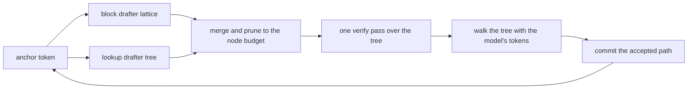
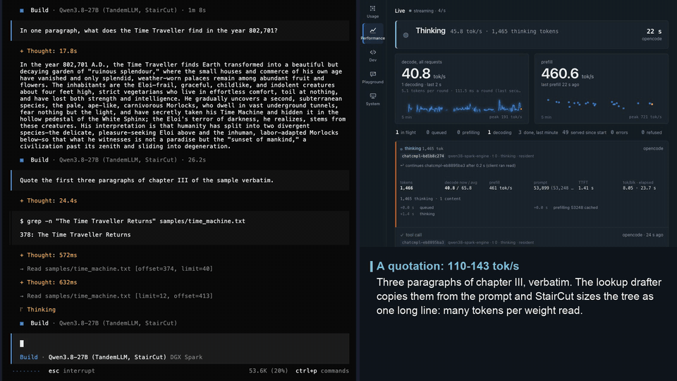

# Drafters and tree verify

A verify of 16 tree rows costs about the same as a verify of 8. On the published NVFP4 set at 1k tokens of context, a tree verify with its commit takes 75.5 ms at 8 rows, 74.4 ms at 16, 83.1 ms at 24 and 87.8 ms at 32 (`ops/stair-tables-nvfp4.json`, median of 8). That flat stretch is the reason this engine speculates at all: the model's forward pass is bound by reading weights, and extra rows in the same pass are nearly free. TandemLLM therefore lets cheap drafters guess many tokens and checks them all at once.

This page covers the drafters, how StairCut decides what to spend each round, how the guesses become one tree, and how the tree is verified through recurrent layers.

## The round

Each round has four steps.

1. Draft. The block drafter proposes a block of tokens, and the lookup drafter proposes continuations it has seen before. The router merges them into one draft tree of at most 32 nodes.
2. Verify. One forward pass of the target model runs over the whole tree, and reads the model's own next token at every node.
3. Accept. Walk down from the root. At each node take the model's token, and move to the child that carries it. Stop where no child carries it. The model's token at the stopping point is kept too, so a round yields at least one token.
4. Commit. Keep the KV rows and the recurrent state of the accepted path, and drop the rest.

On the benchmark row a StairCut round takes 93.4 ms and commits 4.58 tokens (both means over the row; the row's 49.89 tok/s is the mean of the requests' own rates, [measurement.md](measurement.md#the-row)).

## The block drafter

`engine/drafters/dflash2.py` runs DFlash2, a small drafter that proposes a whole block of tokens at once. It has five decoder layers of its own (hidden size 5120) and reads five hidden states of the target (the residual stream entering layers 5, 19, 33, 47 and 61), fused into one input. It has no embedding and no head: it borrows the target's embedding and output head. Inside a block every row attends to every other row, which is what lets it guess 15 tokens in one pass instead of 15 chained steps.

The engine holds two fine-tunes of the released drafter, trained on the target's own output. One proposes 7 tokens a block (trained at block 8), the other 15 (trained at block 16). Both are on Hugging Face: [`0xBakeer/TandemLLM-Qwen3.8-27B-DFlash2-b8`](https://huggingface.co/0xBakeer/TandemLLM-Qwen3.8-27B-DFlash2-b8) and [`0xBakeer/TandemLLM-Qwen3.8-27B-DFlash2-b16`](https://huggingface.co/0xBakeer/TandemLLM-Qwen3.8-27B-DFlash2-b16). StairCut, the served behaviour, drafts with the block 16 one only. The served profile loads the block 8 one too and releases it at the first round; it drafts only with StairCut off. A draft moves about 6 GB (3.6 GB of drafter layers plus one read of the head for all rows), about 25 ms. The EXL3 profiles run the same two drafters with their projections in EXL3 at 3 bits a weight (the K3 files) and a draft head at 4 bits (K4), from [`0xBakeer/TandemLLM-Qwen3.8-27B-EXL3-drafters`](https://huggingface.co/0xBakeer/TandemLLM-Qwen3.8-27B-EXL3-drafters); `ops/use-profile.sh` downloads them, and the BF16 drafters into `train/`, before it switches.

The drafter's head gives the top 16 candidates per slot, and a small bigram selector scores how each candidate follows the one before. That is a lattice of 7 or 15 slots by 16 candidates. The greedy path through it becomes the spine of the tree, and the next-best candidates become branches.

## The lookup drafter

`engine/drafters/ngram.py` copies text instead of predicting it. It looks for the longest match of the last few tokens in three places:

- the request itself, prompt and output so far (orders 2 to 8);
- a corpus of about 38 million tokens of public text, memory-mapped with a suffix array;
- the persistent suffix store, a log of what this engine has read and written before ([caches.md](caches.md)).

*A verbatim quotation in opencode: the lookup drafter copies whole lines and the decode rate rises. Recorded against the served engine (published NVFP4 weights, StairCut on); sped-up parts are marked in the clip.*

Every continuation found is a vote, and the votes form a tree whose node scores are path probabilities. A lookup costs about 0.2 ms, against about 25 ms for the block drafter. On fresh prose it rarely fires. On an edit of a file already in the context, or a quotation, it can commit 15 tokens in a round.

It fires only when the tree it would propose is worth its verify cost. A drafter that proposes on every step and is usually wrong costs the round, because the alternative on a declined step is the block drafter.

After two wide rounds in a row that commit their whole width, the lookup drafter may propose one deep chain of up to 32 rows (`QWEN38_DEEP`). On an editing workload that raised the accepted tokens per round from 12.6 to 15.75.

## StairCut: the node count, calculated each round

StairCut is the served behaviour. `QWEN38_LEN_SWITCH=1 QWEN38_LEN_MODE=wide` turns it on; the flags are off in the code, and `ops/serve.env` sets them. Every round drafts with the wide drafter and builds four candidates at up to 31 nodes: its lattice tree, its chain, the lookup tree and their merge. Each candidate is then cut to the node count that maximises its expected committed tokens per millisecond:

    (1 + sum of q over the kept nodes) / (verify(rows) + draft + commit)

*Schematic animations; the numbers in them are the paper's measurements on the published weights.*

A node's `q` is its path probability from the drafter's lattice (read at temperature 1.4), or the lookup's vote share, scaled by the calibration the router already learns online, and capped at 1. Nodes are admitted in the order of the drafter's own score, each with the ancestors it needs, and the expected gain counts at most one token per kept node (`min(sum q, n)`). The price of a tree is verify(rows) + draft + commit; a chain pays the rollback instead of the commit, weighted by the chance that it is rejected. The verify price is a staircase, not a line, so the router tries every count instead of a search that assumes a smooth cost. A cut ends at 7, 15, 23 or 31 nodes (8, 16, 24 or 32 rows) or at the whole candidate, so other sizes occur when a candidate is smaller. The draft cost is the drafter's own measured time at the current context length, because the drafter reads the whole context; it is learned online, per context class. `learn_block=True` (off) also learns a multiplicative correction per block shape from measured round times; it was noise-driven on the box and is not used.

`QWEN38_STAIR_TABLES` names a JSON file of verify prices by context length, chain and tree apart (`tools/verify_curve.py` at a few lengths). At 32k a 24-row tree costs about 16 ms more than a 16-row one against 9 ms at 1k, and a tree costs 2 to 4 ms more than a chain of the same rows. `QWEN38_STAIR_RHO` names a prior for the lookup's continuation rate on 8-token matches (`ops/lookup-rho.json`, counted on held-out traces; its provenance is in the file), in place of the fixed decay of 1/1.6 a level, which lets a long verbatim copy keep its whole line. The rate is a Beta-binomial per (source, match length, copy-run bin), and the router updates it online against every committed block, halving the counts past 4,000 trials. `QWEN38_STAIR_SKIP=1` decides whether to draft the head at all on the same prices, but only once a copy run has started: on a copy round the lookup line alone often wins, and at 32k a draft costs more than at 1k.

What the router learns online (the draft cost per context class, the calibration, the copy counts) belongs to the router object. The server keeps one router for its whole life, so what one request teaches reaches the next; `router.reset()` clears the per-text evidence (the arms' acceptance, the calibration) and keeps the costs and the copy counts. `tools/forced_bench.py` also keeps one router per configuration for a whole run, while `tools/verify_spec.py` builds a new one for every prompt.

The router releases the narrow drafter at the first round. With the node count calculated, the wide drafter's lattice cut to 16 nodes is a bush near the root on fresh text and a long line on copies, and the narrow drafter has nothing left to add. `tools/router_replay.py` replays these policies exactly on recorded lattices of both drafters, and `tools/forced_bench.py` measures them on the box on one reference text, so that different verify shapes, which move BF16 ties, compare on the same text.

On the benchmark row with the published NVFP4 set, StairCut reaches 49.89 tok/s against 47.13 for the fixed block 8 and 44.80 for the fixed block 16. On the teacher-forced bench of 25 workloads it averages 90.45 tok/s against 59.31 and 81.95 ([measurement.md](measurement.md)).

## StairCut on Flash-Next, and the shared price files

Flash-Next drafts with its own MTP layer and the shared StairCut (`engine/methods/staircut.py`, ENG-245): each round the MTP head drafts a chain of 4 with its top-2 tokens a depth (`engine/models/flashnext/mtp.py`, one captured graph), and the cut keeps the chain's prefix (and, with `siblings`, second-choice leaves) that maximises (1 + sum of q) / (V(rows) + draft). q comes from `ProbDeciles`: the head's probability mapped to the measured acceptance per tenth of probability, starting from the probability itself and learned from every verified round. The drafter that drives it in the server loop is written once for any model's MTP head (`engine/methods/mtp_drafter.py`).

With `QWEN38_FN_LOOKUP=1` (the Flash-Next profiles set it, ENG-229) the lookup joins the same round. It reads the request's own text, `--corpus` and the server's suffix store, the same stores as the 27B's lookup, because the tokenizer is the same. Its best continuation enters the cut as one more branch. While its tokens match the head's chain the two share nodes, and a shared node's q is 1 minus the chance that both are wrong. Where they differ, the lookup's chain hangs under the last shared node; where the head's chain ends, it runs on. The cut admits nodes best-first by q, as long as (1 + sum of q) / (V(rows) + draft) rises, up to 32 rows. A round still runs one verify, and the text does not change.

| class (one greedy request of up to 512 tokens) | MTP alone, tok/s | with the lookup, tok/s | tokens a block, alone and with the lookup |
|-|-|-|-|
| edit | 106 | 132 | 4.6 and 10.4 |
| copy | 102 | 133 | 4.4 and 11.9 |
| prose | 49 | 51 | 2.2 and 2.2 |
| chat | 62 | 64 | 2.5 and 2.5 |
| code | 85 | 83 | 3.4 and 3.5 |

That A/B ran on 3.05 on 2026-10-12, and every text equalled plain decode. The gain on copies is smaller than the gain in tokens a block, because a verify of 16 rows costs about 69 ms against 28 ms for 2 rows on this MoE.

V(rows) comes from `PriceModel`. Its prior is a price file, `ops/prices/<model>/<profile>.<device>.json` (Flash-Next 3.05 on the DGX Spark: `ops/prices/qwen3.8-flash-next/flashnext-3.05.dgx-spark.json`), in the format of the 27B's stair tables:

    {"<context class>": {"<kind>": {"<rows>": ms, ...}, ...}, ..., "step_ms": 3.7, "measured": "how and when"}

`kind` is `chain` or `tree`; the context class is the model's. The 27B's tables key it by context length. Flash-Next's `price_class` is 0 while its sparse attention is still dense (up to 2,051 tokens), and above that the next of 4,096 × 2^k and 6,144 × 2^k at or above the context, up to 262,144. Its file also holds, per class, the plain step's cost (`plain`), a drafted round's cost a token (`spec`) and the draft head's cost a backlog row (`prime`). A class not in the file takes the nearest lower one, rows between two measured counts interpolate, rows past the last add `step_ms` a row (else the last two counts' slope). The model follows the live prices online (EMA 0.1 a count, the unmeasured counts shifted by the learned offset), and a price never falls with more rows. A profile without a file for its device logs the missing path once and starts every count at the same 1 ms, so the cut drafts to the full depth until the first rounds price it; the text does not change either way. The device is `dgx-spark` for the GB10, else the GPU's name in lower case (`engine/methods/device.py`).

The 3.05 file is provisional (ENG-155). In class 0, rows 2 to 16 are the prices the cut learned online on the ENG-229 A/B server (about 1k of context, 600 rounds): 27.8 ms for 2 rows, 38.6 for 5, 52.2 for 10, 68.8 for 16; row 1 is the bench of 2026-10-11. Classes 32,768, 131,072 and 262,144 come from single requests at 32,000, 140,000 and 260,800 tokens. No sweep has run; the cut follows the live prices either way.

### Never slower than the plain step

At long context a drafted round can cost more a token than the plain step. On the first runs at 260,800 tokens the drafter decoded 22.5 tok/s (the second request of a 3.05 run, its prompt from the caches) and plain decoding 36.6 (one request on a server without a drafter). StairCut on Flash-Next therefore keeps, per context class, the plain step's cost and a drafted round's cost a token, both by wall time and both starting from the price file:

- `skip`: a class whose drafted rounds cost more a token than its plain steps takes the plain step, and drafts one probe round at an interval that doubles while drafting keeps losing (16 rounds, up to 256).
- `turn`: a turn drafts only when what speculation saves over the expected answer pays for the draft head's backlog, the prompt rows it has not read yet (0.28 ms a row at 260,800 tokens). A turn that does not draft takes the plain step throughout and never reads the backlog.
- What a class learned of its drafted rounds ages back to the file's prior while its turns take the plain step, so one slow request does not keep a class plain for good.
- While the server is idle (one second after the last request), it captures the verify, commit and draft graphs the current context class lacks, 25 to 30 graphs in about 4.3 s a class. A drafted turn is charged for graphs its class still lacks. Before this, the first drafted request in a new class paid 3.4 to 5.1 s of captures inside its answer.

Measured on 3.05 on 2026-10-12: one fresh server, two rounds at each length of one greedy request and the same request again (its prompt then from the caches), and plain decode from a `--drafter none` server. Each cell is the first request and its repeat:

| context | speculation, round 2, tok/s | plain, tok/s |
|-|-|-|
| 1k | 56.6 and 57.3 | 41.0 and 45.4 |
| 32k | 34.9 and 55.6 | 33.0 and 42.5 |
| 140k | 42.1 and 52.4 | 33.9 and 41.4 |
| 260,800 | 41.0 and 41.0 (plain turns) | 39.6 and 40.5 |

All 16 texts equalled plain decode. With the idle captures, the first request at a new length took the plain step and the next one drafted: 48.2 against 42.5 tok/s at 32k and 46.0 against 41.4 at 140k, every answer equal to plain decode.

## The length router (StairCut off)

Before StairCut, the served profile picked the block width once per request. With the StairCut flags off, `engine/lenrouter.py` still does, so a `serve.env` without them behaves as before.

Which block width wins depends on the text rather than the model. On a quotation the wide drafter commits 14.9 tokens a round against 8.0 for the narrow one. On fresh prose the narrow one does as well, 2.7 against 2.6, for less work.

It decides once per request. It runs four wide rounds first. A wide round prices both widths at once, because a narrow block is a prefix of a wide one, and the target's token at row i does not depend on rows after i. Where that says the narrow width still has room, it runs up to four narrow probes, because the narrow drafter is a different checkpoint and drafts its own 7 slots better than a cut-down wide block. Then it decides and keeps the decision for the rest of the request.

It decides once because switching costs acceptance. A drafter keeps its own cache of the context, and a switched-in drafter starts behind. A schedule that alternated the two widths as often as a per-round router, while knowing nothing, lost 3 % on chat, 10 % on code and 18 % on a quotation against never switching. Once the decision is made, the losing drafter is released (`DROP_IDLE=1`) and stops syncing, which added a median 3.2 % on a five-workload bench.

## Building the tree

`engine/router.py` merges the block drafter's lattice and the lookup tree into one `DraftTree` (`engine/tree.py`), where a shared prefix becomes a shared node. With StairCut on, the merge is built at up to 31 nodes and the staircase cut above sets its size. With StairCut off, the router prunes it to a node budget: a node stays only while its expected gain in accepted tokens pays for its share of the verify cost, priced on a verify curve (`QWEN38_TREE_MS`, or a price table from `ops/prices.json`). That budget is 16 nodes for either drafter, and the wide drafter gets 24 once the request has committed 32 tokens, so a short answer never pays for branches it cannot use. A deep chain may use up to 32 rows. These budgets are also the configuration of the fixed-width baselines the paper measures StairCut against.

The router's cost estimates are learned in the loop. It scores the lookup tree against the tokens the target actually wrote on every round, chosen or not, so its calibration settles before the lookup drafter has had a turn.

## Tree verify through recurrent layers

Verifying a tree through attention layers is known work: give each node an attention mask of its ancestors and a position equal to its depth. The 48 Gated DeltaNet layers are harder. Their state after node t is the state after t's parent, updated by t, and a plain left-to-right walk overwrites the parent's state before t's sibling needs it.

`engine/tree.py` stores a tree in depth-first pre-order: every node's parent has a lower index, and every subtree is a contiguous range. In that order the ancestor relation is part of the strict lower triangle, and every prefix operation of a chain verify has an exact tree counterpart:

| chain | tree |
|-|-|
| causal mask | the committed prefix plus the node's ancestors |
| position = index | position = depth, so two siblings share a position |
| the convolution slides over neighbours | it gathers each node's 3 nearest ancestors |
| cumulative gate along the sequence | the sum of gates along the node's path |
| the delta rule's lower-triangular solve | the same solve on the ancestor relation |
| accept a prefix, roll back to a length | accept a path, commit it by a gather |

The state after any accepted path can be written from quantities the verify already computed. Let `S0` be the state before the round, and for each node on the path let `k` be its key, `u` its pseudo-value and `gc` its cumulative gate. Then

    S_path = exp(gc_last) * S0 + sum over t on the path of exp(gc_last - gc_t) * k_t (x) u_t

`u_t` depends only on t's own path, because the inverse of an ancestor-masked matrix is ancestor-masked too. This formula holds for every root-to-node path, not only for prefixes. The commit is therefore one read of the state and one small matrix product per layer, and it reads no weights. For a chain the same identity is the rollback: keeping the first n tokens of a block is the path of length n.

The KV side is simpler. The cache holds every node at its depth-first slot, and a commit gathers the accepted rows down into place.

## Sampling

Greedy requests (temperature 0) take the path above. A sampled request stays exact in distribution: the target draws its own token at each node, and a drafted token survives exactly while the draw lands on it. For a drafter that proposes one fixed token this is the standard rejection sampler, with no second draw. With `--sampled-tree det` a sampled request keeps the tree. When it was adopted (rc5, before StairCut), a five-workload bench at temperature 0.7 went from about 4.1 to about 5.3 tokens a round (19 to 21 % more tok/s).

A request with a `seed` draws with noise keyed by position (the Gumbel-max trick), so the same seed gives the same text whatever the drafters and the router did. [exactness.md](exactness.md) covers both.

## Reasoning

The model thinks inside `<think>` tags. A reasoning budget (`--think-budget`, `max_reasoning_tokens` or `reasoning_effort`) closes the block when it is spent. The server appends the vendor's closing sentence and `</think>`, runs those tokens through the engine at their real positions, and the model answers from there. This changes the answer, and the sentence is visible in the response.

Closing a block that loops is the conductor's job ([server.md](server.md#the-conductors-session-monitor)): its reasoning-loop task watches the block with three arms (a pattern repeated over 128 tokens or more, the share of the last 256 tokens' 16-grams already seen earlier in the block, and novelty collapse) and, with `--conductor on`, closes it with a hidden phrase, of which the client sees only `</think>`. With `--conductor raw`, the default, nothing closes a block but a budget.

## Knobs

| knob | what |
|-|-|
| `--drafter lenrouter`, `--dflash2-ckpt`, `--dflash2-ckpt16` | the block drafters (both loaded; StairCut drafts with the block 16 one) |
| `--len-fixed 8\|16`, `--len-latch` | with StairCut off: pin one width, or decide once per request |
| `--drop-idle` | release the drafter that is not drafting |
| `--tree`, `--budget`, `QWEN38_TREE_NODES`, `QWEN38_TREE_NODES_NARROW`, `QWEN38_TREE_WIDE_AFTER` | the tree and its node budgets |
| `QWEN38_TREE_MS`, `--price-table` | the verify price curve the node budget is pruned on (StairCut off) |
| `--corpus`, `--suffix-store` | the lookup drafter's corpus and persistent store |
| `QWEN38_DEEP`, `QWEN38_DEEP_AFTER` | the deep chain after long accepted paths |
| `QWEN38_LEN_SWITCH=1`, `QWEN38_LEN_MODE=wide` | StairCut: the node count calculated each round, wide drafter only (off in the code, on in `ops/serve.env`) |
| `QWEN38_STAIR_TABLES`, `QWEN38_STAIR_RHO`, `QWEN38_STAIR_SKIP` | verify prices by context length, the lookup's continuation rates, and the head-skip rule on the same prices, for that mode |
| `QWEN38_LATCH_PRICE=1` | the per-request decision priced on the verify curve (off by default) |
| `--sampled-tree det\|mixed`, `QWEN38_DRAFT_TEMP` | sampled requests on the tree, and the drafter's temperature |
| `--think-budget`, `--reasoning-effort`, `--think-stall` | the reasoning controls (`--think-stall` lets the conductor's loop arms run) |
