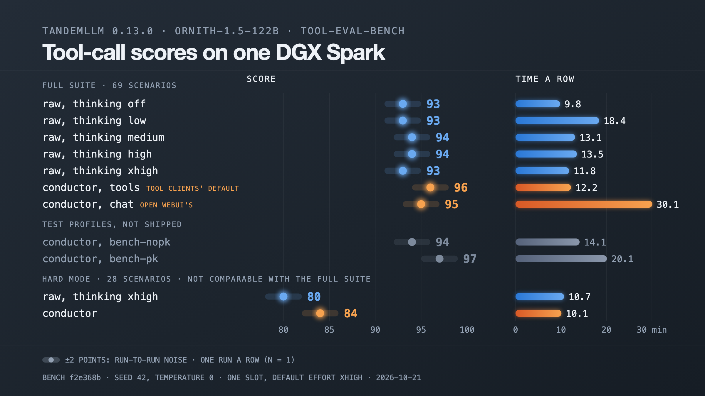

# tool-eval-bench results

We ran [tool-eval-bench](https://github.com/SeraphimSerapis/tool-eval-bench) against TandemLLM on one DGX Spark on 2026-10-19: the raw path at five thinking settings, the conductor in four profiles, and the bench's hard mode on both paths. Thinking adds 3 to 5 points. Packages double the time a tool client waits and add no points, so the `tools` profile, which tool clients get by default, adds none. [benchmarks.md](benchmarks.md) says how to run the bench and which settings change a score.

## Setup

- Model: Qwen3.8-27B in the EXL3 6.0 pack, on the 0.12.0 code. `/health` still said `0.11.4+exl3-6.0`, because the runs came before the version bump.
- Server: default effort `xhigh` (`--reasoning-effort xhigh`), two slots, response cache on.
- Bench: 2.8.1.dev13, commit [f2e368b](https://github.com/SeraphimSerapis/tool-eval-bench/commit/f2e368b), on another machine on the LAN.
- Every run: `--seed 42 --temperature 0 --timeout 600`, `--parallel` 1, one run at a time on the box, each row one run (n = 1).
- The server restarted before the batch, which empties the response cache. No answer in a row below came from the cache. The first raw `xhigh` run did replay 190 answers of the `high` run, which sends the same prompt, so the server restarted and that row ran again.

## Full suite, 69 scenarios

| path | thinking | packages | score | deployability | responsiveness | time | not passed |
|-|-|-|-|-|-|-|-|
| raw | off | | 92 | 83 | 63 | 8.0 min | TC-14, TC-48, TC-50, TC-51, TC-60 partial; TC-03, TC-62, TC-68 failed |
| raw | `low` | | 96 | 81 | 47 | 12.7 min | TC-14, TC-50, TC-52 partial; TC-68 failed |
| raw | `medium` | | 96 | 82 | 49 | 13.4 min | TC-14, TC-49, TC-52 partial; TC-68 failed |
| raw | `high` | | 95 | 83 | 54 | 11.9 min | TC-23, TC-58, TC-62 partial; TC-51, TC-68 failed |
| raw | `xhigh` | | 97 | 84 | 55 | 12.4 min | TC-23, TC-58 partial; TC-68 failed |
| conductor, `tools` | the server's (`xhigh`) | off | 95 | 82 | 52 | 15.0 min | TC-23, TC-49, TC-67 partial; TC-62, TC-68 failed |
| conductor, `bench-nopk` | by turn class | off | 96 | 83 | 53 | 13.5 min | TC-23, TC-49, TC-62 partial; TC-68 failed |
| conductor, `bench-pk` | by turn class | on | 94 | 75 | 31 | 26.0 min | TC-50, TC-63 partial; TC-03, TC-31, TC-68 failed |
| conductor, `chat` | by turn class | on | 91 | 71 | 23 | 28.0 min | TC-40, TC-50, TC-62 partial; TC-03, TC-31, TC-43, TC-63, TC-68 failed |

## Hard mode, 28 scenarios

`--hardmode-only` runs category P alone. Its scores are not comparable to the full suite's.

| path | score | deployability | responsiveness | time | not passed |
|-|-|-|-|-|-|
| raw, `xhigh` | 84 | 71 | 41 | 11.0 min | TC-85, TC-90, TC-91, TC-94, TC-97 partial; TC-88, TC-92 failed |
| conductor, `tools` | 91 | 77 | 43 | 10.2 min | TC-85, TC-90, TC-94 partial; TC-92 failed |

## How each row ran

The base command, then each row's flags:

```bash
tool-eval-bench run --base-url http://<host>:8000/v1 --model TandemLLM --backend tandemllm \
  --seed 42 --temperature 0 --timeout 600
```

| row | flags |
|-|-|
| raw, off | `--header X-Tandem=raw --no-think` |
| raw, an effort | `--header X-Tandem=raw --backend-kwargs '{"reasoning_effort": "low"}'` (`medium`, `high`, `xhigh`) |
| conductor, `tools` | none: an unnamed client that offers tools gets `tools` |
| conductor, another profile | `--header X-Tandem-Profile=<profile>` |
| hard mode | add `--hardmode-only` |

`low` caps thinking at 1,024 tokens and `medium` at 8,192. `high` and `xhigh` send the template's `xhigh` effort sentence, and `high` caps thinking at 16,384 tokens.

`chat` is the profile Open WebUI gets. It classes each turn, sets the effort and adds packages and memory notes. `bench-pk` and `bench-nopk` are test profiles that do not ship. Each is `tools` with the turn class and the effort on and the conductor's prompt, and `bench-pk` adds packages. Run this on the box to create them; a write from another machine needs the admin token:

```bash
for p in on off; do
  name=bench-pk; [ $p = off ] && name=bench-nopk
  curl -s http://127.0.0.1:8000/v1/conductor/profiles/tools \
    | jq --arg p $p '{note: "bench, packages \($p)", doc: (.doc
        | .decisions += {classify: "on", effort: "on", packages: $p}
        | .prompt = "conductor")}' \
    | curl -s -X PUT -H 'Content-Type: application/json' --data @- \
        http://127.0.0.1:8000/v1/conductor/profiles/$name
done
```

## What the rows show

Run-to-run noise is about 2 points. The raw `high` and `xhigh` rows send the same prompt and scored 95 and 97. The `tools` profile scored 96 on the same build the night before, and 95 here. Read rows within 2 points of each other as the same.

- Thinking on scores 95 to 97 against 92 with thinking off. With thinking off the suite runs in 8.0 min against about 12 to 13.
- Packages cost time. `bench-pk` and `bench-nopk` differ in packages alone: 94 against 96, inside the noise, and 26.0 min against 13.5. TC-03, TC-31 and TC-63 fail only in the two rows with packages. On TC-03 the model drafts the message instead of sending it (SRV-615).
- On the full suite the conductor without packages scores the same as raw.
- In hard mode the conductor scored 91 against 84 for raw. It passed TC-88, TC-91 and TC-97, where raw failed TC-88 and got partial on the other two. That is one run a side, and we have not tested which part of the conductor makes the difference.
- TC-68, schema violation resistance, fails in every row: the scenario wants a value that the prompt leaves out, and the model declines to invent it. The graders of TC-23 and TC-49 read "doesn't provide historical data" and "no email will be sent" as failures (OPS-193).

## 2026-10-20: the round-3 build on 0.12.2

Qwen3.8-27B in the EXL3 6.0 pack, the 0.12.2 code with the response cache keyed on the effort level (SRV-645), the grammar mask fix (SRV-647) and the deliverable keep-out (SRV-615). Bench f2e368b, the settings above, `tools/teb_batch.sh` (OPS-209), each row one run (n = 1). The rows with packages ran with SRV-615 acting (`tool_fit.deliverable: on`); it ships in shadow. A hard-mode row's one cache hit was the bench's one-token start probe, no scenario.

| row | flags | score | deployability | responsiveness | time | not passed |
|-|-|-|-|-|-|-|
| raw, `xhigh` | raw, effort `xhigh` | 95 | 83 | 55 | 12.7 min | TC-23, TC-49, TC-58 partial; TC-51, TC-68 failed |
| raw, `xhigh`, again | the same | 96 | 84 | 57 | 11.7 min | TC-23, TC-49, TC-58 partial; TC-68 failed |
| conductor, `tools` | `--header X-Tandem-Profile=tools` | 96 | 84 | 55 | 12.7 min | TC-23, TC-49, TC-67 partial; TC-68 failed |
| raw, variant seed 7 | raw `xhigh`, `--variant-seed 7` | 96 | 84 | 56 | 12.1 min | TC-23, TC-49, TC-58 partial; TC-68 failed |
| conductor, variant seed 7 | `tools`, `--variant-seed 7` | 96 | 83 | 53 | 12.8 min | TC-23, TC-49, TC-62 partial; TC-68 failed |
| conductor, `chat` | `--header X-Tandem-Profile=chat` | 91 | 71 | 23 | 27.6 min | TC-40, TC-62, TC-63 partial; TC-31, TC-43, TC-47, TC-51, TC-68 failed |
| conductor, `bench-pk` | `--header X-Tandem-Profile=bench-pk` | 90 | 73 | 32 | 23.1 min | TC-14, TC-35, TC-50, TC-63 partial; TC-18, TC-31, TC-42, TC-43, TC-68 failed |

A held-out pack of 12 scenarios passed 12 of 12 on both paths. Hard mode, 28 scenarios:

| row | flags | score | deployability | responsiveness | time | not passed |
|-|-|-|-|-|-|-|
| raw, `xhigh` | raw, `--hardmode-only` | 86 | 76 | 54 | 7.3 min | TC-85, TC-90, TC-91, TC-94 partial; TC-74, TC-92 failed |
| conductor, no header | `--hardmode-only` | 86 | 78 | 58 | 7.0 min | TC-85, TC-89, TC-90, TC-91, TC-94, TC-97 partial; TC-92 failed |
| conductor, `tools` | `--header X-Tandem-Profile=tools --hardmode-only` | 82 | 73 | 52 | 8.0 min | TC-85, TC-89, TC-90, TC-91, TC-94, TC-97 partial; TC-88, TC-92 failed |
| conductor, `tools`, again | the same | 82 | 73 | 52 | 13.0 min | TC-85, TC-90, TC-91, TC-94 partial; TC-88, TC-89, TC-92 failed |

- TC-03 passed in the `chat` and `bench-pk` rows, where it failed on 0.12.0: the package question picked write-message at 0.995 as before, and the keep-out question answered `tool` at 0.87, so the model looked up Sarah and sent the email. Both rows lost other scenarios (`chat` TC-47 and TC-51, `bench-pk` TC-18 and TC-42) and scored 91 and 90 against 91 and 94. The cause is not tested, so SRV-615 ships in shadow.
- The raw and `tools` rows are within the 2-point noise of 0.12.0's.
- In hard mode a scenario without tools runs under the default profile when no profile is pinned; pinned to `tools` the row failed TC-88 both times, unpinned it passed. One scenario, the cause not tested; the batch's conductor rows pin no profile.

## Ornith-1.5-122B on 0.13.0, 2026-10-21

Ornith-1.5-122B scored 93 to 97 on the full suite and 80 and 84 in hard mode. The conductor rows scored 94 to 97 and the raw rows 93 and 94. With packages a row took 20.1 and 30.1 min, against 14.1 without.



- Model: Ornith-1.5-122B in our EXL3 4.0 pack, drafting with its MTP layer and the lookup, on the 0.13.0 code; `/health` said `0.13.0+ornith-1.5-122b-exl3-4.0`.
- Server: default effort `xhigh`, one slot (the server log: side slots are not built for this model yet), response cache on, a window of 262,144 tokens, 32,768 tokens an answer by default. The model's own sampling defaults are temperature 0.6, `top_k` 20 and `top_p` 0.95; the bench sends temperature 0.
- Bench f2e368b and the settings above, through `tools/teb_batch.sh`, each row one run (n = 1). The conductor's `tools` row and its hard-mode row send no profile header. We made `bench-pk` and `bench-nopk` again from this build's `tools` profile with the commands above.
- The server restarted before the raw rows and again before the conductor and hard-mode rows. No answer in a row came from the response cache.

| path | thinking | packages | score | deployability | responsiveness | time | not passed |
|-|-|-|-|-|-|-|-|
| raw | off |  | 93 | 82 | 56 | 9.8 min | TC-03, TC-14, TC-39, TC-43, TC-50, TC-51, TC-52, TC-57 partial; TC-68 failed |
| raw | `low` |  | 93 | 77 | 41 | 18.4 min | TC-14, TC-50, TC-57, TC-62 partial; TC-38, TC-51, TC-68 failed |
| raw | `medium` |  | 94 | 82 | 53 | 13.1 min | TC-14, TC-50, TC-52, TC-57, TC-60, TC-62 partial; TC-68 failed |
| raw | `high` |  | 94 | 83 | 57 | 13.5 min | TC-14, TC-50, TC-52, TC-57, TC-60, TC-62 partial; TC-68 failed |
| raw | `xhigh` |  | 93 | 83 | 59 | 11.8 min | TC-14, TC-50, TC-52, TC-57, TC-60 partial; TC-62, TC-68 failed |
| conductor, `tools` | the server's (`xhigh`) | off | 96 | 84 | 56 | 12.2 min | TC-14, TC-50, TC-57, TC-60 partial; TC-68 failed |
| conductor, `bench-nopk` | by turn class | off | 94 | 81 | 50 | 14.1 min | TC-14, TC-22, TC-50, TC-52, TC-57, TC-60 partial; TC-68 failed |
| conductor, `bench-pk` | by turn class | on | 97 | 78 | 34 | 20.1 min | TC-43, TC-62 partial; TC-68 failed |
| conductor, `chat` | by turn class | on | 95 | 74 | 24 | 30.1 min | TC-43, TC-62, TC-63 partial; TC-51, TC-68 failed |

Hard mode, 28 scenarios:

| path | score | deployability | responsiveness | time | not passed |
|-|-|-|-|-|-|
| raw, `xhigh` | 80 | 67 | 36 | 10.7 min | TC-91, TC-94, TC-97 partial; TC-74, TC-85, TC-89, TC-92 failed |
| conductor, no header | 84 | 73 | 48 | 10.1 min | TC-90, TC-94, TC-97 partial; TC-85, TC-89, TC-92 failed |

- With thinking off the suite ran in 9.8 min at 93; with thinking on, 11.8 to 18.4 min at 93 and 94. `low` took the longest of the raw rows. It is one run, and the cause is not tested.
- The `tools` row scored 96 against 93 for raw `xhigh` at the same effort. That is 3 points, a little over the 2-point noise of the 27B rows; one run a side.
- `bench-pk` scored 97 and `bench-nopk` 94, so on this model the row with packages scored 3 points more and took 20.1 min against 14.1. On the 27B it was the other way round. One run each: this needs a second run before it says anything about packages.
- `chat` took 30.1 min, the longest row. Its responsiveness was 24 against 56 for `tools`.
- TC-68 fails in every row, as on the 27B. TC-14, TC-50 and TC-57 are partial in most rows.
- In hard mode the conductor scored 84 against 80 for raw. Both rows failed TC-85, TC-89 and TC-92, and raw also failed TC-74.
